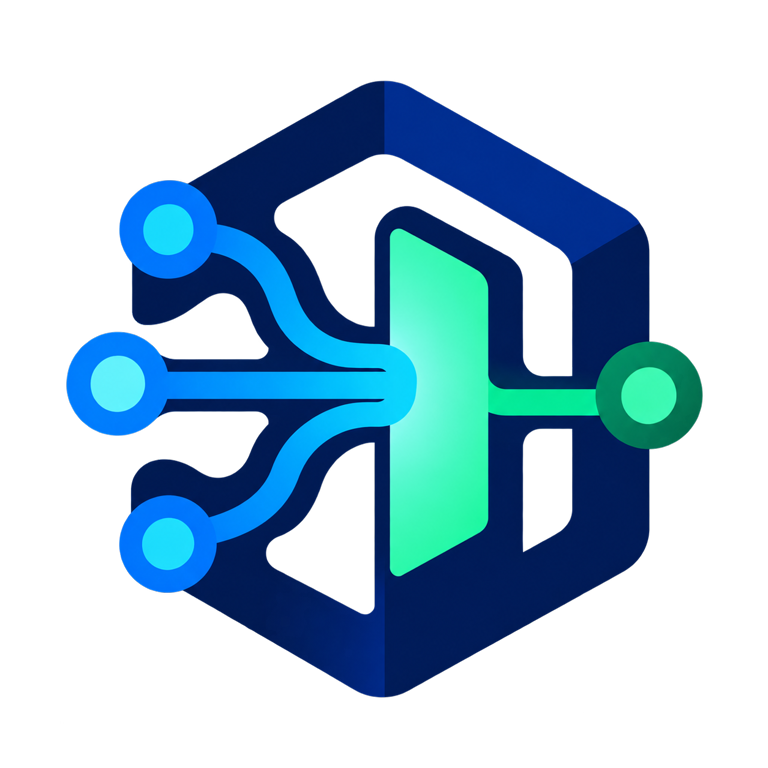

# Arbora

<p align="center">
  
</p>

<p align="center">
  <strong>The process the operator runs to open the Knuckles agent platform.</strong><br>
  <sub>MCP · REST · A2A · identity policy · fleet supervision · hosted interfaces</sub>
</p>

<p align="center">

[](https://pypi.org/project/arbora/)
[](https://github.com/Knuckles-Team/arbora/actions/workflows/release.yml)
[](https://knuckles-team.github.io/arbora/)
[](https://github.com/Knuckles-Team/arbora)
[](https://github.com/Knuckles-Team/arbora/stargazers)
[](https://github.com/Knuckles-Team/arbora/forks)
[](https://github.com/Knuckles-Team/arbora/graphs/contributors)
[](LICENSE)
[](https://github.com/Knuckles-Team/arbora/commits/main)
[](https://github.com/Knuckles-Team/arbora/pulls)
[](https://github.com/Knuckles-Team/arbora/pulls?q=is%3Apr+is%3Aclosed)
[](https://github.com/Knuckles-Team/arbora/issues)
[](https://github.com/Knuckles-Team/arbora)
[](https://github.com/Knuckles-Team/arbora)
[](https://github.com/Knuckles-Team/arbora)
[](https://github.com/Knuckles-Team/arbora)
[](https://pypi.org/project/arbora/)
[](https://pypi.org/project/arbora/)
[](https://pypi.org/project/arbora/)
[](https://pypi.org/project/arbora/)

</p>

<p align="center">
  <a href="https://knuckles-team.github.io/arbora/">Documentation</a> ·
  <a href="https://knuckles-team.github.io/arbora/capabilities/">Capabilities</a> ·
  <a href="https://knuckles-team.github.io/arbora/interfaces/">Interfaces</a> ·
  <a href="https://knuckles-team.github.io/arbora/status/">Status</a>
</p>

## Overview

Run Arbora when an MCP client, HTTP application, A2A peer, or hosted interface
needs one authenticated way into the platform. One serving lifecycle composes
the same application services across transports, applies identity and tenant
policy, and keeps tool discovery tied to the live fleet catalog.

Arbora is the platform edge and composition root. It is not the agent harness,
the durable database, a connector implementation, or the browser UI.

## Key Capabilities

- Serve local MCP over `stdio` and authenticated MCP over streamable HTTP.
- Project the same governed operations through REST and unary A2A.
- Discover, admit, supervise, and route the MCP connector fleet.
- Apply identity, tenant, action-policy, idempotency, and provenance controls.
- Host Overstory and coordinate terminal, desktop, messaging, and attended
  browser capabilities.
- Generate deployment configuration and report live readiness through `/health`.

## Documentation

Start with the **[visual platform guide](https://knuckles-team.github.io/arbora/)**,
then use the task-oriented references:

- [Start Arbora](https://knuckles-team.github.io/arbora/get-started/)
- [Review capabilities](https://knuckles-team.github.io/arbora/capabilities/)
- [Choose an interface](https://knuckles-team.github.io/arbora/interfaces/)
- [Understand the architecture](https://knuckles-team.github.io/arbora/architecture/)
- [Check live status](https://knuckles-team.github.io/arbora/status/)
- [Configure a deployment](https://knuckles-team.github.io/arbora/deployment/)

## Architecture

| Layer | Authority | Relationship to Arbora |
|---|---|---|
| [Overstory](https://knuckles-team.github.io/overstory/) | Browser experience and local interaction state | Arbora hosts it and supplies governed application routes. |
| Tuig | Terminal and headless interaction | Uses the governed Arbora REST interface. |
| Axil | Desktop GUI | Uses the governed Arbora gateway for its primary panels. |
| Messaging channels | Chat and voice entrypoints | Arbora hosts and supervises them; agent-utilities owns adapters and routing. |
| **Arbora** | MCP, REST, A2A, identity policy, fleet supervision | The running process and public door. |
| [Meristem](https://knuckles-team.github.io/meristem/) | In-run execution harness | Arbora supplies run plans through typed harness contracts. |
| [Medulla](https://knuckles-team.github.io/medulla/) | Durable graph, SQL, RDF, vector, time, reasoning, and provenance | Arbora uses its generated client contracts. |
| [Scion SDK](https://knuckles-team.github.io/scion-sdk/) | Connector servers, source synchronization, and governed effects | Arbora discovers and routes SDK-based connector services. |

The boundary is deliberate: Arbora authenticates, composes, routes,
supervises, and projects. Each sibling remains the source of truth for its own
domain.

[](https://knuckles-team.github.io/.github/architecture/#arbora)

[Explore the live architecture](https://knuckles-team.github.io/.github/architecture/#arbora)

## Quick Start

Requires Python 3.12–3.14 and [`uv`](https://docs.astral.sh/uv/). Install the
bundled runtime, generate the local profile, and register its `stdio` launcher
with Codex:

```bash
uv tool install "arbora[webui]"
setup-config generate --profile tiny
setup-config doctor --profile tiny
setup-config codex
```

The doctor command is the first observable result: it reports whether the local
profile and required authorities are ready before a listener starts. Arbora
then appears as the `arbora` MCP server in Codex. Other MCP clients can
start the same local transport directly:

```bash
arbora --transport stdio
```

Network deployments use the identity, TLS, and authorization settings in the
[deployment guide](https://knuckles-team.github.io/arbora/deployment/).

## Contributing

Issues and pull requests are welcome. Read [AGENTS.md](AGENTS.md) for source
boundaries and quality gates. Report vulnerabilities through
[GitHub Security Advisories](https://github.com/Knuckles-Team/arbora/security/advisories/new).

### Development

Run `scripts/bootstrap.sh`, then follow [CONTRIBUTING.md](CONTRIBUTING.md)
for the hooks, tests, and branch and pull-request flow.

## License

Arbora is released under the [MIT License](LICENSE).
