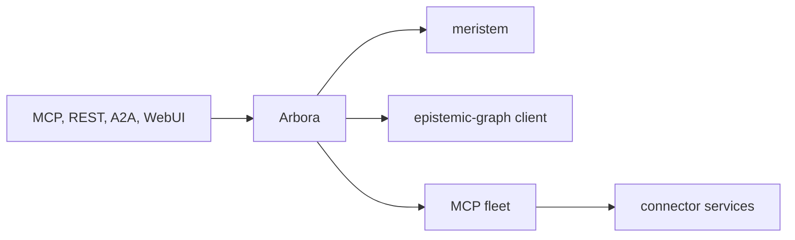

# Arbora repository development

This is the arbora-specific companion to the ecosystem-wide
[`arbora-development`](../arbora-development/SKILL.md) skill. That skill
picks the owning repository for a spec; this one documents everything needed
to build, test, and ship a change once arbora is the chosen owner.
`AGENTS.md` at the repository root points here and stays a short navigation
index — do not duplicate this skill's procedure back into it.

## Step 0: route the feature

Route the feature before any code.

1. Read the [ecosystem boundaries standard](https://github.com/Knuckles-Team/pipelines/blob/main/reference/ecosystem-boundaries.md).
2. Split the feature into parts with its routing procedure.
3. If a part is not owned by arbora, stop work on that part. Write its row in the owner's `specs/`, then link it by ID.
4. Continue here only with the parts that arbora owns.

## Architecture boundaries

Arbora is the deployable composition layer for the Knuckles agent platform.
It owns the Arbora serving process and the code under `arbora/`: MCP and
REST composition, MCP fleet supervision, control-plane policy, optional Agent
WebUI hosting, unary A2A, governed browser control, and deployment
operations.

| Package | Responsibility |
|---|---|
| `arbora.mcp_server` | MCP/REST composition, process authority, serving lifecycle, and shared action routing |
| `arbora.fleet` | MCP child lifecycle, catalog discovery, OAuth admission, health, and per-session tool loading |
| `arbora.gateway` | REST routes, dashboard aggregation, widget projection, and the host daemon |
| `arbora.control_plane` | Fleet reconciliation and action-policy enforcement |
| `arbora.webui_host` | Optional Agent WebUI co-service lifecycle |
| `arbora.a2a` | Authenticated Agent Card and unary A2A projection |
| `arbora.browser_control` | Governed browser catalog, lease, dispatch, and outcome orchestration |
| `arbora.deployment` | Configuration, diagnostics, canaries, environment plans, and production operations |

Arbora authenticates, composes, routes, supervises, and projects. Durable
graph state and RDF/OWL/SHACL semantics belong to `epistemic-graph`; agent
decisions and workflows belong to `meristem`; source-specific transport
and effects belong to `agent-connector-sdk` and connector services; browser
presentation belongs to `agent-webui`.



Dependencies point toward those authorities through public contracts. Do not
copy their implementations here. Connector widgets invoke admitted fleet tools
instead of importing vendor clients. MCP and REST routes share the same
application service and authorization decision.

The serving lifecycle owns one FastMCP event loop and one multiplexer
instance. Co-services submit work to that owner loop; they must not build a
second multiplexer or block another loop on `Future.result()`.

Security is fail closed:

- Resolve settings through the shared XDG configuration model. Add an
  environment variable only when configuration cannot express the value.
- Never commit credentials, bearer tokens, private endpoints, operator
  inventories, generated live configuration, or plaintext secrets.
- Network transports require validated identity, tenant isolation, and the
  configured TLS and authorization posture.
- `stdio` stdout is protocol output; diagnostics use logging or stderr.
- Preserve deterministic request identities, idempotency fences, bounded
  payloads, and privacy-safe receipts. Unknown effects never claim rollback.
- Apply action policy and durable provenance before governed mutation dispatch.

## Build-host and environment setup

From a fresh clone (locally, or in a Claude Code cloud session where
`.claude/hooks/session-start.sh` runs it automatically):

```bash
scripts/bootstrap.sh              # uv >= 0.9, pinned Python, locked PyPI deps, git hooks
scripts/bootstrap.sh --scanners   # also the pinned cccc/kiss/dupehound/jscpd scanners (~15 min cold)
```

Bootstrap is idempotent. Every dependency, the epistemic-graph engine wheels
included, installs from PyPI at the version `uv.lock` pins; no sibling source
is linked. It then installs the pre-commit and pre-push hooks. A hook whose
prerequisite is missing (the synced environment) prints `SKIPPED (<gate>): <reason>` and exits 0
locally; under CI (`$CI` set) it exits 2 with `CANNOT RUN`, so hosted CI never
passes a gate that did not run.

This repository runs its own gates and tests on ordinary hosted CI and
developer hardware; it does not need the heavy per-worktree `epistemic-graph`
Rust build host that an EG lane requires — never submit a arbora-only
change to that build queue.

The package publishes these operator commands:

| Command | Purpose |
|---|---|
| `arbora` | Serve the native MCP composition over `stdio` or `streamable-http` |
| `setup-config` | Generate, validate, and describe deployment configuration |
| `arbora-doctor` | Run deployment and dependency diagnostics |
| `arbora-venv` | Inspect and reconcile managed runtime environments |
| `arbora-release-canary` | Check a candidate release and catalog |
| `arbora-production-ops` | Run guarded backup, restore, and production checks |

The `arbora` entrypoint is `arbora.console:main`.

After `scripts/bootstrap.sh`, run focused development checks with:

```bash
uv run --no-sync pytest tests/<area>
uv run --no-sync ruff check .
uv run --no-sync mypy arbora tests
```

## Required quality gates

`.pre-commit-config.yaml` is the single definition of the gates. The release
workflow runs it directly: the commit stage over every file, the push stage
over the pushed range, then the manual-stage `mypy-env` and `pytest` hooks
after `uv sync --frozen --extra test --extra webui` installs the locked PyPI
dependencies. No sibling source or overlay participates in release qualification.
Local paired-source diagnostics can investigate upstream contracts, but cannot
replace these wheel-only gates. Run the same locally:

```bash
uvx pre-commit run --all-files
uvx pre-commit run --hook-stage pre-push --all-files
uvx pre-commit run mypy-env --hook-stage manual --all-files
uvx pre-commit run pytest --hook-stage manual --all-files
uv run --no-project --with "mkdocs>=1.6,<2" mkdocs build --strict
uv build --wheel --out-dir dist
```

The scanner job provisions the exact native scanner versions with
`scripts/install_scanners.sh` (also `scripts/bootstrap.sh --scanners`) and
blocks on any census finding. On release tags, repository-manager's
external-index `dependency-readiness` hook blocks build and publication. The
`uv-lock` and scanner census hooks remain available at the `manual` stage. Do
not bypass a failure, add an inline suppression, freeze a baseline, or weaken
a threshold; gates check behaviour or a contract derived from its source of
truth, never a hand-kept count, pin copy or golden digest. Scanner acceptance
rules live in `docs/quality-gate-terms.md`.

Shared hooks come from `Knuckles-Team/pipelines` at `main` — the one
sanctioned exception to this repository's immutable-pin policy, so pipeline
fixes land automatically; every reference in `.pre-commit-config.yaml` and
the GitHub Actions workflows names the default branch, never a commit or tag.
A local checkout substitution must be command-local and must never mutate
repository or global Git configuration.

### Orphan-module wiring gate (Python)

`scripts/check_wiring.py orphans` (the `check-orphan-modules` pre-commit
hook) is this repository's Python wiring gate: any `.py` module on disk under
`arbora/` (tracked or not, so a new module is caught before it is ever
staged) fails when it has neither production fan-in (nothing in the
package imports it) nor production fan-out (it imports nothing from the
package), and is not a declared root (the top-level `arbora` package or a
`[project.scripts]` / `[project.entry-points]` target). A dynamically
dispatched module — for example `arbora.gateway.registry`'s string-keyed
widget loader — is not an orphan as long as it imports something from the
package itself (every widget imports its shared `base` module), matching
this gate's structural, not reachability, definition. There is no allowlist:
an isolated module is wired in, reached by another module, or removed. This
restores the semantics `kiss check`'s own `orphan_module_enabled` provided
before kiss 0.4.11 moved orphan detection to the coverage-linked `kiss test`
(see `.config/kiss.toml`).

### Reachability report (Python) — staged, not-yet-served code

`scripts/check_wiring.py unreachable` (the `check-unreachable-modules`
pre-commit hook, **manual stage only** — it never runs at `pre-commit` or
`pre-push` and never blocks CI) asks a stricter question than the orphan
gate above: starting from the same declared roots, which `arbora` modules
does walking every import edge — static (including a function-local
`import`) and dynamic/name-based (a string literal anywhere in a module that
names another discovered module, absolute or relative, the way
`arbora.deployment`'s lazy-submodule facade and
`arbora.gateway.registry`'s widget loader both select a module by value)
— never reach? A cluster of modules that only import each other has nonzero
fan-in/fan-out, so it passes `check-orphan-modules`, but can still be served
by no running process. This command lists exactly that: code that exists,
is wired to itself, and is reached by nothing real. It is intentionally a
report, not a gate: landing it does not mean every module it lists is a bug
to fix today, only that wiring it in, registering it, or removing it is
separate, deliberate, tracked work. See `scripts/wiring/reachability.py` and
`docs/quality-gate-terms.md`.

## Contract regeneration

Generated artifacts (the EG-contract-bound operation catalog under
`arbora/api/registry/`, manifests with embedded digests, capability
catalogs) are produced by their owning script from the pinned
`epistemic-graph` wheel contract; never hand-edit a generated file. Re-run its
generator and commit the regenerated output in the same change as whatever
made it stale. A curated `arbora/api/ops/<module>.py` operation whose
required scope is not yet published by the installed EG contract stays
implemented but unregistered (see `arbora/api/ops/access.py`'s own
`approvals.*` precedent) rather than failing `get_registry()` for the whole
package.

## Identity setup for local development

Local MCP/REST serving needs a resolvable identity authority before it
accepts a request; see
[`arbora/skills/arbora-deployment/references/identity-and-access.md`](../arbora-deployment/references/identity-and-access.md)
for the none/local/external modes and how to select one for a development
checkout. A capability gated on another repository's not-yet-published
identity contract must stay a typed, fail-closed refusal here, never a local
bypass.

## Development rules

- Confirm that a change belongs to Arbora and identify its public entrypoint.
- Update the single owning implementation; do not add a parallel fallback.
- Trace a real entrypoint through composition to its owning service. A test
  that only imports a class is not wiring evidence.
- Change and test MCP and REST together when both expose the behavior.
- Keep package metadata, `uv.lock`, generated manifests, and tests consistent.
  Regenerate derived artifacts rather than editing them by hand.
- Preserve fail-closed authority checks, deterministic effects, and tenant
  isolation.
- Update current public status without overstating availability.
- Run focused tests first, then every applicable full gate.
- Stage only an explicit reviewed path allowlist and inspect the staged diff.
- Push, tag, publish, and deploy only when explicitly requested.

## Documentation

`README.md` is the concise public entry page. Detailed public material belongs
under `docs/` and is published with MkDocs. Keep prose about the current
product and its contracts. Internal planning history, local paths, temporary
branches, and repository-transition notes do not belong on the public surface.

Build the site with:

```bash
uv run --no-project --with "mkdocs>=1.6,<2" mkdocs build --strict
```

Update `mkdocs.yml` when adding or removing a page. README links must resolve
within the repository or to a public URL.

## Branching & isolation

Never push to `main`. Work on a topic branch from current `origin/main`, in a
dedicated Git worktree when other work shares the checkout:

```bash
git fetch origin
git worktree add "${XDG_STATE_HOME}/repository-worktrees/arbora/<lane>" \
  -b "<type>/<lane>" origin/main
```

Commit in logical steps, push the branch with `git push -u origin <branch>`,
and open a draft pull request against `main`; hosted CI (`release.yml`) is the
merge gate.

- Never use an orchestration tool's automatic worktree isolation against this
  shared checkout; it can mutate `core.bare` in the common Git directory.
- Never use `git stash`; linked worktrees share one `refs/stash`.
- Never stage with `git add .` or `git add -A`.
- Inspect `git status --short`, stage explicit paths, then re-read
  `git diff --cached --name-status` and `git diff --cached`.
- Do not commit logs, caches, reports, generated sites, scratch files, local
  configuration, or handoff notes.
- Preserve unrelated work. Do not reset, revert, remove, merge, push, tag, or
  publish another lane's changes without explicit ownership.

## Release

Bump the version before tagging. A tag on a commit with the old version rebuilds the old version, and PyPI refuses it.

1. Bump first on a topic branch: `uv run bump-my-version bump --new-version X.Y.Z --no-commit --no-tag`. It edits `arbora/_version.py` and `CHANGELOG.md`. `uv.lock` holds no arbora version and no fixture embeds one. Confirm with `git grep -n "<old version>"`.
2. Open a PR and rebase-merge the bump with `gh pr merge --rebase` after the `release.yml` gates pass.
3. On the merged `origin/main` commit, check that `__version__` and the bumpversion `current_version` both equal `X.Y.Z`. Check that PyPI lacks it: run `python3 -I <pipelines>/.github/actions/verify-release-version/verify_release_version.py --root . --ref refs/tags/vX.Y.Z` from Knuckles-Team/pipelines main. Or request `https://pypi.org/pypi/arbora/X.Y.Z/json` and expect HTTP 404.
4. Only then tag that commit and push the tag: `git tag vX.Y.Z <sha> && git push origin vX.Y.Z`.
5. Confirm PyPI lists both the wheel and the sdist. `uv build` makes both, and `release.yml` uploads both.
6. If the tag sits on the wrong commit and nothing published, delete it with `git push origin :refs/tags/vX.Y.Z` and re-tag. If anything published, cut the next patch version.
