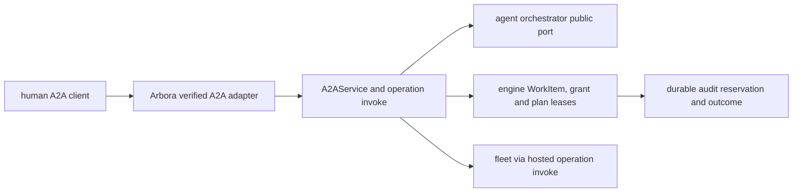
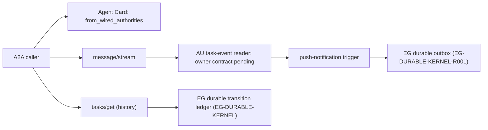
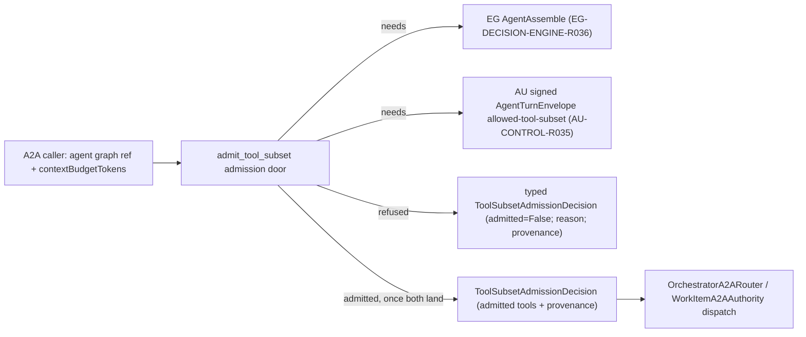
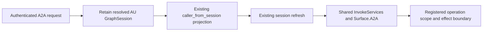

# ARBORA-A2A — A2A projection, streaming, history and tool-subset admission — architecture

## A2A task and approval projection

### Amendment 2026-10-17: unary caller refresh

For ARBORA-A2A-R006.2.1.1, refresh a retained caller immediately before
unary dispatch through the existing verify_current_from_session port. Refuse
changed authority before binding the session or calling the task authority.
Keep explicitly injected authenticators that own their binding compatible.
Exercise the registered HTTP handlers with AU session minting and changed or
revoked claims. This does not qualify signed approval or production issuers.

Status: **READY FOR IMPLEMENTATION**. Delivery: **NOT ACCEPTED**. Governing [spec](spec.md).

### Existing system and reuse

`arbora.a2a.application` already implements authenticated Agent Card and unary `message/send`, `tasks/get/list/cancel`; `arbora.a2a.service.A2AService` calls an `A2ARouter` and `A2ATaskAuthority`. `arbora.a2a.composition.compose_a2a` wires `OrchestratorA2ARouter` and `WorkItemA2AAuthority` to the serving application. `arbora.a2a.models` provides typed A2A messages and tasks. Extend these modules and public ports. Keep the existing FastMCP owner loop, fleet and verified-session middleware. No new broker or task database is justified by this projection.

### Architecture and durable identities

`task_id` is an opaque projection of the durable parent WorkItem, and child dispatch IDs are stored in a typed parent-child relation. `tasks/get/list` read that authority, not an A2A-local cache. `message/stream` emits ordered WorkItem events with a resume cursor; `tasks/resubscribe` resumes after the last acknowledged event and deduplicates on event ID. The upstream contract may lack the relation or the input-required state. The Arbora method then reports typed `UNAVAILABLE` until the published package provides it.

An operation request uses the hosted registry and `invoke` pipeline, not an A2A-specific authorization implementation. The verified A2A adapter supplies actor, tenant, effective scopes, auth mode, policy revision and session provenance. The response carries the hosted API envelope within JSON-RPC `result`; JSON-RPC transport errors remain protocol errors. This preserves the engine/fleet's source error code and a privacy-safe message.

When the orchestrator pauses on a pending effect, Arbora issues a durable plan lease bound to `(task_id, parent_work_item_id, child_work_item_id, pending_call_id, op_id, params_digest, principal, tenant, policy_revision, registry_digest, expiry)`. It sends an `input-required` event with a safe preview. The client obtains a fresh authenticated human signature/grant through the public identity contract; the service never stores the bearer itself. On `arbora.plan/confirm`, Arbora verifies the original human and each bound identity, asks the engine to atomically consume the human grant and plan fence, then dispatches through the common invocation pipeline. If any authority changes, return a stable refusal and preserve zero effect. A console-only admin effect instead returns a URL and is confirmed only on the console surface.

Pre-effect audit reservation and post-effect outcome linking use the shared hosted-operation service. A two-person approval must prove two distinct qualified humans using the same durable relation. No service or delegated agent can synthesize either participant. All claims are rechecked at resume time. A canceled task cannot be confirmed. A committed effect is not treated as reversible by task cancellation.

### Implementation sequence

1. Inventory published WorkItem, assembly, grant, plan lease, audit, and task-event contracts; pin versions and make unsupported capabilities typed unavailable.
2. Extend A2A method table and models for `message/stream`, `tasks/resubscribe`, `arbora.op/invoke`, and `arbora.plan/confirm`; reuse `A2AService` and serving composition.
3. Add durable parent/child resolution, event cursor and input-required projection using public ports. Ensure no separate task state or private agent import.
4. Bind pending calls to an attested original human and revocable grant; integrate atomic fence and shared invocation/audit path. Keep approval disabled until exact served proof.
5. Generate/update public client contract and status, run [test-spec.md](test-spec.md), record exact default-branch evidence, then enable approval.

### Quality and environment

Use `uv sync --extra test`, focused `uv run pytest tests/a2a tests/api`, Ruff, mypy, repository pre-commit hooks and wheel build. The shared hooks include CCCC, KISS, jscpd and Dupehound; do not weaken their configured thresholds or add suppressions. Keep one application service and one method table; use typed adapters and small functions. CI fixtures should start an ephemeral local engine/agent stack with synthetic principals and no external secrets. A separate served test verifies restart/resume. Public docs must describe only observed capability at the accepted revision.

## A2A streaming, push notifications and transition-history projection
Status: **READY FOR IMPLEMENTATION**. Delivery: **NOT ACCEPTED** except `ARBORA-A2A-R009.1`, landed in this PR. Governing [spec](spec.md).

### Existing system and reuse

`arbora/a2a/models.py` already defines `A2AAgentCapabilities` and (added in this PR) `A2AStreamingAuthority`, `A2APushNotificationAuthority`, `A2ATransitionHistoryAuthority` runtime-checkable protocols plus `from_wired_authorities`. `arbora/a2a/application.py` and `arbora/a2a/composition.py` wire the serving application; `arbora/a2a/authority.py` already defines the `-32010` `A2AStreamingUnavailable` refusal pattern for `tasks/resubscribe` that `A2ATransitionHistoryUnavailable` (A2A-H04) reuses as its sibling error. No new task store, event log, or history ledger is justified: this spec extends existing composition, not a new authority.

### Architecture and durable identities

`A2AAgentCapabilities.from_wired_authorities` is the single seam composition calls; it is pure and has no I/O, so advertised capabilities can be tested without a live AU/EG stack. The actual streaming and history projections are separate runtime paths that call the AU/EG public ports directly — the Agent Card's `true`/`false` is a property of what composition wired, and the test-spec's acceptance (A2A-H07) cross-checks the two never drift apart.

### Implementation sequence

1. **`ARBORA-A2A-R009.1` (this PR):** typed capability model and protocols in `arbora/a2a/models.py`, with unit tests proving default-false, selective-true and non-conforming-object refusal. No wiring yet — `A2AAgentCard`'s default factory still produces all-false, matching current truthful behavior.
2. Depend on `ARBORA-A2A` landing (context-budget subset) before implementing the actual streaming cursor and push-trigger wiring, since both reuse its bounded-cursor machinery rather than duplicating it.
3. Publish the AU task-event reader contract before wiring `message/stream`. Its requirement ID and public export remain unassigned. Return typed `UNAVAILABLE` for a projection gap.
4. Implement `tasks/get` history read-through to EG's durable kernel (`EG-DURABLE-KERNEL`); on an absent/unreachable authority, return the new `A2ATransitionHistoryUnavailable` (A2A-H04).
5. Implement push-notification delivery over EG's durable outbox (`EG-DURABLE-KERNEL-R001`) with dead-letter reporting.
6. Wire real authorities into composition only after each path is proven. Run the full test-spec and flip the relevant capability field to a live `true` at that revision, never earlier.

### Quality and environment

Use `uv sync --extra test`, focused `uv run pytest tests/a2a`, Ruff, mypy, repository pre-commit hooks. Keep one Agent Card capability seam (`from_wired_authorities`). No second ad hoc truthiness check elsewhere in the codebase. CI fixtures for steps 3–5 start an ephemeral local AU/EG fixture. This PR's `R001.1` slice needs no live stack since the model is pure.

## A2A context-budget tool-subset admission
Status: **READY FOR IMPLEMENTATION**. Delivery: **NOT ACCEPTED**. Governing [spec](spec.md).

### Existing system and reuse

`arbora.a2a.models.A2AContextBudget` already carries the caller-declared `contextBudgetTokens` wire field, and `arbora.a2a.routing.OrchestratorA2ARouter` already fails closed (`A2AAssemblyUnavailable`) whenever a route request carries a non-null `context_budget_tokens`, with an explicit comment naming both upstream gaps: EG `AgentAssemble` is a refusal stub and the signed AU dispatch carrier cannot carry an allowed-tool subset. `arbora.a2a.authority.WorkItemA2AAuthority._enqueue`/`dispatch` likewise refuse whenever `decision.selected_tools` is non-empty, per `arbora/a2a/authority.py:242,274`. This spec does not replace that router or authority; it factors the admission decision they both need into one typed, independently testable door: `arbora.a2a.admission`.

### Architecture

`ToolSubsetAdmissionRequest` and `ToolSubsetAdmissionDecision` (`arbora/a2a/admission.py`) are typed `pydantic` models reusing the existing `_WireModel` base and `A2AContextBudget` type from `arbora.a2a.models`, so the wire shape stays consistent with the rest of the A2A facade. `admit_tool_subset` is a pure function: given a request, it returns a decision. Today it always refuses with `EG_ASSEMBLE_UNAVAILABLE`, matching the existing router/authority behavior exactly, because that is the first upstream gap reached. Once EG `AgentAssemble` is callable, the function gains a dependency-injected EG assembly client and a second refusal path, `ENVELOPE_LACKS_ALLOWED_TOOL_SUBSET`, for the remaining AU gap; once both upstreams land, it returns an admitted decision whose `admitted_tools` and `provenance` trace to one committed EG decision record and one signed AU envelope field.

`OrchestratorA2ARouter.route` and `WorkItemA2AAuthority._enqueue`/`dispatch` are updated, in a later increment under this spec, to call `admit_tool_subset` instead of inlining their own `A2AAssemblyUnavailable` raises, so there is exactly one admission authority instead of two duplicated fail-closed checks. That wiring is out of scope for the `ARBORA-A2A-R016.1` slice delivered now; it is the open remainder under `ARBORA-A2A-R017`/`R003`.

### Implementation sequence

1. **This PR (`ARBORA-A2A-R016.1`):** add the typed `ToolSubsetAdmissionRequest`/`ToolSubsetAdmissionDecision` models and the `admit_tool_subset` function returning today's exact fail-closed result. Add the refusal unit test. Open the spec and the AU owner row (`AU-CONTROL-R035`) this door depends on.
2. Once epistemic-graph publishes a non-stub `AgentAssemble` client, inject it into `admit_tool_subset` and add the `ENVELOPE_LACKS_ALLOWED_TOOL_SUBSET` refusal path for the still-missing AU field.
3. Once agent-utilities lands `AU-CONTROL-R035` (the signed envelope's allowed-tool-subset field) and publishes the updated generated client, wire the admitted path: EG answer in, signed envelope out, with signature verification before any dispatch treats the subset as enforced.
4. Replace `OrchestratorA2ARouter`'s and `WorkItemA2AAuthority`'s inline `A2AAssemblyUnavailable` raises with a call to `admit_tool_subset`, so there is exactly one admission authority.
5. Update [test-spec.md](test-spec.md) coverage for the admitted path and record exact default-branch evidence before changing delivery state.

### Quality and environment

Use `uv sync --extra test`, focused `uv run pytest tests/a2a/test_admission.py`, Ruff, mypy, and the repository's configured pre-commit hooks. No new broker, task store, or duplicate admission authority is introduced. CI fixtures require no external secrets or private network for the model and refusal tests landed in this PR.

## A2A harness-configuration admission

### Data flow

`POST /a2a` `message/send` (`arbora/a2a/application.py:264,166`) → `_send_message` (`application.py:100`) → `A2AService.send_message` (`arbora/a2a/service.py:40`) → `router.route` (`arbora/a2a/routing.py:71`) → `admit_tool_subset` (`arbora/a2a/admission.py:50`) → `HarnessConfigDecider` → engine `Decide(HarnessConfig)` → `WorkItemA2AAuthority._enqueue` (`arbora/a2a/authority.py:256`) → signed `AgentTurnEnvelope` with `harness_config`.

### What the code does today

`admit_tool_subset` is synchronous and unused in production. It ignores its request and returns `EG_ASSEMBLE_UNAVAILABLE` (`arbora/a2a/admission.py:61`). The live refusals are inline: `routing.py:74` refuses any non-null budget, and `authority.py:268,299` refuse any non-empty tool subset. No engine decision client for `HarnessConfig` exists in `arbora`. The envelope built at `authority.py:~277` carries no `harness_config`.

### Types and fields

- `ToolSubsetAdmissionRequest` gains `model_profile_ref`, `task_class`, and `priority` (`ARBORA-A2A-R016.2`, `R017.3`). The existing `context_budget` stays.
- `ToolSubsetAdmissionDecision` gains `harness_config` and `context_budget_tokens` (`ARBORA-A2A-R016.3`).
- `HarnessConfigAnswer` mirrors the engine contract: `context_policy` with `soft_threshold`, `hard_threshold`, and `recent_window_fraction`; `plan_scaffold`; `action_space` with the allowed tool subset; premises; resolution kind; typed abstention.
- New refusals: `HARNESS_CONFIG_UNAVAILABLE`, `HARNESS_CONFIG_ABSTAINED`, `ENVELOPE_LACKS_HARNESS_CONFIG`, `CONTEXT_BUDGET_MISSING` (`ARBORA-A2A-R016.4`).

### Attach point

The admission call attaches in `A2AService.send_message` between `router.route` and `authority.dispatch` (`service.py:40-43`). `A2ARouteDecision` supplies the model profile and task class (`ARBORA-A2A-R016.5`). The caller supplies neither, because a caller must not choose its own model or task class. The `resolve_capability` result at `routing.py:61` may not carry these fields today. The code does not show it. `ARBORA-A2A-R016.5` raises `A2AAssemblyUnavailable` when they are absent.

### One engine round trip

The `HarnessConfigAnswer` already carries the tool subset, because the engine decision reuses its tool-subset selection (the EG-DECISION-ENGINE row for the `HarnessConfig` question). Admission therefore makes one call and takes the subset from `action_space`. It makes no separate `AgentAssemble` call (`ARBORA-A2A-R017.2`). If the engine instead returns the two answers separately, `ARBORA-A2A-R017` still governs the subset source and the decider port gains one more call.

### Failure and refusal behaviour

- Engine unreachable, answer stale, or answer missing a threshold under a summarizing policy: refuse `HARNESS_CONFIG_UNAVAILABLE` (`R020.2`).
- Typed abstention: refuse `HARNESS_CONFIG_ABSTAINED`. The decision records the abstention's named default in `provenance` and never applies it (`R020.1`).
- Budget null or below 1: refuse `CONTEXT_BUDGET_MISSING` before any engine call (`R017.4`).
- Envelope model without `harness_config`: refuse `ENVELOPE_LACKS_HARNESS_CONFIG` (`R018.2`).
- Provenance names the engine decision record on every decision (`R019.1`).

### Reuse and new

Reused: `_WireModel` and `A2AContextBudget` (`arbora/a2a/models.py`), the decision and request types (`admission.py:34,41`), the refusal enumeration, `A2AAssemblyUnavailable` mapping to JSON-RPC `-32003` and HTTP 503 (`application.py:186`). New: the `HarnessConfigAnswer` mirror, the `HarnessConfigDecider` port and its engine adapter, the async admission call, the wiring in `service.py`, and the envelope pass-through. The adapter binds at the composition root (`arbora/a2a/composition.py`).

### Decisions

- Abstention refuses. Admitting with the conservative default applies a substitute the engine did not commit. `ARBORA-A2A-R020` forbids an advisory, cached, or partial substitute. A default that arbora applies is a substitute. The run loop must not depend on a value arbora chose. The named default stays visible in `provenance` for the operator.
- Rejected: a default threshold table in arbora. The engine owns policy, and a second table drifts from it.
- Rejected: two engine calls (assembly, then harness). They can disagree and double latency.
- Rejected: caller-supplied model profile or task class. A caller picks the cheapest configuration.

### Cross-repository dependencies

- Depends on the EG-DECISION-ENGINE row for the `HarnessConfig` question and `HarnessConfigAnswer`.
- Depends on the EG-TYPED-PACKS rows for `contextWindowTokens`, `shellProficiency`, `stoppingBehaviour`, and `shellCentric`.
- Depends on the AU-CONTROL row for the signed envelope `harness_config` field next to `AU-CONTROL-R035`.
- Unblocks the AU-HARNESS row where the run loop reads its configuration only from the envelope.
- Unblocks the client rows that show the applied harness configuration.

### Agent Card

The card must not advertise a harness capability before `ARBORA-A2A-R017.6` passes. `ARBORA-A2A-R014` already fixes streaming, push, and history fields false. `ARBORA-A2A-R014.1` adds the same rule for any harness field. No such field exists today (`arbora/a2a/models.py:167`).

### Open facts the code did not show

The source of `priority` and the field names inside the `resolve_capability` result are not visible. `ARBORA-A2A-R017.3` and `R016.5` set them as explicit rows.

## A2A tool-action admission (ARBORA-A2A-R005.3 to R005.8)

Consumers: AU-SEC-R012. Moves from agent-utilities: `agent_utilities/security/tool_guard.py:383`.

Existing code: `arbora/a2a/application.py:140` (fail-closed confirm stub), `arbora/a2a/models.py:104` (`A2APlanConfirmParams`), `arbora/api/invoke/pipeline.py:641` (`_confirmation_gate`). `arbora/access/service.py:54` is operator-console elevation and is not an A2A approval port. Reachable today: no. The stub is reachable and always refuses; no admission function exists. Search terms: `admission`, `approval`, `untrusted`, `taint`, `pending_call`.

Data flow: `POST /a2a` `arbora.plan/confirm` → `_invoke_method` (`application.py:157`) → async confirmation_kind dispatcher → shared invoke with Surface.A2A and verified signed authority → `ToolActionAdmitter.admit` (new) → one engine verdict → audit reservation (`ARBORA-A2A-R007`) → `ToolActionApproval` in the response → harness applies it.

Types: `ToolActionAdmissionRequest` (`pending_call_id`, `params_digest`, `trust_mark_ref`, `action_class`), `ToolActionApproval` (`verdict`, `approval_ref`, `decision_ref`), `ToolActionRefusal` (closed reasons).

Failure: any refusal denies. Approval stays refused until full ARBORA-A2A-R005.2 and the ARBORA-A2A-R006.2 verified-caller bridge (including R006.2.1) are proven end to end. A grant store alone cannot enable it; require input-required emission, signature verification and replay, changed-params, different-human, expiry and revocation refusals.

Reuse: the method table and params model. New: the admitter and its models.

Decision: arbora checks, records and serves; the engine decides, because a second policy table drifts from the engine. Rejected: keeping the content-trust decision in the harness, which the door cannot audit.

Cross-repository: `EG-DECISION-ENGINE` (verdict on a tool action after untrusted content); `AU-SEC-R012` (applies the approval).

## A2A held-item admission (ARBORA-A2A-R006.3 to R006.8)

Consumers: AU-CONTROL-R040, AU-HARNESS-R023. Moves from agent-utilities: `agent_utilities/knowledge_graph/enrichment/writeback/approval.py:47`.

Existing code: `arbora/a2a/application.py:140`, `arbora/a2a/models.py:104`, `arbora/access/service.py:54`, `agent_utilities/knowledge_graph/enrichment/writeback/approval.py:170` (`approve_proposal`, called from `agent_utilities/mcp/tools/ontology_tools.py:335`). Reachable today: no for arbora; yes for the harness-side function. Search terms: `admit`, `proposal`, `verdict`, `approve_proposal`, `stored program`.

Data flow: `POST /a2a` `arbora.plan/confirm` → `_invoke_method` (`application.py:157`) → shared invoke with verified caller and Surface.A2A → `HeldItemAdmitter.admit` (new) → dedicated engine held-item verdict port (new).
A program also passes a verification record check. A dedicated engine held-item admission port records the verdict through shared invoke with the verified caller and Surface.A2A, retaining signed human approval, grant/plan fences, scope/policy checks and audit reservation. This port and adapter are new; `approve_elevation` accepts ElevationApproval and hardcodes OPERATOR_CONSOLE, so it cannot authorize held items. Missing ports or full signed-chain/verified-caller prerequisites keep the stub refused. The harness then applies the `HeldItemVerdict` or leaves the item held.

Types: `HeldItemAdmissionRequest`, `HeldItemVerdict`, closed refusal reasons. One closed confirmation_kind union distinguishes tool_action from held_item; reject missing, unknown or mixed variants. Replace the synchronous confirm stub with one async dispatcher into shared invoke, authority and audit. Engine policy supplies all verification/retirement thresholds; missing evidence refuses without local defaults. A registry operation that serves this outside A2A belongs to the hosted-api-operations spec and is not written here.

Failure: a refusal leaves the item held. No local record exists.

Decision: one admitter for both held kinds, because both wait on the same confirm door. Rejected: a separate program-admission method, which duplicates the door.

Cross-repository: `EG-` rows for the held proposal, the verification record, the replay count and the retirement count; `AU-CONTROL-R040` and `AU-HARNESS-R023` apply the verdict.

## Critique-gated output release (ARBORA-A2A-R022)

- Keep the output-release gate at `arbora/a2a/application.py:_send_message` separate from recipient selection in `arbora/a2a/routing.py:OrchestratorA2ARouter.route`.
- Require the typed AU checklist/questions and an EG verdict bound to the same output. Use the held-item contract in `ARBORA-A2A-R006.3` through `.8`, with verified-caller and signed-authority prerequisites in `ARBORA-A2A-R006.2.1` and `.5`.
- Routing success cannot satisfy critique acceptance. Keep release unavailable until AU and EG producer contracts are published. Do not add another approval authority.

## Additional owner requirements

- `ARBORA-A2A-R001.2`: Plan the owner work and dependencies defined in requirements.md.

## Verified caller correction

Component: Arbora A2A request adapter

Depends-on: ARBORA-A2A-R006.2, [AU public session API](https://github.com/Knuckles-Team/agent-utilities/blob/50c313ab01871ff7e10aee2a9d0254fa55d71f07/agent_utilities/api/session.py)

Code: ../../arbora/a2a/application.py:39

Code: ../../arbora/a2a/application.py:225

Code: ../../arbora/a2a/mcp.py:15

Code: ../../arbora/api/mcp/caller.py:12

Code: ../../arbora/api/invoke/bootstrap.py:99

Code: ../../arbora/api/invoke/pipeline.py

Code: ../../arbora/mcp_server/composition.py:185

AU's public GraphSession already satisfies the actor, tenant and engine_verified_context projection used by Arbora.
A bounded synthetic human-session probe passed caller_from_session and verify_current_from_session at the pinned source revisions.
That evidence does not qualify production tokens, TLS, tenant isolation, deployed serving or engine effects.
It establishes no new delivery receipt for this spec.

AmbientA2AAuthenticator currently discards resolve_session's return and the request dispatch receives no caller.
Preserve that verified session with its actual request credential provenance; never invent a credential kind from an ambient test context.
Retain the existing human/service actor classification; unsupported agent kinds must refuse without relabeling.
The A2A process composition must also inject the shared InvokeServices.
Reuse the existing service builder and invoke pipeline; do not create another authorization or effect implementation.
Use the registry operation's actual scopes, including write and fleet decisions.
The current generic kg:read request classification cannot establish that operation-specific parity.
Reverify session and tenant authority before invoking with Surface.A2A.
Returning a caller without the shared service composition leaves R006.2 incomplete.

R005.2 retains its complete signed input-required and consume-once grant acceptance.
The existing pending-input CAS and plan lease are reusable primitives, not that signed approval chain.
The method spelling remains arbora.plan/confirm.
Keep ordinary `arbora.op/invoke` unavailable until R006.2 acceptance passes.
Keep `arbora.plan/confirm` unavailable until R005.2 and its caller prerequisites pass.

The former AU control-plane label identifies no current task-event reader requirement.
AU-CONTROL-R035 owns the signed dispatch envelope only; it is not an event-reader replacement.
AU-CONTROL-R040.5 records workspace proposal events and does not define durable task/tenant stream replay.
AU-BOUNDARY-R020 assigns durable state to EG; it does not define the missing public reader either.
AU must publish the exact reader contract over the durable authority before Arbora binds R001 or R010.
Require task/tenant scope, ordered event identity, resume positions, restart recovery and explicit gaps in that producer contract.
Do not invent a requirement ID or substitute an in-process event log.

R006.2.1.1 isolates the remaining caller handoff acceptance.
R006.2.2 isolates the remaining shared-service composition acceptance.
Both stay pending until their production-path tests pass; compatibility evidence cannot close either child.
Generate status from these pending children and preserve historical commit receipts without treating them as completed acceptance.

## Amendment: explicit serving dependency handoff

R006.2.2 requires the native server to retain the same admitted services and
request authenticator for A2A and HTTP. Add an explicit `HostedInvocation`
argument to the trusted server entry and gateway installer. Validate provider
admission before registration. Never infer a process credential for a request.
Reject attempts to replace one dependency on an already composed gateway.

This slice wires supplied dependencies through the native entry. Deployment
construction of those dependencies, the MCP registry cutover, durable provider
qualification and full read/write/fleet parity remain pending under R006.2.2.
Tests with controlled effect owners qualify the handoff only. They cannot
qualify real credential issuers or durable effects.

### Detached signature validation boundary

R005.2.2 reuses `PlanBinding` and the existing closed confirmation payload. The binding and trusted public key remain server-side. The validator checks exact canonical bytes and current supplied caller/grant evidence. No issuer, key resolver or local grant store is added. The served confirmation route passes no authority and remains unavailable. EG must still own fresh grant and pending-task evidence, plus atomic consumption of the grant and plan fence. Supplied consumed/revoked snapshots test rejection only; they do not establish replay prevention.

### Committed terminal read preparation

Implement ARBORA-A2A-R010.1 against EG-DURABLE-KERNEL-R028.2 and AU RunClient.outcome. Keep the request opt-in and existing unary behavior unchanged. This point read supplies no lifecycle stream or replay cursor. Native producer qualification and released dependency availability remain separate acceptance conditions.

The bounded projection preserves the actual outcome/tool_call/degraded/reconciled kind and physical scope identity, including its 32-byte digest. Physical storage owner tenant and sanitized graph name are receipt identity, not caller authorization. Routing uses the existing verified session graph transport. The projection caps identifier labels at 512 UTF-8 bytes and result references at 4096 bytes. These presentation bounds may refuse a larger otherwise valid producer record.

## R016.6 profile-use authority boundary (adopted architecture)

This architecture does not enable model preference or certify R016.6. Existing
GraphSession authentication and scope checks identify the caller. Agent catalog
reads enforce visibility; EG AgentLibrary definitions pin model-profile
components. Neither visibility nor provider configuration establishes permission
to substitute a profile. A selected agent's component digest must not be changed
under the identity of its original immutable definition.

Adopted policy: require an explicit engine-owned profile-use authorization for
caller preferences, distinct from catalog visibility. There is no implicit
profile grant from kg:read, roles, CHAT_MODELS, MODEL_REGISTRY_PATH or provider
availability. Until the owner implements that authorization, the
profile authority is unavailable. Existing default-agent behavior is unchanged. Calls that explicitly request a
profile preference, or use models.list, require the new authority; absence must
not turn a preference-enabled request into an existing default-agent call.
The issuer and storage schema are owner work, not inferred by this boundary.

Proposed typed application port, supplied only by trusted composition:

- ProfileAuthority.list_preferable(session: GraphSession) returns either a
  bounded ProfileCatalog or ProfileUnavailable. Available empty is distinct from
  unavailable. A maximum of 128 records is returned; overflow is unavailable,
  never a silent partial catalog. This catalog expresses caller-level eligibility,
  not permission for every routed capability. Final admission additionally
  checks the exact capability revision. Each public record contains only profile_ref,
  display_name and provider (bounded printable text), never endpoint or secrets.
- ProfileAuthority.resolve_preference(session: GraphSession,
  routed_capability_ref, routed_revision, preferred_profile_ref | None) returns
  ProfileDecision or ProfileUnavailable. The routed identity and revision come
  from the existing route authority, never caller metadata.
- Internal decisions bind tenant, principal, graph, authoritative session
  identity, capability identity/revision, selected profile reference/digest,
  policy revision, authorization expiry and decision reference. These bindings
  are validated against fresh owner session evidence, not minted from request
  fields. Do not invent missing session identity or expiry.
- Public task metadata projects selected_profile_ref and preference_honoured
  only after execution admission accepts that exact selection. Display names
  and provider names are descriptions, not authorization or routing targets.
- Typed unavailable reasons: AUTHORITY_UNAVAILABLE, CALLER_CHANGED,
  PROFILE_REVOKED, CAPABILITY_UNAVAILABLE, STALE_DECISION, INVALID_DECISION.
  Refusals expose no foreign profile metadata or provider secrets.

The authority owns selection. Allowed preferences require both current
profile-use permission and approval by the exact routed capability revision.
An absent preference uses the admitted routed profile. A disallowed preference
may use that profile with preference_honoured=false only after its current
admission is independently proven. Revocation, unavailable capability, stale
session or missing authority refuses; no configuration fallback is permitted.
Revalidate after asynchronous reads. The proposed owner operation
ProfileAuthority.admit_for_dispatch(decision, session, task_admission_ref) must
atomically revalidate current session, profile-use grant and capability revision
with task admission, or return a typed refusal. Its EG public operation and
transaction contract are not implemented; a separate resolve-then-check sequence
cannot substitute for it or authorize dispatch. Add a revocation-between-resolution-
and-admission test requiring zero queued tasks. Changed
capability/profile digests require fresh assembly/admission, never mutation of
an already sealed agent definition. No new credential, grant or issuer is
created by composing the port.

Acceptance matrix (all pending implementation):

1. No injected authority returns AUTHORITY_UNAVAILABLE with zero provider calls.
2. Fresh matching caller and capability permit an explicitly allowed preference;
   list and decision agree, selected metadata names the admitted profile.
3. A disallowed preference falls back only to a freshly admitted routed profile;
   absent preference uses that profile; neither case creates a grant.
4. Foreign principal/tenant/session replies return CALLER_CHANGED and reveal no
   profile names; missing or expired owner session evidence fails closed.
5. A revoked profile before or during resolution returns PROFILE_REVOKED with
   zero dispatches; cached catalog membership cannot authorize execution.
6. Missing, withdrawn or revision-changed routed capability returns
   CAPABILITY_UNAVAILABLE or STALE_DECISION before model construction.
7. Invalid, oversized, duplicate or secret-bearing catalog/decision projections
   refuse; exact public projection excludes keys, endpoints and raw credentials.
8. Actual SDK A2A entry and operation dispatch use the same composed authority;
   old-router-only tests do not establish served model preference.

Expected implementation ownership after policy acceptance: Arbora owns the
application port, list operation, A2A projection and trusted composition; EG owns
profile-use grants and sealed agent/component admission. Coordinate registry
regeneration with its current owner. TUI consumes only the accepted generated
operation and task metadata; no consumer-selected permission table is added.

Existing owner mapping: ARBORA-A2A-R016.6 owns preference and catalog admission;
R016.5 owns routed profile and task-class evidence; R017 and R017.1 own committed
engine assembly/decision consumption; R019.1 owns decision provenance. EG-
IDENTITY-R004 owns exact published scope classification, not implicit grants.
EG-DECISION-ENGINE-R036 owns assembly and pinned components; R126.2.1 owns
visibility-filtered capability coverage. These existing rows do not yet specify
or implement the new atomic profile-use admission operation: extend their owner
contracts before implementing it. EG-IDENTITY-R001 owns issuer verification; R002 owns atomic identity/RBAC
writes and audit. Verified session evidence must come from the current identity
owner, not a synthesized field in this boundary. No profile-use permission is inferred from any of these existing rows.

The first code increment defines bounded preference input and a closed typed
unavailable result in the existing admission module. It has no authority port
implementation, no registered model operation, no selected-profile success and
no change to existing default execution. Foreign caller, revocation and atomic
admission acceptance remain producer work, not satisfied by syntax validation.

## Amendment 2026-10-20: durable context identity continuation

R001.3 first preserves a returned canonical context identifier at admission.
Resolve it through EG's existing tenant-scoped ListWorkItems metadata filter
for the A2A schema, caller owner reference and context. Validate the returned
record and recheck the caller before admission. Tenant binding comes from the
verified native reader request; its caller-view record intentionally omits tenant
and worker authority fields. Follow empty pages with cursors,
bounded to 32 pages; exhausted bounds fail explicitly. Unknown or foreign
canonical contexts admit no work. Reader failures and page-bound exhaustion
return JSON-RPC -32014 with HTTP 503 and no producer error details. This fixes
identity continuity only: historical
messages, model memory and streaming remain subject to the parent acceptance.
No additional context store, cache or event log is introduced.

### 2026-10-20 — Bounded committed-terminal resubscribe

The first replay consumer may serve one EG-committed terminal event, or an empty
replay when the supplied engine cursor already acknowledges it. It requires the
native opt-in terminal replay producer, validates caller ownership from the same
WorkItem snapshot, and performs no admission or execution. This does not deliver
active lifecycle streaming, conversation transcripts, or model checkpoint resume;
the Agent Card continues to advertise streaming as unavailable. Missing producer,
pending tasks and legacy unbound outcomes remain explicitly unavailable. Native
cursor identity and retention remain EG-owned under the approved R028 contract.

### 2026-10-20 — Admitted checkpoint host composition

The approved checkpoint path shares the actual native admission/claim carrier
with publication. It never derives checkpoint authority from request metadata.
EG owns sealed checkpoint content and atomic head/fence validation; AU owns the
serialized model history and completed/inflight step interpretation. Arbora
supplies the live claim and revision CAS, checks returned identity/digest, and
preserves uncertain writes without issuing a changed retry. Missing published
ports leave ordinary execution unchanged; an installed producer failure does
not silently fall back after checkpoint execution begins. Full conversation
history discovery and user-facing resume admission still require qualification.
