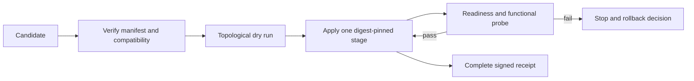

# ARBORA-RELEASE — Design and implementation plan

## Summary

Delivery phase: P5

No scenario of P1 to P4 exercises these rows, so they serve P5. They wait for the P4 gate (`ARBORA-ACCEPTANCE-R006.4`).

This plan serves the rows of `ARBORA-RELEASE` in requirements.md. It covers dependency-ordered, digest-pinned Arbora rollout. The design record follows in the sections below.

## Technical Context

- **Language/Version**: Python 3.14, with a 3.12 floor
- **Primary Dependencies**: the arbora served registry and the Medulla client adapter from the SDK
- **Storage**: N/A, because the engine owns every fact
- **Testing**: pytest with one bound test per row, at the proof level the row names
- **Target Platform**: Linux service
- **Project Type**: service
- **Performance Goals**: N/A, because rows state their own limits
- **Constraints**: one door, and the engine owns every decision
- **Scale/Scope**: the rows of this spec only

## Constitution Check

- R-I One door, no policy table: pass. Every decision is read from the engine.
- R-II Every module is reachable from a production caller: pass. Each row names its caller chain.
- R-III Public specs and core skills are complete and self-contained: pass.

## Project Structure

- `specs/dependency-ordered-release/` (existing): spec, requirements, plan, tasks, test-spec and checklist.
- Code paths: each row names its files in its `Shape:` sentence. This plan adds no other path.

## Phase 0: Research

No unknowns remain. The sections below record the earlier research and decisions.

## Phase 1: Design

The sections below hold the architecture, ownership, data flow and failure modes of this spec.

## Phase 2: Task approach

tasks.md lists one task per row, producer first. Tasks of independent rows run in parallel.

## Complexity Tracking

None. The constitution check passed.

## Build contract

The change must pass the repository pre-commit gates at both stages: `uvx pre-commit run --all-files` and `uvx pre-commit run --all-files --hook-stage pre-push`.
The wiring gate (`scripts/check_wiring.py`) and the public-spec gate (`scripts/check_public_specs.py`) apply. A new module must have a production caller.

## Production caller chain

Each row names its entry point and caller chain in its own text. This plan adds no separate chain.

## Cross-repo seams

None owned here. The `Depends on` lines of requirements.md name each dependency by the row ID that owns it in the other repository.

## Existing system and reuse

`arbora.deployment.genesis_environments` already validates closed release inputs and rejects non-digest-pinned production profiles. `profile_summary` provides a reviewable, secret-free representation. `arbora.deployment.release_canary` checks the installed Arbora entrypoints, engine binary and numeric kernel without starting services. `arbora.deployment.production_ops` owns bounded production operations. `arbora.deployment.self_deploy` has dry-run, health-gated and rollback-advice semantics. `doctor_certification` checks signed release manifest and compatibility inputs. Reuse these owners; do not introduce a second release manager or copy the pipeline's image builder into Arbora. `arbora.deployment.release_candidate` now fills the candidate-manifest and dependency-ordering part of that gap. It provides typed, closed `Artifact`/`Stage`/`Profile`/`Candidate` models and a trusted-digest reader (`read_candidate`). Its deterministic topological `_order` refuses a cycle, an unknown or disabled predecessor, and an incompatible API/schema edge. The remaining gap is stage-by-stage served proof (apply, readiness/functional probes) and rollback.

## Candidate manifest and compatibility

A versioned candidate contains `candidate_id`, `created_at`, `source_revisions`, `artifacts`, `profiles`, `compatibility`, `stages`, and `evidence`. Each artifact has a stable component ID, source repository and full commit SHA. It has an immutable `sha256` image or wheel digest and public build receipt. A stage names required predecessors and a probe contract. A Arbora profile refers to the Arbora artifact digest and its exact profile digest. The manifest signature or trusted provenance is validated before reading deployment inputs. Canonicalize and hash the manifest; record the digest in each stage receipt. Reject duplicate IDs, cycles, missing required edges, unsupported schema, omitted digests, tag-only references and incompatible API/schema ranges. Do not accept a same-tag image as equivalent to a digest.

The pipeline owner produces artifact attestations and the dependency metadata; Arbora consumes and verifies them. If another owner has not published an exact compatible receipt, Arbora reports `dependency_unqualified` and leaves the current release active. A local fixture can supply test signatures and fake digests without accessing any external registry.

## Rollout state machine

The topological sort uses only manifest edges, with a stable tie-break by component ID. A typical candidate declares engine before Arbora, Arbora before optional WebUI, and each enabled connector according to its engine/agent/SDK dependency; the graph, not a hardcoded sequence, decides. For every stage, compare target's observed digest and profile digest, apply the immutable artifact, then require both readiness and a meaningful function: engine query, agent dispatch, connector capability, Arbora authenticated MCP `tools/list` and denied request, or WebUI API consumption. Bound waits and include timeout reason. A stage cannot pass from liveness alone.

Arbora uses its current `setup-config`/profile loader and `doctor` to verify target input before apply. `arbora-release-canary` proves installed local packaging; an independent served probe exercises the public gateway, identity and engine. Each receipt identifies which tier was actually tested. Do not re-run another owner's tests under a Arbora label or infer consumer success from producer green.

## Failure and rollback

Before each stage, persist the previous artifact digest, profile digest and stage status in a privacy-safe receipt. On a failure, stop scheduling dependents. Roll back only when the previous immutable artifact and profile are available and the operation is reversible. Then repeat readiness and functional probes. If a migration or external effect is irreversible, preserve partial status and require an operator-approved recovery plan. Idempotent retry of the same candidate must not duplicate effects. A new candidate with a different digest needs a new approval and receipt chain.

## Quality and release gates

Required PR checks prove manifest validation, deterministic ordering, profile/digest checks, negative failures and dry-run using disposable fixtures. Release acceptance adds signed artifact/build provenance, hosted integration or cluster test, canary, served Arbora identity and consumer probes, and rollback drill. Run `uv run pytest`, `uv run ruff check .`, `uv run mypy arbora`, and `uv build --wheel`; record exact revisions. CCCC cyclomatic ≤10/cognitive ≤15, KISS thresholds from `.kiss/kiss.toml`, and shared `dupehound-changed`, `jscpd-differential`, and `jscpd-census` gates apply to implementation. Keep this orchestration as a small state machine around existing components; no copied build scripts, second config parser, or mutable-tag escape hatch.

## Amendment 2026-10-20: genuine pull-request wheel validation

The existing wheel build also runs after pull-request gates. It builds the wheel,
checks package data and retains the artifact. A skipped release build cannot
stand in for this validation. Platform install qualification remains a release
job; package publication still requires a version tag. This changes no release
credential, approval or deployment boundary. Workflow tests preserve these
conditions and the existing build command.

## Amendment 2026-10-23: typed tool steps in served plan runs

`agents.plan_run` runs a caller-supplied DAG. A task may now be a typed tool step (`ARBORA-RELEASE-R003.4.6`). Its arguments bind to prerequisite outputs by path. Cross-connector data then flows by resolution, not by a model copying a value.

Call path: `handle_plan_run` (`arbora/api/ops/plans.py:298`) asks the engine for the `TaskPlan` decision. The engine validates and digests calls and bindings (`MEDULLA-DECISION-ENGINE-R134.111.8` to `.13`). The harness runs a `DependencyPlan` with tool steps. It resolves bindings and calls an injected caller (`MERISTEM-BOUNDARY-R043.6.1` to `.7`). That caller is the governed fleet caller (`ARBORA-RELEASE-R003.4.5`). It uses the invoke pipeline (`ARBORA-OPS-R009`) to reach the connector.

Arbora validates no binding and holds no planner. It supplies the one authority path. The idempotency key `plan-call:<record>:<task_id>:<call_digest>` makes a replay return the recorded result. The reply returns the harness record per step (`ARBORA-RELEASE-R003.4.8`).

## Amendment 2026-10-24: static architecture tests run on every pull request

The pull-request fast subset runs only the tests a diff maps to. A change to
one file can therefore break a repository-wide import or boundary rule, merge,
and leave main red. `scripts/pr_static_scope.py` lists the static tests: all of
`tests/architecture`, plus every test that parses or walks repository source.
Together they take about one minute (measured: 52 seconds). The release
workflow runs them on every pull request next to the mapped tests. It runs
them when the mapped scope is empty too. A full-suite scope stays as it was.
`tests/deployment/test_pr_static_scope.py` fails when a source-scanning test is
missing from the list. It also fails when the workflow stops adding the list.

## Amendment 2026-10-24: preserve the engine-owned schema body digest

For `ARBORA-RELEASE-R003.4.4`, pin-file serialization must preserve the engine
export's nested key order because the released body codec hashes that order.
Arbora sorts only outer pin metadata. Startup must recompute the deserialized
body's digest before binding a publisher, not trust its declared digest alone.
Regenerate the existing pin through its owning generator. Do not change the
engine codec, invent a digest or substitute another body at serving time.
Roundtrip and public-initializer checks qualify this bounded repair, not full
run execution, durable usage, deployment or release acceptance.

### Task-plan publication receipt boundary

The bounded follow-up to `ARBORA-RELEASE-R003.4.4` must obtain a new receipt
from Arbora's existing action-policy owner before publishing a schema. Bind
the request to the exact pin, tenant, graph and verified session. Preserve
read-only reuse of an existing matching component. Unknown actions still need
approval under the unchanged default policy. A denied, held, stale or missing
receipt must stop publication. This does not qualify the separate approval
grant loop, native context admission, run completion or durable usage replay.
The existing action-policy owner must not issue a new decision receipt when
its atomic audit create returns false. An existing ID is not new evidence.

### 2026-10-24: explicit child interaction after read-only exploration

`ARBORA-RELEASE-R003.4.12` and `.13` extend the served plan-run owner without
claiming the existing flat `agents.plan_run` creates child conversations. Current
`agents.run` admits a root; A2A `contextId` alone is not a child mailbox and
`ARBORA-A2A-R001.3` does not establish completed history hydration. No client may
retarget those calls using a trace or local step ID.

The admitted action names its mode: message active child or continue completed child.
It carries the root owner, owner-issued target, lifecycle/history revision, content and idempotency key. The public target is a binding, not an authority
claim: admission re-resolves caller/tenant ownership and current lifecycle.
Reuse native WorkItem/session/history and keyed receipt mechanisms; Arbora holds
no mailbox, history store or authority table. Installed owners must supply the binding, atomic lifecycle check and durable receipt.
Otherwise the capability is false and the action refuses. This document does not assign or implement EG work.

Active input is queued for an AU model-turn boundary, never injected into an
in-flight request. Completion or cancellation before application makes the
receipt terminal and not applied; it does not spawn anything. Replays return the
same durable receipt, including queued or uncertain outcomes. The receipt binds
the exact action, message ID, target, accepted revision, outcome and applied event
when known, without echoing private content. An acknowledgement is not proof of
model consumption. Existing shared budgets and drain-before-terminal rules apply.

Continuation is a new execution from an explicitly completed child's permitted
history, not resumption of a running or uncertain checkpoint. Its receipt names
both predecessor and new execution/conversation bindings. AU
`MERISTEM-BOUNDARY-R043.16` consumes only host-selected history; existing
`MERISTEM-BOUNDARY-R043.8` and `.9.2.2` remain required for genuine checkpoint support.
Fresh turn limits never reset enclosing session/parent ceilings. Unsupported
history refuses; a new blank root is never substituted.

Delivery order: qualify read-only OPS-R021.4.8/.9 first; then installed child
identity/history/receipt support, AU safe-boundary input and continuation;
finally a served root-child-grandchild acceptance with duplicate delivery,
completion/cancellation races, foreign targets and enforced budget ceilings.
Each client consumes the same results. No new operation or authority is
implemented by this spec-only change; all new rows remain SPECIFIED.
