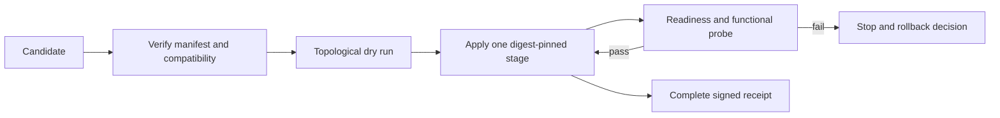

# ARBORA-RELEASE — Design and implementation plan

## Existing system and reuse

`arbora.deployment.genesis_environments` already validates closed release inputs and rejects non-digest-pinned production profiles. `profile_summary` provides a reviewable, secret-free representation. `arbora.deployment.release_canary` checks the installed Arbora entrypoints, engine binary and numeric kernel without starting services. `arbora.deployment.production_ops` owns bounded production operations. `arbora.deployment.self_deploy` has dry-run, health-gated and rollback-advice semantics. `doctor_certification` checks signed release manifest and compatibility inputs. Reuse these owners; do not introduce a second release manager or copy the pipeline's image builder into Arbora. `arbora.deployment.release_candidate` now fills the candidate-manifest and dependency-ordering part of that gap: typed, closed `Artifact`/`Stage`/`Profile`/`Candidate` models, a trusted-digest reader (`read_candidate`), and a deterministic topological `_order` that refuses a cycle, an unknown or disabled predecessor, and an incompatible API/schema edge. The remaining gap is stage-by-stage served proof (apply, readiness/functional probes) and rollback.

## Candidate manifest and compatibility

A versioned candidate contains `candidate_id`, `created_at`, `source_revisions`, `artifacts`, `profiles`, `compatibility`, `stages`, and `evidence`. Each artifact has a stable component ID, source repository and full commit SHA, immutable `sha256` image or wheel digest, and public build receipt. A stage names required predecessors and a probe contract. A Arbora profile refers to the Arbora artifact digest and its exact profile digest. The manifest signature or trusted provenance is validated before reading deployment inputs. Canonicalize and hash the manifest; record the digest in each stage receipt. Reject duplicate IDs, cycles, missing required edges, unsupported schema, omitted digests, tag-only references and incompatible API/schema ranges. Do not accept a same-tag image as equivalent to a digest.

The pipeline owner produces artifact attestations and the dependency metadata; Arbora consumes and verifies them. If another owner has not published an exact compatible receipt, Arbora reports `dependency_unqualified` and leaves the current release active. A local fixture can supply test signatures and fake digests without accessing any external registry.

## Rollout state machine

The topological sort uses only manifest edges, with a stable tie-break by component ID. A typical candidate declares engine before Arbora, Arbora before optional WebUI, and each enabled connector according to its engine/agent/SDK dependency; the graph, not a hardcoded sequence, decides. For every stage, compare target's observed digest and profile digest, apply the immutable artifact, then require both readiness and a meaningful function: engine query, agent dispatch, connector capability, Arbora authenticated MCP `tools/list` and denied request, or WebUI API consumption. Bound waits and include timeout reason. A stage cannot pass from liveness alone.

Arbora uses its current `setup-config`/profile loader and `doctor` to verify target input before apply. `arbora-release-canary` proves installed local packaging; an independent served probe exercises the public gateway, identity and engine. Each receipt identifies which tier was actually tested. Do not re-run another owner's tests under a Arbora label or infer consumer success from producer green.

## Failure and rollback

Before each stage, persist the previous artifact digest, profile digest and stage status in a privacy-safe receipt. On a failure, stop scheduling dependents. Roll back only when the previous immutable artifact and profile are available and the operation is reversible. Then repeat readiness and functional probes. If a migration or external effect is irreversible, preserve partial status and require an operator-approved recovery plan. Idempotent retry of the same candidate must not duplicate effects. A new candidate with a different digest needs a new approval and receipt chain.

## Quality and release gates

Required PR checks prove manifest validation, deterministic ordering, profile/digest checks, negative failures and dry-run using disposable fixtures. Release acceptance adds signed artifact/build provenance, hosted integration or cluster test, canary, served Arbora identity and consumer probes, and rollback drill. Run `uv run pytest`, `uv run ruff check .`, `uv run mypy arbora`, and `uv build --wheel`; record exact revisions. CCCC cyclomatic ≤10/cognitive ≤15, KISS thresholds from `.kiss/kiss.toml`, and shared `dupehound-changed`, `jscpd-differential`, and `jscpd-census` gates apply to implementation. Keep this orchestration as a small state machine around existing components; no copied build scripts, second config parser, or mutable-tag escape hatch.

## Amendment 2026-10-20: genuine pull-request wheel validation

The existing wheel build also runs after pull-request gates. It builds the wheel,
checks package data and retains the artifact. A skipped release build cannot
stand in for this validation. Platform install qualification remains a release
job; package publication still requires a version tag. This changes no release
credential, approval or deployment boundary. Workflow tests preserve these
conditions and the existing build command.

## Amendment 2026-10-23: typed tool steps in served plan runs

`agents.plan_run` runs a caller-supplied DAG. A task may now be a typed tool step (`ARBORA-RELEASE-R003.4.6`). Its arguments bind to prerequisite outputs by path. Cross-connector data then flows by resolution, not by a model copying a value.

Call path: `handle_plan_run` (`arbora/api/ops/plans.py:298`) asks the engine for the `TaskPlan` decision. The engine validates and digests calls and bindings (`EG-DECISION-ENGINE-R134.111.8` to `.13`). The harness runs a `DependencyPlan` with tool steps. It resolves bindings and calls an injected caller (`AU-BOUNDARY-R043.6.1` to `.7`). That caller is the governed fleet caller (`ARBORA-RELEASE-R003.4.5`). It uses the invoke pipeline (`ARBORA-OPS-R009`) to reach the connector.

Arbora validates no binding and holds no planner. It supplies the one authority path. The idempotency key `plan-call:<record>:<task_id>:<call_digest>` makes a replay return the recorded result. The reply returns the harness record per step (`ARBORA-RELEASE-R003.4.8`).
