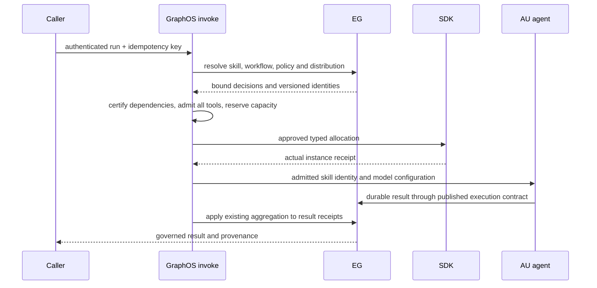

# Architecture and implementation plan

## Existing wiring to reuse

| Existing seam | Role in this design | Change boundary |
|---|---|---|
| `graph_os/fleet/catalog_reader.py` and `epistemic_adapter.py` | Typed fleet catalog reads and generated engine adapter | Extend one canonical item projection; preserve strict integrity failures |
| `graph_os/fleet/multiplexer.py` | Child transport, session visibility, mounts, meta-tool registration | Make it a transport/session component. Route authority and effects through `invoke`. Remove default-open branches |
| `graph_os/fleet/session_notifications.py` | Per-session list-change queue | Notify on load, unload, revocation, and generation change |
| `graph_os/fleet/child_resilience.py` | Child health and reconnect | Include generation and health in status without granting authority |
| `graph_os/mcp_server/{runtime,server,catalog_composition,composition}.py` | Served FastMCP instance and startup composition | Install the ten registry projections on the same event loop. Fail startup on incomplete attachment |
| `graph_os/webui_host/mcp_delegation.py` | Host-to-MCP bridge | Route calls through the same registry/policy boundary |
| `graph_os/deployment/doctor.py` | Local environment and policy diagnostics | Report policy off, unavailable, invalid config, and catalog digest mismatch |

Build on these seams; do not introduce a second catalog authority, child-call path, or policy decision point. `graph_os/api/registry/` owns immutable operation metadata. `graph_os/api/invoke/` owns validation, caller binding, exact scopes, policy, effects, execution, audit, and error mapping. `graph_os/api/mcp/` projects intent and resident fleet tools. `graph_os/fleet/gateway_ops.py` adapts catalog operations and creates native forwarders whose body delegates to `invoke("fleet.call", ...)`. The engine contract provides method schemas/scopes and durable event APIs; the SDK provides certified connector manifests and pack annotations.

## Data and generation model

```text
verified principal + policy revision
    -> authorized registry view + fleet catalog snapshot
    -> generation {id, digest, typed items, source versions}
    -> MCP / HTTP / A2A discovery and session mounts
    -> invoke(op, params, caller, surface)
    -> delegated child or engine under verified caller
```

Use frozen typed models for `OpSpec`, `CatalogItem`, `CatalogGeneration`, `ReloadReceipt`, `SessionLoad`, and `OpError`. `OpSpec` includes ID, verb, summary/examples, params/result schema, binding, caller and executor scopes, subject and effect. It also includes principal rule, confirmation, surfaces, idempotency, stability and audit class. Canonicalize sorted IDs and normalized schemas, then SHA-256 the serialized form. Version and digest must appear in MCP instructions, HTTP registry response, and A2A card. A curated alias suppresses the generated engine op so one engine method has one public identity.

The catalog join uses the verified **runtime MCP server name** from the child session, plus its tenant and source identity. Package ID and transport key remain separate metadata. Reject duplicate runtime names or an ambiguous alias. A connector schema pin is the canonical digest of its real `tools/list` schema. A failed or empty probe cannot silently certify it. Validate body digests for skills, prompts, resources, and templates before a candidate generation is eligible.

## Request and authority flow

1. Surface adapter supplies a `VerifiedCaller` from authenticated MCP, HTTP, or A2A context; local/stdio creates an explicit scoped bootstrap principal.
2. Resolve a registered op, forbid extra fields and caller-asserted authority, and validate a typed schema.
3. Check principal kind and exact caller scopes. `mcp:discover`, `mcp:delegate`, item scopes, and domain scopes have no cross-class admin implication.
4. Evaluate narrowing-only Eunomia at discovery, load, and every call. Enabled and unreachable yields `POLICY_UNAVAILABLE`; disabled still runs scope and principal filtering.
5. For service-executed work, check the caller's subject-read authority before entering the service identity; verify the service grant allowlist. For caller-executed work, use the verified caller context directly.
6. Apply READ/WRITE/DESTRUCTIVE/ADMIN effect rules and preview/plan/console confirmation. Require idempotency keys for side effects that can retry.
7. Dispatch with the existing timeout and interactive priority. Append a minimal audit event. Map errors without changing engine error codes.

Discovery omits denied items. A privileged policy-debug response may identify the denying layer only with exact `mcp:admin` and an explicit request. Loaded native forwarders re-evaluate all checks on **each call**, even if a prior load succeeded. A scope or policy revision change removes visibility and queues notifications; a stale native call returns a stable denial.

## Reload state machine

| Phase | Required behavior |
|---|---|
| Snapshot | Read current active generation and source versions; acquire a single-writer generation token |
| Build | Fetch child catalog and bodies, certified pack entries, registry, and policy metadata off the serving path |
| Validate | Check schema/body digests, duplicates, deletion semantics, identity joins, scopes, and cross-surface projections |
| Prepare | Persist candidate and ordered delta events with one trace ID; do not expose candidate to readers |
| Publish | Atomically swap the active generation pointer after validation; each read sees one whole generation |
| Drain | Let calls pinned to the previous generation finish until a bounded deadline; cancel/return retryable outcome after it |
| Notify | Queue per-session tool/prompt/resource/skill list changes and durable ingestion events in source order |
| Reconcile | Replicas compare active ID/digest; lagging replicas remain last-known-good or report degraded, never assemble mixed generations |

On any build/validation/publish failure, retain the last-known-good active generation and record a typed failure receipt. Make no positive list-change claim. Deleted assets disappear only after a valid new generation publishes; stale loaded calls deny once deletion takes effect. A repeated reload of the same digest is idempotent and produces no duplicate ingestion. Every receipt carries prior/candidate/active IDs, digest, counts by kind, trace ID, status, and deadline.

## Sequence

1. Define registry and canonical digest; generate engine bindings from the packaged method/schema/scope contract and maintain explicit exclusions.
2. Add typed `invoke` and the fleet gateway adapter. Make existing child call sites delegate through it; prove no alternate path by static scan and tests.
3. Project six verbs, four resident fleet tools, typed discovery, generated clients, and API/A2A views. Use one filtered catalog and one resolver; remove legacy harvest and granular registration only after the replacement starts and serves.
4. Add strict policy modes, exact fleet scopes, session cap/expiry, native forwarders, notifications, and revocation handling.
5. Add candidate generation and reload state machine, durable delta receipts, replay, and multi-replica convergence checks.
6. Re-certify connectors against actual served schemas and wire pack annotations and write-back effect classes. Include feed sanitation, run admission and assembly model parsing.
7. Run the gate matrix and publish exact evidence; only then move each slice through SOURCE LANDED to ACCEPTED.

## Development environment

A contributor starts with this repository and its declared lockfiles, installs local dependencies, runs generated-contract checks and fixture tests, and starts a local MCP server with fake engine/child adapters and bundled policy. The test suite must not require private DNS, secrets, an existing tenant, or a live production service. Mark unavailable optional integration tests separately and use a provisionable container/local fixture for CI. Release acceptance adds a disposable two-replica graph-os setup and synthetic connector; its setup commands and manifests belong in this repository.

## GRAPHOS-FLEET-R034 skill and workflow admission

Data flow: POST route (graph_os/api/http/routes.py:127) → `invoke` (graph_os/api/invoke/pipeline.py:810) → skill audit and workflow admission → `_confirmation_gate` → effect.

Types: `SkillAuditReport`, `WorkflowAdmissionRecord`. The policies attach before the confirmation gate. Failure behavior: a typed refusal naming the missing field or exceeded limit; nothing runs.

Reused: the `invoke` pipeline and the `OpError` path. New: both policies and models; the call site does not exist yet.

Decision: admit at the single pipeline boundary. Rejected alternative: audit at skill install only, which misses skills already present.

## Certified execution, provisioning and schema admission

These extensions define missing host contracts. Reachable today: no complete integrated path.
All new rows remain SPECIFIED. Existing helper coverage does not establish served acceptance.
GraphOS owns admission, lifecycle and transport composition. EG owns decisions, skill identity, prompt semantics and aggregation.
AU executes approved model work. SDK owns tool schemas, connector transport and provisioner effects.
No host policy may widen an EG grant. Generated workflow text never grants authority.
The current intent projection remains authoritative; this extension adds no resident MCP tools.

### Existing code and missing wiring

| Existing code | Reuse | Missing connection |
|---|---|---|
| graph_os/api/http/routes.py:113 endpoint; graph_os/api/mcp/verbs.py:377 dispatch_verb | Served adapters. | Certification and provisioning gates. |
| graph_os/api/invoke/pipeline.py:810 invoke; :641 _confirmation_gate; :444 _dispatch | Authority, confirmation, effect journal and dispatch | Bind the full workflow snapshot before any effect |
| graph_os/api/ops/agents.py:43 handle_agent; :97 operations | A2A delegation. | Provisioning and local-model orchestration. |
| graph_os/control_plane/runs/admission.py:108 NativeWorkItemAdmissionProtocol | Exact persisted run admission | Durable producer adapter and runtime allocation receipt |
| graph_os/control_plane/runs/capacity.py:53 CapacityLedger | Bounded acquisition | Fleet measurement, budget reservation and release integration |
| graph_os/fleet/catalog_items.py:208 compute_schema_fingerprint | Real served schema digest | Versioned nested definitions and compatibility gate |
| graph_os/fleet/onboarding.py:236 FleetOnboarding.onboard | SDK capture, EG attestation and import | Independent ingested identity read and provisioned-agent consumption |

The current agents.run handler sends an A2A message; it does not prove VM allocation or certification.
Semantic content provisioning imports graph content; it is not a VM/container provisioner.
In-memory admission is a reference implementation, not durable fleet recovery evidence.
Extend these owners and inject their published ports; do not build another selector, store or aggregator.



### Certification and workflow snapshot

A certification request binds tenant, skill ID/version/body digest, dependency DAG and declared tool schema digests.
It also binds model endpoint configuration revision, model identity, system prompt digest and certification policy revision.
The endpoint is a configured local model service. Fixture model requests must be observed through actual orchestration.
EG owns scoring, selection and acceptance decisions; AU performs model calls through its public orchestration contract.
GraphOS admits atomic skills first, then composed skills in dependency order using current producer attestations.
Missing dependencies, cycles, stale certificates or changed model/prompt/schema bindings prevent composed execution.
Certificate validity is bounded by producer expiry, policy revision and all referenced artifact versions.
Cancellation preserves completed receipts but never certifies unfinished work.

The workflow snapshot includes tenant, verified caller, workflow ID/version, trusted declaration digest and policy/grant revision.
Each tool binding includes connector identity, tool identity, input/output schema digests, operation, resource scope and effect class.
Resolve the declaration from EG authority, not caller or model text. Compare every bound tool before the first call.
Admission intersects the trusted declaration with current caller grants and the existing narrowing policy.
An undeclared tool or broader resource scope refuses the whole initial admission with zero tool calls.
Before each later dispatch, revalidate snapshot revisions and revocation. A changed binding requires fresh admission.
A refusal after earlier completed calls stops future effects and reports those prior receipts; it does not claim rollback.
Certificates establish prerequisites, never caller authority.

### Typed provisioning and measured capacity

ProvisionRequest contains tenant, run/work-item ID, decision reference, instance count and immutable image digest.
It includes OS, architecture, runtime class, provider target reference, CPU/memory/disk limits, network policy and deadline.
Secret references are opaque. The verified caller supplies authority; request fields cannot assert grants.
A budget binds maximum concurrent instances, aggregate resource units, elapsed time and provider cost ceiling.
Provider cost currency and estimation revision are mandatory when the provider charges money.
ProvisionResult contains request digest, allocation ID, actual instance IDs, image digest and observed runtime/OS.
Each instance reports admitted, allocating, running, completed, failed, unknown or released state with timestamps and receipt references.
A result cannot report running without runtime observation. Unknown outcomes require query/reconciliation before retry.

The following is the required certification matrix, not a claim of current availability.
Each row needs a disposable fixture with a pinned image digest and an approved SDK adapter version.
Only certified rows enter the runtime supported matrix; an empty matrix exposes no allocation capability.

| OS | Architecture | Runtime | Required fixture |
|---|---|---|---|
| Linux | x86_64 | local container | Disposable OCI container and real agent process |
| Linux | x86_64 | local VM | Disposable VM and real agent process |
| Linux | x86_64 | cloud VM | Disposable approved provider VM and real agent process |
| Windows | x86_64 | cloud VM | Disposable approved provider VM and real agent process |

Other tuples, mutable image tags, uncertified digests and unavailable adapters refuse before allocation.
Provider transport belongs to SDK; GraphOS does not add provider clients.
Use the existing all-or-nothing capacity acquisition before dispatch. Do not silently reduce the requested instance count.
Release reserved capacity after observed cleanup; retain holds for unknown active resources until reconciliation.
Replay identity is tenant, run, operation and idempotency key, bound to the canonical request digest.
Identical retries return existing receipts; changed bodies return IDEMPOTENCY_CONFLICT before further allocation.
Provider allocation receipts fence duplicate effects. Retryable transport failures never imply that allocation did not happen.

The capacity proof requires at least 200 distinct actual running agent instances with overlapping lifetimes.
Hold a readiness barrier for thirty seconds after all 200 report ready, within the predeclared concurrency and cost budgets.
Record every start, completion, failure and cleanup plus peak concurrency and measured resource/cost consumption.
Read each durable returned result independently, then pass its receipt to the existing EG aggregation operator.
Bind aggregation to tenant, run, operator ID/version and ordered unique result receipts; preserve partial-result policy from EG.
Do not implement host voting, ranking or summarization as a substitute.
Cancellation, deadline and budget exhaustion stop additional allocations and preserve truthful partial results.
A local small run proves wiring only. Mocks, helper counters and extrapolation cannot prove hundreds-instance capacity.

### Versioned nested definitions

VersionedDefinition contains producer, kind, stable ID, semantic version, schema version, schema/body digests and compatibility receipt.
Prompt sections are typed role, instructions, context, constraints and examples; tools carry nested input and output JSON schemas.
Require producer-declared types, required fields, array item schemas and explicit additional-property policy at each object boundary.
Bound schema bytes, depth and reference expansion through configuration; refuse cycles or unresolved external references.
Validate actual served definitions against their producer schemas before fingerprinting and candidate publication.
Identical version and digest is an idempotent no-op. Same version with different content is a conflict.
A minor update may add optional fields with defaults while preserving every existing consumer input and output contract.
Removing fields, adding required inputs, narrowing accepted values or changing types is breaking.
A major change requires explicit consumer re-admission; it never silently replaces a workflow's pinned definition.
EG owns prompt structure and evolution; SDK owns tool definition evolution and compatibility evidence.
GraphOS consumes the published compatibility decision and rejects contradictions with its admitted schema snapshot.
Absent producer compatibility contracts return PRODUCER_UNAVAILABLE. Host parsing alone cannot close that producer gap.

### Producer dependencies and integrated acceptance

| Producer | Required public contract | Host consumer and remaining gap |
|---|---|---|
| [EG typed packs](https://github.com/Knuckles-Team/epistemic-graph/tree/main/specs/typed-packs-and-catalog) | Attested skill/prompt identity and versioned content | R002/R027/R034 need version compatibility and certification binding |
| [EG specs](https://github.com/Knuckles-Team/epistemic-graph/tree/main/specs) | Distribution and aggregation. | R024 requires generated operation ID/version and result receipt schema before implementation. |
| [SDK connector control](https://github.com/Knuckles-Team/agent-connector-sdk/tree/main/specs/SDK-CONNECTOR-CONTROL) | Certified tool schema, governed effects and provider transport | R002/R024 require compatibility evidence and typed allocation/reconciliation producer contracts |
| [AU specs](https://github.com/Knuckles-Team/agent-utilities/tree/main/specs) | Approved orchestration, local model call and returned-result path | R024/R034 require producer wiring to certification and EG aggregation; no host replacement |

These dependencies are not implementation claims. Host definitions do not close missing producer clauses.
The integration fixture starts GraphOS, the published EG service, an SDK connector, a provisioner and the configured local model.
In one served run, discover a domain skill, consume its distribution decision, provision an agent and observe its actual model/tool call.
Read the ingested skill identity independently from EG and compare it with the identity consumed by that agent.
Read the durable result and aggregation receipt through the public authority, not the orchestration response alone.
Repeat through MCP intent dispatch and REST with equivalent authorization and outcomes.
Exercise missing certification, denied tool, changed declaration, incompatible schema, unsupported platform, producer outage and cross-tenant substitution.
Assert refusal before each protected effect, replay without duplicate allocation, and explicit partial outcomes after interruption.
Every proof records exact host/producer revisions, fixture manifest, matrix row, timestamps, identities and redacted receipt digests.
No runtime acceptance was run for this definition change.
