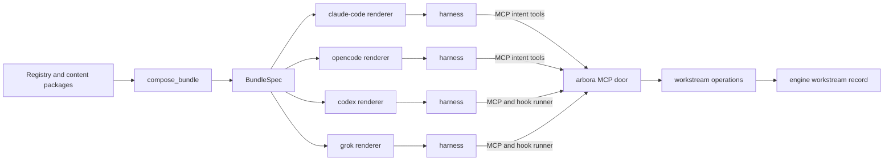
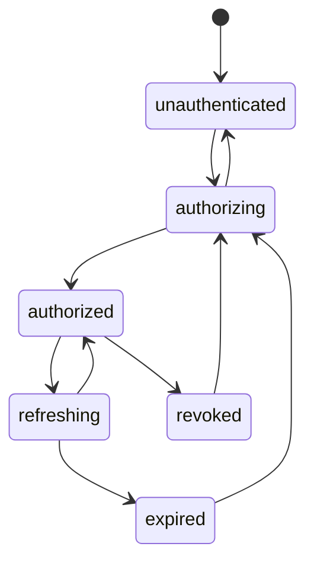
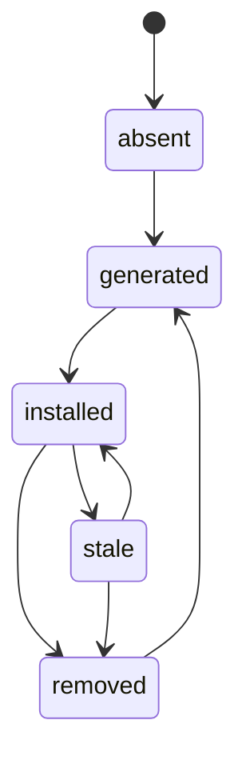
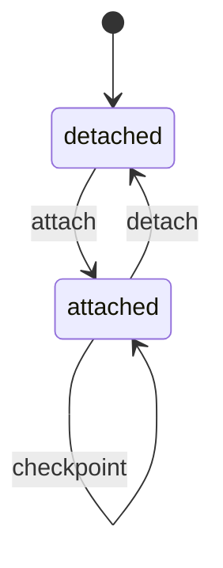

# ARBORA-HARNESS-PLUGINS — Implementation plan

Governing spec: [spec.md](spec.md). Rows: [requirements.md](requirements.md). Harness facts: [research.md](research.md).

Component: Coding harness plugins

## Summary

Delivery phase: P2

Arbora generates one plugin per coding harness from its registry, on the developer's machine. One harness-neutral core feeds four renderers. Hooks reach the door as MCP tool calls where the harness allows it. Otherwise hooks run the one arbora hook runner. A workstream record in the engine joins the sessions of all harnesses on one workspace.

## Technical Context

- **Language/Version**: Python 3.14 (floor 3.12). One generated TypeScript module for the `opencode` profile.
- **Primary Dependencies**: The arbora registry, the SDK content convention, the native client contract.
- **Storage**: The medulla engine. Arbora keeps only `~/.config/arbora/plugins.json`, the install record.
- **Testing**: pytest. One `node` loader fixture for the generated `opencode` module.
- **Target Platform**: Developer machines on Linux and macOS.
- **Project Type**: Command-line tools and served operations.
- **Performance Goals**: Attach at 150 ms p95. Status line at 200 ms. Bundle generation in 2 seconds for 50 skills.
- **Constraints**: No credential in a bundle. No committed bundle. No host or private domain in a template.
- **Scale/Scope**: Four harness profiles. The rows of requirements.md.

## Constitution Check

- **I. One owner per concept**: The bundle, install, login and workstream operations live here. The engine record lives in medulla.
- **II. Extend before you create**: The publication gate, the native client, the turn path and the masking path are reused.
- **III. Specs describe the current state only**: No history appears in this plan.
- **IV. Requirements are neutral and controlled**: Harness names appear only as profile identifiers, the integration targets.
- **XXXI. Explicit state machines**: Install, credential and attachment each have one state field, one transition function and one typed refusal.

## Project Structure

```text
arbora/harness_plugins/
  profiles.py        HarnessProfile table (R001.1)
  compose.py         compose_bundle -> BundleSpec (R001.2)
  render.py          render + tree digest (R001.3), one function per profile (R005, R006, R008, R009)
  validate.py        structural validator per profile (R001.7)
  cli.py             bundle, install, status, remove, login, hook, statusline (R001.4, R002.2, R003.2, R005.4, R007)
  install.py         install machine (R002)
  login.py           credential machine and token store (R003.2, R003.3)
  hook_runner.py     command hook runner (R007)
  templates/opencode/package.json, server.ts   (R006.1)
arbora/api/ops/workstreams.py                  (R004)
arbora/ontology/state_machines.ttl             three machines (R002.1, R003.3, R004.5)
```

## Phase 0: Research

The unknowns and their resolution are in [research.md](research.md). Open unknowns:

- Whether an `opencode` session hook can call a tool of a connected MCP server. Fallback: the runner credential of R003.2.
- The `codex` plugin manifest path and its compaction event, to verify on a live harness before R008 lands.
- Whether `grok` reads the `claude-code` layout as stated, to verify before R009 lands.

## Phase 1: Design

### Architecture



### Shared core

`BundleSpec` is pure data. It holds the door MCP entry, the skill set, the agent set, the command set and the hook intents. A hook intent is an abstract pair: a lifecycle point and a workstream operation. The renderer maps each lifecycle point to the event name of its harness. The core never names a harness file.

The skill set is the door skills of `US-CONTENT-R007`, `arbora-door` and `session-handoff`, plus the declared list `harness_plugins.skills`. The default list is empty. The developer reaches every other skill through `find` and the served skill resources. This keeps the harness context small.

The agent set holds one definition per registered agent profile that the caller may run. Each definition delegates through `act` with `agents.run`. The bundle copies no MCP prompt. Each harness lists the served prompts of the door itself.

### Per-harness adapters

| Profile | Manifest | Door entry | Hooks | Install place | Update channel |
|---|---|---|---|---|---|
| `claude-code` | `.claude-plugin/plugin.json` | `.mcp.json`, `http`, OAuth client ID, callback port | `mcp_tool` to `write` | local marketplace, command source | rerun per session |
| `opencode` | generated server plugin, `package.json` | set at plugin setup | session `context` and `compaction` hooks, end event | global plugin discovery directory | read at setup |
| `codex` | `.codex-plugin/plugin.json` | `.mcp.json`, streamable HTTP | `command` hooks, runner | plugin command line | rerun install |
| `grok` | shared layout and `.grok-plugin/marketplace.json` | `.mcp.json` | `command` hooks, runner | user plugin directory | rerun install |

### Lifecycle point map

| Lifecycle point | Operation | `claude-code` event | `opencode` hook | `codex` and `grok` event |
|---|---|---|---|---|
| first prompt | `workstream.attach` | `UserPromptSubmit` | session `context` | `UserPromptSubmit` |
| before compaction | `workstream.checkpoint` | `PreCompact` | session `compaction` | `PreCompact` |
| session end | `workstream.detach` | `SessionEnd` | session end event | none: no session end event |

The `claude-code` launch-time start event fires before MCP servers connect. So attach runs on the first prompt. Attach is idempotent on the harness session ID, so later prompts return an empty context fast.

A profile with no session end event sends no detach. The engine keeps `last_active_ms` on each attachment. A reader treats an attachment as idle after 30 minutes without activity.

### Auth handshake

The harness signs in through the native public client of `ARBORA-IDENTITY-R030.4`. The bundle carries the client ID and the fixed loopback callback of the profile. The harness stores its own tokens. `ARBORA-IDENTITY-R030.4.7` derives the native redirect URIs from the profile table, so one table feeds both.

A command hook runs outside the harness token store. `arbora plugin login` gives the runner its own refresh token. The runner renews the access token while the session lives. A missing credential gives a non-blocking `AUTH_REQUIRED` note.



### Install lifecycle



Install never edits a harness file that it did not write. A hand-written door entry refuses `DUPLICATE_DOOR`. This is the hard cutover: the developer removes the old entry once, with the printed step.

### Cross-harness session model

A workstream is one engine record per tenant, principal and workspace digest. Each harness session is a `ClientSession` with an `attachedTo` link to the workstream. A checkpoint is one conversation turn written through `ARBORA-OPS-R897.4`. The engine derives memory from turns. Arbora adds no ranking and no text.



The attach context holds the last checkpoint, the open run IDs of `development.run.status` and the other attached sessions. It is 4096 bytes or fewer. The tuig terminal client attaches the same way under `TUIG-RUNTIME-R013`.

## Production caller chain

- Bundle: `arbora` console script → `arbora/console.py:main` → `arbora/harness_plugins/cli.py::bundle_command` → `compose_bundle` → `gate_mcp_resource_publication` → `render`.
- Install: `arbora/console.py:main` → `cli.py::install_command` → `install.py::transition` → `render` → place.
- Attach over MCP: harness hook → MCP `write` verb at `arbora/api/mcp/verbs.py` → `invoke` at `arbora/api/invoke/pipeline.py` → `workstreams.py::handle_attach` → the engine send helper of `ARBORA-OPS-R897.1`.
- Attach from the runner: harness command hook → `cli.py::hook_command` → `hook_runner.py::run` → `arbora.client` HTTP `POST /api/v1/ops/workstream.attach` → the same `invoke`.

## Reuse inventory

| Need | Reused part |
|---|---|
| Publication receipt check | `gate_mcp_resource_publication` in `arbora/fleet/mcp_resource_reconciliation.py` |
| Native client and scopes | `arbora/identity/client_contract.py` (`ARBORA-IDENTITY-R030.4`) |
| Turn write and masking | `participant.turn.append` path (`ARBORA-OPS-R897.4`) and `ARBORA-OPS-R844.1` |
| Served HTTP client | `arbora/client/http.py` |
| Skill files | SDK content convention, `skills/<name>/SKILL.md` |
| State machine ontology | `arbora/ontology/state_machines.ttl` |

## Cross-repo seams

| Row | Owner | Seam |
|---|---|---|
| `MEDULLA-IDENTITY-R723` | medulla | Workstream label and the `attachedTo` link |
| `MEDULLA-CQ-ORCH-R820` | medulla | Competency questions that the workstream and bundle rows serve |
| `US-CONTENT-R007` | universal-skills | Door skills and portable frontmatter |
| `PIPE-RELEASE-R028` | pipelines | Release proof with the harness validators; no committed bundle |
| `TUIG-RUNTIME-R013` | tuig | Terminal client as a workstream peer |

## Phase 2: Task approach

Tasks run producer first: the profile table, the composer, the renderers, then install and login. The workstream operations wait for `MEDULLA-IDENTITY-R723`. The `claude-code` and `opencode` renderers come before `codex` and `grok`.

## Decisions

- The bundle is generated at the point of use. No repository commits a generated bundle.
- Hooks write only to the caller's own workstream. The operations declare `Confirm.NONE`. This needs owner approval; see research.md, open decision D3.
- The default skill set is the door skills only. A selection of skills per task stays an engine decision.
- The `opencode` module is a template in the arbora wheel. No separate package registry entry exists.

## Complexity Tracking

None.

## Build contract

- Gates: `pipelines-hook complexity-staged`, `kiss-staged`, `jscpd-differential`, `dupehound-changed`, `swallowed-errors` and the spec gates.
- Types: `uv run mypy arbora/harness_plugins arbora/api/ops/workstreams.py` passes with no new ignore.
- Each state machine has one state field, one transition function over one edge table and one typed refusal.
- The renderers share `hook_entries` and `tree_digest`. No renderer copies another renderer's code.
- The `opencode` template holds no host, domain or path. The renderer fills the endpoint from config.
- Tests: `uv run pytest tests/harness_plugins tests/api/ops/test_workstreams.py tests/api/ops/test_workstreams_served.py -q`.
