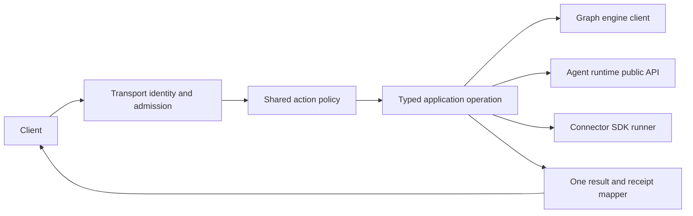

# Architecture and implementation plan

## Existing wiring to reuse

| Arbora module | Existing responsibility | Required change |
|---|---|---|
| `arbora.mcp_server.server`, `runtime`, `composition`, `bootstrap` | FastMCP entrypoint, lifecycle and composition | Keep one loop and one multiplexer. Move dependency-specific construction behind public ports and fail closed on unavailable contracts. |
| `arbora.gateway` | REST routes, catalog and widget projection | Adapt routes to the same application operation and authorization decision as MCP. Keep vendor calls in admitted fleet tools. |
| `arbora.a2a` | Agent Card and task projection | Reuse the host application service, never create a task/event store. |
| `arbora.webui_host` | Optional WebUI co-service | Submit to owner loop; keep browser presentation in the WebUI package. |
| `arbora.control_plane` | Policy and reconciliation orchestration | Keep hosted decisions here while durable provenance and graph state use the engine client. |
| `arbora.deployment` | Configuration and operator commands | Reuse one XDG configuration resolver and publicly installable extras. |

`arbora.mcp_server.bootstrap` and `arbora.a2a.routing` currently contain dependency-internal imports. Treat them as migration inventory, not approved architecture. A port is a narrow protocol describing the methods Arbora actually calls; its adapter imports the dependency's supported public API. If a public method is missing, add it to the owning package. Pin a released version before deleting the old import. Do not mirror the private implementation in Arbora.

## Request path

The transport adapter parses and bounds a payload, authenticates identity, applies origin/CSRF requirements where applicable, and constructs an immutable request. `action`, `tenant`, `resource`, `scopes`, `policy_version`, `idempotency_key` and `correlation_id` are typed; the trusted principal comes from transport admission. Policy runs before an effect or delegated call. The operation returns typed data or a typed error; transport adapters only encode them. Redacted structured logs carry the correlation and receipt identity, never secrets.

## Migration sequence

1. Inventory each Arbora-to-AU import and each duplicate host/module. Label its owner and the public port it needs. Cover eager, lazy and type-only imports.
2. Add missing public dependency ports in their owners and test them through installed wheels. Replace Arbora call sites by capability, beginning with identity/config, graph client and agent execution; no package-wide compatibility alias.
3. Reconcile gateway, deployment, MCP, fleet, A2A and messaging copies against the public behavior tests. Delete old duplicate script registration after parity.
4. Make owner-loop submission a single service and verify co-service lifecycle, reload and cancellation under concurrent sessions.
5. Run the boundary census and served parity tests on a clean environment; record exact package versions and source hashes in `tasks.md`.

## Design constraints

New adapters remain small and cohesive. Before adding a class, inspect an existing `arbora.*` port and route; extend the owning module where its contract fits. Avoid duplicate decision trees, hand-maintained action catalogs, hidden fallback authority and broad `except` that turns denial into success. A dependency contract mismatch returns a typed unavailable error and an observable receipt. A temporary migration shim must have one caller, one removal task and a test preventing expansion.

Cross-repository work is sequenced by public package release: engine/SDK/AU contract first, Arbora adapter second, client projection last. Public dependency versions in `pyproject.toml` and `uv.lock` express the minimum required API; no unpublished sibling path is a required test input.

## Startup configuration design (ARBORA-HOST-R010)

Existing code: `core/config_admin.py:51` reads four hosting variables and validates ports and profiles.
`mcp_server/server.py:164` currently loads agent-runtime configuration before constructing the server.
Reachable today: the four-field helper exists; complete declaration composition and startup validation are missing.

The proposed immutable `HostEnvironmentManifest` uses schema version 1 and an ordered declaration list.
Each declaration carries `name`, `component`, `source_revision`, `type`, `required_when`, `default`, `sensitive` and `call_sites`.
Sort by component and name; reject conflicting duplicate names rather than depending on import order.
Types are string, boolean, integer, URI, path and secret reference, with explicit bounds and enum values.
Require public declaration producers for enabled SDK and agent-runtime components before claiming complete ecosystem coverage.
Those producer contracts are prerequisites; the current four-field helper does not provide them.

Resolve configuration once, validate, then bind an immutable snapshot before constructing transports or starting children.
Retain existing XDG precedence; this definition grants no new environment override or permission source.
Named reasons are `environment_undeclared`, `environment_missing`, `environment_malformed`, `environment_conflict` and `environment_manifest_unavailable`.
Return names and reasons without resolved values. Validate ports against 1 through 65535.
Use seeded declaration ordering permutations to prove identical normalized manifest digests and refusal sets.

Preservation: R010.1 retains the complete original ownership and schema acceptance.
All original rows and acceptance remain binding; narrower startup children cannot replace their evidence.

## Detected harness installation (ARBORA-HOST-R008)

Existing code: `deployment/cli.py:67` registers one harness; `:77` delegates a fence installer to agent-runtime internals.
`core/` currently contains the configuration owner, not a complete generic installer or harness detector.
Reachable today: the existing registration command is callable; generic detected-only installation is missing.
Extend that command with a proposed `install-harnesses` subcommand rather than creating another installer service.
Use versioned adapters for detection, parsing, managed-section edits and supported hooks.
Support absence explicitly; do not create a harness directory merely because its adapter exists.

`HarnessInstallation` schema version 1 records adapter, version, executable identity, configuration root and positive detection evidence.
`HarnessConfigurationChange` records destination, before digest, proposed bytes digest, managed sections and installation identity.
Validate roots and all proposed artifacts before applying; use conditional replacement with idempotent managed sections.
Recheck each original digest immediately before replacement. Preserve unknown keys, comments and unrelated instructions.
Multi-file interruption reports which artifacts changed; resume by reading actual digests, never by claiming an atomic transaction.
Reasons are `harness_absent`, `harness_unsupported`, `harness_ambiguous`, `configuration_conflict`, `destination_denied` and `installation_incomplete`.
An absent harness produces an observation without writes; unsupported requested configuration produces a refusal.
Supported-hook absence is reported as a capability limitation, never silently described as installed.
R008.1 preserves the complete original module census and every named owner.

## Terminal start and scoped logs (ARBORA-HOST-R009/R010)

### Owned shutdown prerequisite

ARBORA-HOST-R009.4.1 adds targeted supervisor shutdown. Stop only the named
service; preserve borrowed siblings. All-service shutdown uses one monotonic
deadline, retains live handles on timeout, and permits a later cleanup retry.
Loopback HTTP tests verify the surviving sibling and bounded shutdown behavior.

Combined startup needs two composition contracts.
First, an authoritative `host.start` grant must bind session, tenant, principal,
canonical workspace, interfaces, policy revision and expiry.
Second, a WebUI factory must accept the provided host authority without resolving global runtime state.
A `host.logs.read` grant cannot authorize startup.
The next increment must validate the start grant before constructing any graph or listener.
It must pass the same authority into HTTP and WebUI composition.
Existing launcher refusals remain until composition uses both contracts and tests verify them.

Existing code: `agent_host/__init__.py:192` starts HTTP synchronously and explicitly excludes the terminal launcher.
`mcp_server/composition.py:65` owns `CoServiceSupervisor`; `:230` starts existing co-services.
`webui_host/webui_co_service.py:104` provides the hosted web service and stop-event lifecycle.
Reachable today: HTTP hosting and supervised web threads exist; terminal start selection and log handoff are missing.

Add `HostLaunchRequest` version 1 with `workspace`, `interfaces`, `web_logs`, `configuration_digest` and authenticated start context.
`interfaces` is exactly `terminal`, `web` or `both`; expose only `--terminal` and `--web` selection flags.
`--terminal --web` chooses both. With neither flag, retain the existing command behavior.
`web_logs` controls the terminal log subscription; it cannot disable the host's required redacted log sink.
Reject unknown fields. Resolve client availability and workspace authority before opening a listener.

Run terminal-mode HTTP in a supervised background thread; retain the single MCP owner loop and multiplexer.
Co-services submit operations to that loop; never block it waiting on another loop or create another authority.
Keep authenticated host context in the background thread; each network request still authenticates its own caller.
The foreground terminal consumes only public start and log contracts, never agent-runtime internals.
`HostLaunchReceipt` version 1 carries host instance, interface mode, endpoint, workspace binding, log reference and readiness observations.
These are proposed contracts, not existing exports or readiness claims.

Use `<workspace>/agent_data/logs/server.log`, with owner-only file access and validated parent directories.
Do not follow escaping symlinks. Reject incompatible ownership before opening the file.
Default bounds are 10 MiB per file, five retained files and 16 KiB per redacted record.
Sequences increase per host instance; rotation increments a generation and exposes retained sequence bounds.
A shared workspace's `server.log` is host-internal; never pass its descriptor to a tenant client.
Tenant tags inside records do not make a shared descriptor safe.
A descriptor is permitted only for a tenant-exclusive projection whose entire readable contents belong to that authenticated tenant.
Otherwise provide an authenticated filtered stream or opaque reference, bound to tenant, principal, workspace, host instance and generation.
Authorize each descriptor grant and every stream/reference read or reconnect; filter before encoding or sending any bytes.
Descriptor grants contain bounded immutable snapshots; new records require a newly authorized grant.
Never accept a client-provided tenant or workspace as authority. Revocation and expiry end further delivery.
Private projections require tenant-specific access control even when two tenants use the same workspace.
If filesystem access cannot enforce that separation, refuse descriptor delivery and use the authenticated filtered path.
Bind rotations to the same tenant; do not expose another tenant's records, aggregate file offsets or shared sequence metadata.
Expose tenant-local sequence and gap metadata without revealing other tenants' activity.
Record tenant, workspace, host instance, request, sequence, timestamp, severity and redacted message in the host-internal sink.
Filter secrets and raw request bodies before writing; protocol stdout and terminal rendering receive no host log output.
Use bounded delivery; a slow reader must not block serving or create an unbounded queue.
Return an explicit gap when requested history was rotated. Shutdown drains logs and joins owned HTTP threads within five seconds.

Reasons are `invalid_launch`, `client_unavailable`, `workspace_denied`, `log_unavailable`, `log_gap`, `bind_failed` and `shutdown_incomplete`.
Preserve R009.1's original A2A, task-lifecycle and ACP acceptance; logs establish none of those independently.
The terminal consumer is specified by TUI-RUNTIME-R002.2 through R002.6.
Bind R009.5, R009.6 and R010.7 to the public adapters in the amendment below.
Consumer definitions are available; their runtime exports and the authenticated host handoff remain implementation prerequisites.

## Shared transport scaffold (ARBORA-HOST-R006/R023)

Existing code: `mcp_server/server.py:164` exposes standard transport arguments and a shared fleet lifecycle.
`runtime._build_server:2208` still imports the agent-runtime server factory; existing R007 owns replacement of that private coupling.
Reachable today: both transport branches exist; this does not establish served parity or complete scaffold conformance.
Keep one public Arbora entrypoint, one registry and one multiplexer. Do not restore a standalone multiplexer server.
Use typed arguments for transport, bind address, port and security; compare normalized served catalogs under one registry generation.
R006.1 retains all original module ownership; R023.1 retains every tool, ranking, fallback and invocation-policy clause.
The new transport acceptance must use real wire clients, including unauthorized calls and stdout-purity probes.

## Native desktop, visual state, and coding-agent handoff (ARBORA-HOST-R029–R031)

- **R029:** After the SDK publishes a typed grant-bound port and certified provider, bind it through `arbora/api/invoke/pipeline.py:invoke` and `arbora/api/invoke/executor.py:BoundOperationRuntime.dispatch` (line 273). `OperationRuntime.dispatch` is only a protocol.
- **R030:** Bind observation and state through the same composed dispatch path. Do not add a local state store. Wait for SDK observation and EG state/context contracts.
- **R031:** Use `arbora/mcp_server/server.py:mcp_server` for host/admission composition. Wait for EG selection, AU harness, and WebUI renderer contracts; do not advertise the complete flow before all ports exist.

## Amendment: authenticated terminal log preference

Extend ARBORA-HOST-R009.5, ARBORA-HOST-R009.6 and ARBORA-HOST-R010.7.
The consumer contract is [TUI-RUNTIME-R002.2 through R002.6](https://github.com/Knuckles-Team/agent-terminal-ui/blob/5ac5e3fec4d590f167d2c6bd694683dbd8950c26/specs/terminal-runtime/plan.md#tui-runtime-r002-consumer-boundary).
This amendment provides definitions only. Keep these host rows SPECIFIED with empty acceptance receipts.

The proposed HostLaunchReceipt version 1 must include required `web_logs: bool`.
It is the effective preference resolved from HostLaunchRequest.web_logs and authorized host configuration.
Use a strict boolean; missing, null and nonboolean values are invalid. Never infer true from a log reference.
Bind this value and the entire receipt to the authenticated host session, host instance, workspace, tenant and principal.
Retain the endpoint, interface mode, readiness, opaque log reference, generation and expiry bindings.
Deliver the receipt through the existing authenticated host/client handoff. Receipt fields alone grant no authority.
A changed binding, unknown version, expired session or missing preference refuses subscription before any log read.
The current runtime has no receipt field or served handoff proving this binding. Until implemented, log viewing stays unavailable and performs zero reads.
Do not fill this gap with an unsigned preference, client-selected scope or filesystem path.

R010.7 resolves terminal, web or both before startup and passes the authenticated effective preference to R009.5.
R009.5 provides `agent_terminal_ui.app.run_host_terminal(receipt: HostLaunchReceipt, *, client: AgentClient, log_reader: HostLogReader | None) -> None`.
Inject the existing authenticated client and the TUI-defined `agent_terminal_ui.client.HostLogReader` implementation.
Its asynchronous method is `read(log_ref: str, *, cursor: str | None, limit: int) -> HostLogBatch`.
Arbora implements the authorized producer side under R009.3 and R009.4; TUI owns rendering, subscription and cancellation under R002.3 through R002.5.
The reader uses only the opaque reference and reauthorizes each read and reconnect. No new route or file reader is implied.
These signatures are specified consumer interfaces, not claims of existing runtime exports.

Only terminal and both modes with authenticated `web_logs=true` permit TUI log reads.
False or absent preference, web mode, unavailable reader or invalid scope yields zero TUI reads.
Agent interaction remains available when log viewing is disabled or unavailable.
The required redacted host sink stays enabled in every case; the preference controls only the TUI subscription.
Retain all existing tenant isolation, bounded delivery, rotation gaps, shutdown and single-authority requirements.
R009.6 proves this through the real host and public adapter together with TUI-RUNTIME-R002.6.
A controlled adapter can prove only the host handoff, not unified terminal rendering.

## Additional owner requirements

- `ARBORA-HOST-R023.3`: Plan the owner work and dependencies defined in requirements.md.
- `ARBORA-HOST-R008.6`: Plan the owner work and dependencies defined in requirements.md.
- `ARBORA-HOST-R026.6`: Plan the owner work and dependencies defined in requirements.md.
- `ARBORA-HOST-R022.1`: Plan the owner work and dependencies defined in requirements.md.
- `ARBORA-HOST-R010.8`: Plan the owner work and dependencies defined in requirements.md.
- `ARBORA-HOST-R032`: Plan the owner work and dependencies defined in requirements.md.

### 2026-10-16 — Authorized natural-language fallback

R023 fallback uses the registered `query.nl` operation and shared invocation pipeline under `query:nl`. Delete the synthetic descriptor and direct callback path. Absent or unauthorized query operations refuse before dispatch. Preserve all eight tools and ranking behavior.

### 2026-10-17: Refuse unavailable interface requests before startup

R009.2 through R009.6 and R010.7 still lack a verified workspace/session start
authority, authenticated HostLaunchReceipt and tenant-filtered HostLogReader.
Do not derive workspace access from generic caller scopes or WebUI AccessContext.
The connector create_agent_server absorbs enable_terminal_ui, enable_web_ui and enable_web_logs.
It does not provide those capabilities.
Reject explicit enabled requests with client_unavailable before graph creation
or listener startup. Reject non-boolean selections with `invalid_launch`.
Omitted, false and the existing optional web default preserve ordinary HTTP
hosting. This validates refusal only; interface selection, scoped log delivery,
rotation, reconnect and the served host/terminal acceptance remain pending.

### 2026-10-17: Injected workspace log policy (R009.7)

No current EG contract represents host filesystem workspace grants.
Reuse Arbora SessionAuthority for current owner-verified caller, session reference and expiry.
Trusted composition provides a WorkspaceGrantProvider; missing composition denies every read.
The provider returns an exact tenant, principal, session, workspace, action, policy revision, grant revision and expiry.
No generic scope, request field or WebUI context creates a grant.
HostLogAccess binds opaque references to these facts and one configured host instance.
Each read resolves current session and policy before and after awaiting its record source.
Changed bindings, revocation and expiry suppress delivery. Bounds limit references, batches, records and response time.
The existing connector host registers optional reference and read adapters under /host/logs.
The configured source must provide redacted tenant projections and tenant-local opaque cursors; shared file offsets remain forbidden.
Controlled HTTP fixtures prove this composition contract, not deployed grants, filesystem logging, rotation or terminal rendering.
No persistent credential store, local grant issuer or production configuration is added.
R009.2 through R009.6 and R010.7 retain their full served acceptance.

### 2026-10-17: Required rotating sink and private projections (R009.8)

HostLogRuntime composes the existing session and grant owners with WorkspaceLogSink.
The existing host builder attaches this optional runtime before dispatch.
An authenticated request writes a fixed arrival event before its handler runs.
Bodies, query strings and credential headers never enter the sink.
Sink recording remains active when terminal log viewing is disabled.
Validate ownership, modes and links before opening files relative to a retained directory descriptor.
Rotate at ten MiB and retain five files. Redact records through the existing AU privacy port before writing.
Keep bounded tenant projections and opaque tenant-local cursors; never return shared files or offsets.
This slice uses controlled identity grants with a real sink and HTTP server.
It does not prove deployed policy, durable replay after restart, terminal rendering or full host lifecycle acceptance.

### Source generation admission

R009.8.1 extends WorkspaceGrantProvider decisions with explicit source generations. Caller session identity cannot establish generation entitlement. R009.8.2 retains durable replay and metadata acceptance.

### Retained host-file replay

Reuse the five bounded owner-only log files and current exclusive sink lock.
A private integrity key binds resume positions; it grants no read authority.
Require fresh authenticated workspace/source-generation admission on every restart.
Keep version-one message projection separate from full metadata presentation.

### Startup admission port

R010.7.1 adds injected host.start policy and session-binding owners.
The binding owner attests the exact GraphSession object and current SessionState.
Actor fields and scopes cannot establish that binding.
Admission refreshes identity after awaited owner calls and verifies explicit grant expiry.
The connector entrypoint verifies the requested mode, workspace and preference before admission.
It still refuses client startup until R010.7.2 provides shared-authority client factories.
No deployed grant, credential configuration or listener is added by this increment.

The admission request binds a configuration digest to the policy decision only.
This slice does not compute that digest from graph configuration or prove their agreement.
R010.7.2 must compute the digest from the actual start configuration before any startup effect.

### Actual declarative startup configuration (2026-10-17)

R010.7.2.1 binds explicit builder inputs, listener settings, workspace and host metadata before calling admission owners.
Canonical JSON rejects unsupported values and nonfinite numbers. Mapping order does not change the digest.
AU execution dictionaries contain live engines, nodes and toolsets; their topology cache key cannot prove startup configuration identity.
This slice rejects provided runtime objects and unused hosting arguments when callers request admission.
R010.7.2.2 retains owner-attested runtime configuration and actual terminal/WebUI factory integration.
Existing unsupported interface refusals remain after successful admission. Controlled owner tests establish boundary behavior, not deployed grants or served clients.

### 2026-10-17: Versioned retained-log presentation

R009.8.2.2 adds an explicit `version: 2` selector to the existing read request.
The response contains version, records, cursor and gap. Each record carries the
original host_instance, sequence, request, timestamp, severity and message.
Version one remains message-only. No tenant or workspace identifiers are added
to records. Fresh authority and opaque cursor bindings remain.
Both clients require version two, render metadata literally and distinguish the
exact HTTP 409 retention_gap response from refusal. A gap stops polling and
clears protected content; it never resets a cursor or retries automatically.

### 2026-10-17: Live admission qualification remains open

R010.7.2.2 is not qualified by the metadata work. WebUI APIUI-06.1 is available
at merged revision 6a7df660e0048d7453dff2e294c50f7882a5cec8; version 2.7.0 alone
does not establish that contract. Its engine provider returns a borrowed engine
and grants no session authority.

A controlled isolated native engine constructed and created an in-memory graph.
This does not prove admitted client startup. The current startup guard refuses
provided runtime objects before admission owners run. HostSessionBinding binds
GraphSession but does not attest provided engine/configuration ownership. The
qualified session resolver adapter remains unavailable. Acceptance needs a served local fixture with that binding and an explicit session resolver.
Real terminal and WebUI clients must share it. Test readiness, revocation and
borrowed-resource lifetime. No production access or
weakened authentication is an acceptable substitute.

### Runtime ownership admission (2026-10-17)

Extend the existing construction owner's session binding to cover exact borrowed graph, engine, execution configuration and callback resources.
The owner attests its current configuration revision and the canonical declarative digest; callers cannot mint these facts.
Validate the actual digest before owner calls and after their awaits. Compare resource identity and owner revision across attestations.
A frozen admitted bundle carries authorized resources to the launcher. It transfers no ownership and creates no engine or grant.
Opaque resource internals remain the construction owner's responsibility; object identity alone never establishes permission.
The remaining child retains real client startup and qualified session integration acceptance.

Refresh the owner binding after final session resolution, so that await cannot hide a changed runtime revision.
Accept increased idle expiry only when identity, session reference and MFA facts remain exact. Keep the original admission expiry ceiling.
Shortened expiry or changed authority denies; construction-owner state snapshots follow the same rule.

### Launcher bundle attachment

ARBORA-HOST-R010.7.2.2.1 connects the existing runtime admission to
create_agent_server through an explicit host_runtime argument. Legacy resource
arguments may be omitted or refer to the same borrowed objects. Conflicts and
unknown arguments refuse before owner calls. No resources are constructed or
closed by this attachment. ARBORA-HOST-R010.7.2.2.2 remains pending.
Missing parts include host.start policy, construction owners, browser caller binding
and authenticated client lifetime composition.

## 2026-10-18 borrowed runtime lifespan

R010.7.2.2.2.1 reuses the checked start and existing owner ports at ASGI startup.
It adds no provider, policy or UI import. R010.7.2.2.2.2 retains live client acceptance.

## 2026-10-18 R010.7.1 access-operation adapter assessment

The existing operations cannot yet provide an authoritative HostStartGrant.
`arbora/access/service.py:check_access` delegates graph access to CheckAccess
and returns only allowed. EG AccessDecision binds agent, graph and read/write
access; it carries no session, workspace, configuration or grant lifetime.
RbacElevation remains graph-access elevation, not a host-start grant.

ActionPolicy PolicyReceipt binds a request digest, disposition, origin and
optional approval id. It does not expose a current exact-session grant with
policy revision, grant revision and expiry. Hashing host-start fields into its
request does not establish those missing authoritative facts.

EG IssueControlLease can store all required fields in its immutable grant map,
with tenant checks, revision and expiry. These fields represent storage facts.
Generic lease permissions and principal-to-kind restrictions do not establish
a qualified host-start issuer.
Arbora's generic approval handlers are also not registered while their required
approval scopes are absent. No existing host-start grant kind, issuer binding
or authoritative projection is wired here. Do not turn a caller-authored lease
map into authority merely because its fields match.

Smallest follow-up under R010.7.1 and ARBORA-IDENTITY-R019: specify the host-start
projection of the existing access owner. Bind its verified issuer and permitted
lease kind. Derive tenant, principal and session from current authority.
Validate workspace, interfaces, web_logs and actual configuration digest.
Return existing HostStartGrant fields including current policy/grant revisions and expiry.
Use the existing native control-lease lifecycle if its issuer restriction is
qualified, without a new lease store. Then implement HostStartGrantProvider as
that owner's consumer, refreshing status/revision/expiry before startup and
re-admission. Until this binding exists, selected interfaces remain unavailable.

This amendment adds no approval policy, role assignment, universal MFA, new TTL,
single-use requirement or live issuer. Preserve human/service-account parity,
existing conditional approval rules, replay-safe restart admission and the
existing five-second ownership-aware shutdown bound. Ordinary no-auth loopback
validation retains bootstrap principal, normal scopes/RBAC, Host/Origin checks
and diagnostics independently of selected-interface grants.

### Reviewed issuer privilege gap

Independent architecture review rejects a raw ControlLeaseView-to-HostStartGrant
adapter. Generic lease:write can issue a caller-chosen kind; principals absent
from ControlLeaseKindPolicy's restriction map are permitted. ControlLeaseView
contains no authenticated issuer provenance. host.start is currently the action literal required by this host contract. The inspected EG scope registry does not enforce it as a scope. Treating lease:write as host-start issuance introduces a new privilege decision.

The specific pending decision is which existing access-owner permission may
issue host-start authority, with an enforceable issuer-to-kind binding. This
need not introduce a new scope, and does not require approval on every use of
an already valid grant. No particular principal, new approval policy or deployed
permission is selected here.

The existing provider protocol now states fresh exact-read/provenance duties
and requires lease identity plus revision for continuity. Adversarial fixtures reject generic lease maps even when every caller-provided field matches.
ASGI lifespan fixtures reject changed grant revision, session, configuration or expiry before readiness. They do not qualify a production issuer or consumer adapter.

### 2026-10-22: bounded valid RunEvent JSON

Under ARBORA-HOST-R001.2.1, the run-event sink preserves each complete event
mapping in valid JSON with a shared 1 MiB serialized payload ceiling. It never
cuts encoded JSON or rewrites arbitrary event fields. ASCII escaping preserves
Unicode exactly and gives the sink and reader a byte-exact limit. Events that
cannot serialize as valid JSON or exceed the bound persist an explicit bounded
payload-error representation with a privacy-safe diagnostic. They never persist partial JSON. Engine write
refusals remain visible as missing durable output, never a local substitute.

The A2A reply projection retains its independent 65,536-character bound. The
1 MiB envelope admits the worst-case escaped representation of every reply
within that bound plus normal terminal metadata. Larger replies are unavailable
as artifacts rather than silently shown as complete prefixes. This change does
not add another event store or qualify streaming, terminal receipts or history.

#### Explicit payload-error amendment

The 1 MiB bound does not discard an oversized or unserializable event. Persist a
versioned `arbora-run-event-payload-error-v1` JSON representation with the original
`type`, `run_id`, `step`, optional bounded terminal `status`, and
`payload_error: {code, max_bytes}`. The code is `payload_too_large` or
`payload_serialization_failed`; `max_bytes` is 1,048,576. No `result`, output prefix,
or invented execution outcome is included. Canonical identity fields must be
nonempty bounded strings (run ID 512 characters, type 64); invalid identities
refuse instead of being shortened. This marker records an observed event whose
body is unavailable, not a replacement AU event or native terminal receipt.

### 2026-10-22: Shared task graph evaluation

`ARBORA-HOST-R001.2.1.1` adds an opt-in HostedInvocation evaluation boundary.
It reuses operation admission and the configured caller client, with immutable
host limits and resident schema/policy references. EG verifies graph content;
Arbora does not reinterpret a content digest as execution authority.
`ARBORA-HOST-R001.2.1.2` retains durable run-fenced publication, planner budget
accounting, AU translation and serving-start configuration as required work.

### 2026-10-22: Executable-plan publication prerequisite

`ARBORA-HOST-R001.2.1.2` remains blocked. The served path is `agents.run` ->
`WorkItemA2AAuthority._run` -> `AgentRunPort` -> AU `AgentRunExecutor` ->
`agent_runs.decide_run`. The claim remains local to `_run`; AU receives only
the session and the provider returns the single-step default.

Reuse EG's native `SubmitWorkItemRequest.run_id` owner binding and
lease-fenced current-plan transaction. `PublishCurrentPlan` / `GetCurrentPlan`
carry only scaffold text/status, not an executable DAG. The missing producer contract must atomically bind and read back canonical content under that owner and fence. This content includes tasks, edges, output, limits and plan/policy digests. Do not invent a RunCoordinator or encode a DAG in scaffold text. Do not treat evaluation receipts, statistical logs, RunEvents or terminal result references as admission.
Arbora currently submits a chosen WorkItem id without run_id; native run
admission forbids chosen ids. Preserve A2A replay identity when changing this.
Then account for planner usage, reauthorize, publish durably before execution,
and map the returned plan to AU DependencyPlan. Explicit dependency requests
remain unavailable; this amendment adds no mode or silent serial fallback.

Producer attachment points are EG's `crates/eg-types/src/current_plan.rs`,
`src/redb_store/work_item/current_plan.rs::{publish,read_current}`, and
`src/redb_store/work_item/run_owner.rs::admit_owner`. The native publication request carries tenant, worker_id, lease_epoch, fencing_token and idempotency_key. Authenticated principal and graph come from admission.
`src/server/mutation_batch/commit/work_item.rs` commits through the existing
locked graph mutation batch. `src/server/handlers/work_item_read.rs` reads
current-plan owner, lease and payload from the authoritative snapshot.
The executable-plan extension must preserve these owners and transaction
boundaries, not add an Arbora store or substitute the scaffold payload.

### 2026-10-22: Shared planner consumption accounting

`ARBORA-HOST-R001.2.1.2` passes measured planner usage and elapsed time to
AU RunPlan initial consumption, retaining the original host-bounded limits.
AU owns aggregate enforcement and result/event accounting; Arbora must not
subtract consumption from limits or add it again to returned usage. Existing
attached-plan retries remain fail closed until protected receipt reuse and
private fence renewal are validated without reconstructing publication times.

Scoped source tests verify original limits, measured initial consumption and
matching aggregate result/event usage. Native first owner submission and claim pass against the rebuilt engine. Replay still fails with an idempotency conflict because the request context timestamps change. Resolve replay via an EG-owned protected lookup by admitted run identity. Validate caller, request digest and native run binding. Do not guess engine-assigned ids or timestamps.
The complete native submit/retry/get/list/cancel proof has not passed.

Initial publication uses EG's required empty revision zero. The controlled
transport regression checks this boundary; native publication remains unproven.

### 2026-10-22: preserve decision receipt wire aliases

ARBORA-HOST-R001.2.1.1 preserves generated-model wire aliases when passing
decoded decisions to EG receipt verification. Nonempty premise records retain
`class`, never Python's `class_`. A typed captured native response regression
checks the strict verifier; native first-dispatch acceptance remains separate.

The 45 focused tests pass with the actual EG strict verifier and a captured
native response containing eleven premises. Native first dispatch now passes
evaluation and reaches publication, which refuses `ACCESS_DENIED: current-plan
owner unavailable`. No plan or child execution was admitted. WorkItem admission
uses the control graph while publication selects the caller graph. Carry the owner graph through the private run context with existing checks.

### 2026-10-22: Native owner graph binding

`ARBORA-HOST-R001.2.1.2` binds the admitted WorkItem engine graph in the
private native run scope. Current-plan reads and publication use that graph,
not the caller session's possibly different default graph. Caller identity,
policy revalidation and EG graph capabilities remain mandatory. Model input
cannot select the graph; missing native graph bindings fail closed.
### 2026-10-22: bounded run-event writer decomposition

Under ARBORA-HOST-R001.2.1, extract the unchanged event identity validation and
bounded JSON/error-marker encoding from the persistence dispatcher. Preserve
engine selection precedence, diagnostic behavior, the 1 MiB bound and the
versioned payload-error representation. CCCC 1.6.0 reports
`record_run_event` cyclomatic/cognitive complexity reduced from 16/13 to 6/6;
the identity and encoding helpers measure 6/1 and 6/6 respectively. The focused
payload, agent-run and A2A read suites pass 84 tests; scoped Ruff checks pass.

Scoped mypy (`--follow-imports=silent`) passes for both changed source files.

## Amendment: temporary request-loop clients (2026-10-23)

ARBORA-HOST-R001.2.3 keeps serving-loop clients separate from temporary
request-loop clients. The synchronous bridge owns each temporary client.
It closes that client on its own loop before the loop exits. Repeated calls,
failed requests and cancellation must not displace a serving-loop reader.
The lifecycle tests check reader completion and repeated close behavior.

### 2026-10-20 — Dedicated managed-start provenance

R010.7.1 uses the native ControlLease owner through `IssueHostStartGrant`, guarded
by `host:issue-start`. The engine records issuer provenance outside caller JSON.
Generic lease issuance cannot create a qualifying `host.start` record.
The issuer reference is the existing native caller fingerprint, not a raw principal name.
Arbora accepts only an active grant from its configured issuer.
It binds the qualified session, principal, tenant, workspace, interfaces, policy and configuration digest.
Existing session and construction checks run before and after reads.
Lease identity and revision both participate in continuity.

The access owner invokes the dedicated issuer under its existing policy.
Unknown dispatch outcomes require reconciliation by lease identity; they never trigger an automatic retry.
Cancellation preserves its semantics and carries that reconciliation identity.
Existing systems-manager and container-manager policy remains unchanged.
This adds no launcher, issuer enrollment or manual approval requirement.
Container output never establishes authority.

The native producer and generated client remain deployment prerequisites.
Controlled tests do not qualify deployed issuance or atomic reservation across stores.
They also do not qualify terminal or WebUI runtime handoff.
Human renewal remains with the identity owner and cannot widen this grant.

### 2026-10-20 — Owner-attested web application serving

R010.7.2.2.2.1 permits web-only foreground serving of an owner-attested ASGI application.
The runtime binding includes exact application identity, authenticated request handling and engine/configuration binding.
The owner also attests exclusive lifespan ownership.
A callable alone is not WebUI or identity proof.
The application must preserve borrowed resources during shutdown.
Arbora selects no default application or session policy.
Terminal/both modes and web logs remain unavailable in this slice.

An external ASGI wrapper revalidates admission before forwarding lifespan startup.
Uvicorn requires lifespan support. Denial sends startup failure, never readiness.
Each restart revalidates admission.
The application owns its messages, cancellation and shutdown.
Controlled ASGI tests establish this composition behavior only.
They do not qualify deployed WebUI, native issuance or live identity.

## Current-main native host-start reconciliation

This source retains the dedicated native issuer adapter and admission checks without replacing current caller credentials or process refusals. The issuer prerequisite is EG694's exact-source host-start contract and fresh generated bindings. Older generated artifacts and controlled owner fixtures cannot qualify that dependency. Native issuer policy, installed consumer composition and actual host startup remain open. No credentials, grants or infrastructure starts are created by this source reconciliation.

The separate web-only slice retains owner-attested borrowed ASGI resources and revalidates admission at lifespan startup. Its controlled application fixtures do not qualify a deployed WebUI factory or native issuer. R010.7.2.2.2.2 retains live client activation, terminal, combined interfaces and logs acceptance. No listener is started outside bounded local fixtures.

## Unique action-decision audit refusal

For `ARBORA-HOST-R033`, a false atomic-create result means the unique ID already
exists. The action-policy owner must not treat that ID as a new decision receipt.
Both a collision and a write exception leave the action without effect authority.
This bounded refusal repair does not qualify native audit persistence or the
separate approval-grant flow.

## 2026-10-26: Native terminal acceptance migration

R009.8.2.2.1 replaces the retired Python/Textual test consumer with released
Tuig 2.3.6, released from `4f53111e53f6179312995883f4f62c8bb584d502`.
The native executable consumes the existing authenticated HTTP contract and
renders it in a real PTY. This supersedes the Python terminal adapter examples
above; it does not restore another TUI implementation.

Keep exact endpoint and source-generation receipt bindings. The test extra
selects the published Linux x86_64/aarch64 wheels and a terminal-cell decoder.
No source checkout or private consumer implementation replaces that wheel.
The four cases retain real sink, restart, rotation, delayed reads and writes, and clearing
checks with controlled identity/grant owners. They do not establish deployed
grant issuance, complete host startup or Overstory acceptance (R009.8.2.2.2).
