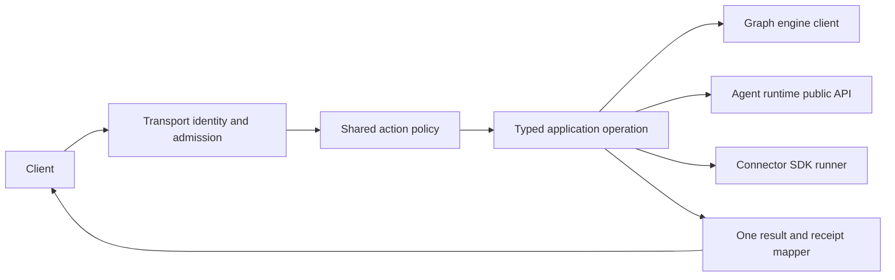

# Architecture and implementation plan

## Existing wiring to reuse

| GraphOS module | Existing responsibility | Required change |
|---|---|---|
| `graph_os.mcp_server.server`, `runtime`, `composition`, `bootstrap` | FastMCP entrypoint, lifecycle and composition | Keep one loop and one multiplexer. Move dependency-specific construction behind public ports and fail closed on unavailable contracts. |
| `graph_os.gateway` | REST routes, catalog and widget projection | Adapt routes to the same application operation and authorization decision as MCP. Keep vendor calls in admitted fleet tools. |
| `graph_os.a2a` | Agent Card and task projection | Reuse the host application service, never create a task/event store. |
| `graph_os.webui_host` | Optional WebUI co-service | Submit to owner loop; keep browser presentation in the WebUI package. |
| `graph_os.control_plane` | Policy and reconciliation orchestration | Keep hosted decisions here while durable provenance and graph state use the engine client. |
| `graph_os.deployment` | Configuration and operator commands | Reuse one XDG configuration resolver and publicly installable extras. |

`graph_os.mcp_server.bootstrap` and `graph_os.a2a.routing` currently contain dependency-internal imports. Treat them as migration inventory, not approved architecture. A port is a narrow protocol describing the methods GraphOS actually calls; its adapter imports the dependency's supported public API. If a public method is missing, add it to the owning package and pin a released version before deleting the old import. Do not mirror the private implementation in GraphOS.

## Request path

The transport adapter parses and bounds a payload, authenticates identity, applies origin/CSRF requirements where applicable, and constructs an immutable request. `action`, `tenant`, `resource`, `scopes`, `policy_version`, `idempotency_key` and `correlation_id` are typed; the trusted principal comes from transport admission. Policy runs before an effect or delegated call. The operation returns typed data or a typed error; transport adapters only encode them. Redacted structured logs carry the correlation and receipt identity, never secrets.

## Migration sequence

1. Inventory each GraphOS-to-AU import and each duplicate host/module. Label its owner and the public port it needs. Cover eager, lazy and type-only imports.
2. Add missing public dependency ports in their owners and test them through installed wheels. Replace GraphOS call sites by capability, beginning with identity/config, graph client and agent execution; no package-wide compatibility alias.
3. Reconcile gateway, deployment, MCP, fleet, A2A and messaging copies against the public behavior tests. Delete old duplicate script registration after parity.
4. Make owner-loop submission a single service and verify co-service lifecycle, reload and cancellation under concurrent sessions.
5. Run the boundary census and served parity tests on a clean environment; record exact package versions and source hashes in `tasks.md`.

## Design constraints

New adapters remain small and cohesive. Before adding a class, inspect an existing `graph_os.*` port and route; extend the owning module where its contract fits. Avoid duplicate decision trees, hand-maintained action catalogs, hidden fallback authority and broad `except` that turns denial into success. A dependency contract mismatch returns a typed unavailable error and an observable receipt. A temporary migration shim must have one caller, one removal task and a test preventing expansion.

Cross-repository work is sequenced by public package release: engine/SDK/AU contract first, GraphOS adapter second, client projection last. Public dependency versions in `pyproject.toml` and `uv.lock` express the minimum required API; no unpublished sibling path is a required test input.

## Startup configuration design (GRAPHOS-HOST-R010)

Existing code: `core/config_admin.py:51` reads four hosting variables and validates ports and profiles.
`mcp_server/server.py:164` currently loads agent-runtime configuration before constructing the server.
Reachable today: the four-field helper exists; complete declaration composition and startup validation are missing.

The proposed immutable `HostEnvironmentManifest` uses schema version 1 and an ordered declaration list.
Each declaration carries `name`, `component`, `source_revision`, `type`, `required_when`, `default`, `sensitive` and `call_sites`.
Sort by component and name; reject conflicting duplicate names rather than depending on import order.
Types are string, boolean, integer, URI, path and secret reference, with explicit bounds and enum values.
Require public declaration producers for enabled SDK and agent-runtime components before claiming complete ecosystem coverage.
Those producer contracts are prerequisites; the current four-field helper does not provide them.

Resolve configuration once, validate, then bind an immutable snapshot before constructing transports or starting children.
Retain existing XDG precedence; this definition grants no new environment override or permission source.
Named reasons are `environment_undeclared`, `environment_missing`, `environment_malformed`, `environment_conflict` and `environment_manifest_unavailable`.
Return names and reasons without resolved values. Validate ports against 1 through 65535.
Use seeded declaration ordering permutations to prove identical normalized manifest digests and refusal sets.

Preservation: R010.1 retains the complete original ownership and schema acceptance.
All original rows and acceptance remain binding; narrower startup children cannot replace their evidence.

## Detected harness installation (GRAPHOS-HOST-R008)

Existing code: `deployment/cli.py:67` registers one harness; `:77` delegates a fence installer to agent-runtime internals.
`core/` currently contains the configuration owner, not a complete generic installer or harness detector.
Reachable today: the existing registration command is callable; generic detected-only installation is missing.
Extend that command with a proposed `install-harnesses` subcommand rather than creating another installer service.
Use versioned adapters for detection, parsing, managed-section edits and supported hooks.
Support absence explicitly; do not create a harness directory merely because its adapter exists.

`HarnessInstallation` schema version 1 records adapter, version, executable identity, configuration root and positive detection evidence.
`HarnessConfigurationChange` records destination, before digest, proposed bytes digest, managed sections and installation identity.
Validate roots and all proposed artifacts before applying; use conditional replacement with idempotent managed sections.
Recheck each original digest immediately before replacement. Preserve unknown keys, comments and unrelated instructions.
Multi-file interruption reports which artifacts changed; resume by reading actual digests, never by claiming an atomic transaction.
Reasons are `harness_absent`, `harness_unsupported`, `harness_ambiguous`, `configuration_conflict`, `destination_denied` and `installation_incomplete`.
An absent harness produces an observation without writes; unsupported requested configuration produces a refusal.
Supported-hook absence is reported as a capability limitation, never silently described as installed.
R008.1 preserves the complete original module census and every named owner.

## Terminal start and scoped logs (GRAPHOS-HOST-R009/R010)

Existing code: `agent_host/__init__.py:192` starts HTTP synchronously and explicitly excludes the terminal launcher.
`mcp_server/composition.py:65` owns `CoServiceSupervisor`; `:230` starts existing co-services.
`webui_host/webui_co_service.py:104` provides the hosted web service and stop-event lifecycle.
Reachable today: HTTP hosting and supervised web threads exist; terminal start selection and log handoff are missing.

Add `HostLaunchRequest` version 1 with `workspace`, `interfaces`, `web_logs`, `configuration_digest` and authenticated start context.
`interfaces` is exactly `terminal`, `web` or `both`; expose only `--terminal` and `--web` selection flags.
`--terminal --web` chooses both. With neither flag, retain the existing command behavior.
`web_logs` controls the terminal log subscription; it cannot disable the host's required redacted log sink.
Reject unknown fields. Resolve client availability and workspace authority before opening a listener.

Run terminal-mode HTTP in a supervised background thread; retain the single MCP owner loop and multiplexer.
Co-services submit operations to that loop; never block it waiting on another loop or create another authority.
Keep authenticated host context in the background thread; each network request still authenticates its own caller.
The foreground terminal consumes only public start and log contracts, never agent-runtime internals.
`HostLaunchReceipt` version 1 carries host instance, interface mode, endpoint, workspace binding, log reference and readiness observations.
These are proposed contracts, not existing exports or readiness claims.

Use `<workspace>/agent_data/logs/server.log`, with owner-only file access and validated parent directories.
Do not follow escaping symlinks. Reject incompatible ownership before opening the file.
Default bounds are 10 MiB per file, five retained files and 16 KiB per redacted record.
Sequences increase per host instance; rotation increments a generation and exposes retained sequence bounds.
A shared workspace's `server.log` is host-internal; never pass its descriptor to a tenant client.
Tenant tags inside records do not make a shared descriptor safe.
A descriptor is permitted only for a tenant-exclusive projection whose entire readable contents belong to that authenticated tenant.
Otherwise provide an authenticated filtered stream or opaque reference, bound to tenant, principal, workspace, host instance and generation.
Authorize each descriptor grant and every stream/reference read or reconnect; filter before encoding or sending any bytes.
Descriptor grants contain bounded immutable snapshots; new records require a newly authorized grant.
Never accept a client-provided tenant or workspace as authority. Revocation and expiry end further delivery.
Private projections require tenant-specific access control even when two tenants use the same workspace.
If filesystem access cannot enforce that separation, refuse descriptor delivery and use the authenticated filtered path.
Bind rotations to the same tenant; do not expose another tenant's records, aggregate file offsets or shared sequence metadata.
Expose tenant-local sequence and gap metadata without revealing other tenants' activity.
Record tenant, workspace, host instance, request, sequence, timestamp, severity and redacted message in the host-internal sink.
Filter secrets and raw request bodies before writing; protocol stdout and terminal rendering receive no host log output.
Use bounded delivery; a slow reader must not block serving or create an unbounded queue.
Return an explicit gap when requested history was rotated. Shutdown drains logs and joins owned HTTP threads within five seconds.

Reasons are `invalid_launch`, `client_unavailable`, `workspace_denied`, `log_unavailable`, `log_gap`, `bind_failed` and `shutdown_incomplete`.
Preserve R009.1's original A2A, task-lifecycle and ACP acceptance; logs establish none of those independently.
The terminal consumer is specified by TUI-RUNTIME-R002.2 through R002.6.
Bind R009.5, R009.6 and R010.7 to the public adapters in the amendment below.
Consumer definitions are available; their runtime exports and the authenticated host handoff remain implementation prerequisites.

## Shared transport scaffold (GRAPHOS-HOST-R006/R023)

Existing code: `mcp_server/server.py:164` exposes standard transport arguments and a shared fleet lifecycle.
`runtime._build_server:2208` still imports the agent-runtime server factory; existing R007 owns replacement of that private coupling.
Reachable today: both transport branches exist; this does not establish served parity or complete scaffold conformance.
Keep one public GraphOS entrypoint, one registry and one multiplexer. Do not restore a standalone multiplexer server.
Use typed arguments for transport, bind address, port and security; compare normalized served catalogs under one registry generation.
R006.1 retains all original module ownership; R023.1 retains every tool, ranking, fallback and invocation-policy clause.
The new transport acceptance must use real wire clients, including unauthorized calls and stdout-purity probes.

## Native desktop, visual state, and coding-agent handoff (GRAPHOS-HOST-R029–R031)

- **R029:** After the SDK publishes a typed grant-bound port and certified provider, bind it through `graph_os/api/invoke/pipeline.py:invoke` and `graph_os/api/invoke/executor.py:BoundOperationRuntime.dispatch` (line 273). `OperationRuntime.dispatch` is only a protocol.
- **R030:** Bind observation and state through the same composed dispatch path. Do not add a local state store. Wait for SDK observation and EG state/context contracts.
- **R031:** Use `graph_os/mcp_server/server.py:mcp_server` for host/admission composition. Wait for EG selection, AU harness, and WebUI renderer contracts; do not advertise the complete flow before all ports exist.

## Amendment: authenticated terminal log preference

Extend GRAPHOS-HOST-R009.5, GRAPHOS-HOST-R009.6 and GRAPHOS-HOST-R010.7.
The consumer contract is [TUI-RUNTIME-R002.2 through R002.6](https://github.com/Knuckles-Team/agent-terminal-ui/blob/5ac5e3fec4d590f167d2c6bd694683dbd8950c26/specs/terminal-runtime/plan.md#tui-runtime-r002-consumer-boundary).
This amendment provides definitions only. Keep these host rows SPECIFIED with empty acceptance receipts.

The proposed HostLaunchReceipt version 1 must include required `web_logs: bool`.
It is the effective preference resolved from HostLaunchRequest.web_logs and authorized host configuration.
Use a strict boolean; missing, null and nonboolean values are invalid. Never infer true from a log reference.
Bind this value and the entire receipt to the authenticated host session, host instance, workspace, tenant and principal.
Retain the endpoint, interface mode, readiness, opaque log reference, generation and expiry bindings.
Deliver the receipt through the existing authenticated host/client handoff. Receipt fields alone grant no authority.
A changed binding, unknown version, expired session or missing preference refuses subscription before any log read.
The current runtime has no receipt field or served handoff proving this binding. Until implemented, log viewing stays unavailable and performs zero reads.
Do not fill this gap with an unsigned preference, client-selected scope or filesystem path.

R010.7 resolves terminal, web or both before startup and passes the authenticated effective preference to R009.5.
R009.5 provides `agent_terminal_ui.app.run_host_terminal(receipt: HostLaunchReceipt, *, client: AgentClient, log_reader: HostLogReader | None) -> None`.
Inject the existing authenticated client and the TUI-defined `agent_terminal_ui.client.HostLogReader` implementation.
Its asynchronous method is `read(log_ref: str, *, cursor: str | None, limit: int) -> HostLogBatch`.
GraphOS implements the authorized producer side under R009.3 and R009.4; TUI owns rendering, subscription and cancellation under R002.3 through R002.5.
The reader uses only the opaque reference and reauthorizes each read and reconnect. No new route or file reader is implied.
These signatures are specified consumer interfaces, not claims of existing runtime exports.

Only terminal and both modes with authenticated `web_logs=true` permit TUI log reads.
False or absent preference, web mode, unavailable reader or invalid scope yields zero TUI reads.
Agent interaction remains available when log viewing is disabled or unavailable.
The required redacted host sink stays enabled in every case; the preference controls only the TUI subscription.
Retain all existing tenant isolation, bounded delivery, rotation gaps, shutdown and single-authority requirements.
R009.6 proves this through the real host and public adapter together with TUI-RUNTIME-R002.6.
A controlled adapter can prove only the host handoff, not unified terminal rendering.

## Additional owner requirements

- `GRAPHOS-HOST-R023.3`: Plan the owner work and dependencies defined in requirements.md.
- `GRAPHOS-HOST-R008.6`: Plan the owner work and dependencies defined in requirements.md.
- `GRAPHOS-HOST-R026.6`: Plan the owner work and dependencies defined in requirements.md.
- `GRAPHOS-HOST-R022.1`: Plan the owner work and dependencies defined in requirements.md.
- `GRAPHOS-HOST-R010.8`: Plan the owner work and dependencies defined in requirements.md.
- `GRAPHOS-HOST-R032`: Plan the owner work and dependencies defined in requirements.md.

### 2026-10-16 — Authorized natural-language fallback

R023 fallback uses the registered `query.nl` operation and shared invocation pipeline under `query:nl`. Delete the synthetic descriptor and direct callback path. Absent or unauthorized query operations refuse before dispatch. Preserve all eight tools and ranking behavior.

### 2026-10-17: Refuse unavailable interface requests before startup

R009.2 through R009.6 and R010.7 still lack a verified workspace/session start
authority, authenticated HostLaunchReceipt and tenant-filtered HostLogReader.
Do not derive workspace access from generic caller scopes or WebUI AccessContext.
The connector create_agent_server absorbs enable_terminal_ui, enable_web_ui and enable_web_logs.
It does not provide those capabilities.
Reject explicit enabled requests with client_unavailable before graph creation
or listener startup. Reject non-boolean selections with `invalid_launch`.
Omitted, false and the existing optional web default preserve ordinary HTTP
hosting. This validates refusal only; interface selection, scoped log delivery,
rotation, reconnect and the served host/terminal acceptance remain pending.

### 2026-10-17: Injected workspace log policy (R009.7)

No current EG contract represents host filesystem workspace grants.
Reuse GraphOS SessionAuthority for current owner-verified caller, session reference and expiry.
Trusted composition provides a WorkspaceGrantProvider; missing composition denies every read.
The provider returns an exact tenant, principal, session, workspace, action, policy revision, grant revision and expiry.
No generic scope, request field or WebUI context creates a grant.
HostLogAccess binds opaque references to these facts and one configured host instance.
Each read resolves current session and policy before and after awaiting its record source.
Changed bindings, revocation and expiry suppress delivery. Bounds limit references, batches, records and response time.
The existing connector host registers optional reference and read adapters under /host/logs.
The configured source must provide redacted tenant projections and tenant-local opaque cursors; shared file offsets remain forbidden.
Controlled HTTP fixtures prove this composition contract, not deployed grants, filesystem logging, rotation or terminal rendering.
No persistent credential store, local grant issuer or production configuration is added.
R009.2 through R009.6 and R010.7 retain their full served acceptance.

### 2026-10-17: Required rotating sink and private projections (R009.8)

HostLogRuntime composes the existing session and grant owners with WorkspaceLogSink.
The existing host builder attaches this optional runtime before dispatch.
An authenticated request writes a fixed arrival event before its handler runs.
Bodies, query strings and credential headers never enter the sink.
Sink recording remains active when terminal log viewing is disabled.
Validate ownership, modes and links before opening files relative to a retained directory descriptor.
Rotate at ten MiB and retain five files. Redact records through the existing AU privacy port before writing.
Keep bounded tenant projections and opaque tenant-local cursors; never return shared files or offsets.
This slice uses controlled identity grants with a real sink and HTTP server.
It does not prove deployed policy, durable replay after restart, terminal rendering or full host lifecycle acceptance.

### Source generation admission

R009.8.1 extends WorkspaceGrantProvider decisions with explicit source generations. Caller session identity cannot establish generation entitlement. R009.8.2 retains durable replay and metadata acceptance.
