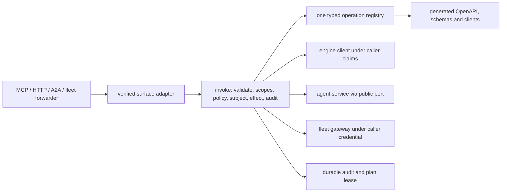

# Hosted API and intent operations — architecture

Status: **READY FOR IMPLEMENTATION**. Delivery: **NOT ACCEPTED**. Governing [spec](spec.md).

## Existing wiring to reuse

`arbora.mcp_server.runtime` owns the served FastMCP loop, verified session scope, 320-second bounded dispatch, and `runtime.graph_client(tenant)`. `arbora.gateway.graph_api.register_graph_routes` composes the REST host. `arbora.fleet.multiplexer` owns per-session loading, forwarding, notifications, and child lifecycle. `arbora.a2a` already has authenticated unary task methods. `arbora.webui_host.mcp_delegation` must use the same public invocation boundary. These are migration seams, not new parallel servers. Engine state belongs to `epistemic-graph`. Decisions, context, traces and durable WorkItems belong to `epistemic-graph`. `agent-utilities` is the agent harness that applies engine decisions. Connector ingestion belongs to `agent-connector-sdk` (SDK-CONNECTOR-CONTROL-R005). Connector effects belong to the SDK and fleet. Arbora authenticates, composes, supervises, routes and projects.

## Component and data flow

Use immutable `OpSpec` data grouped by domain. An engine binding is generated from the versioned packaged method schema; a composite binding names a typed Arbora service function. A curated alias suppresses the corresponding generated `eg.*` op so each wire method has exactly one owner. `Registry.digest` hashes canonical sorted schema and policy metadata. Route/verb factories create a single HTTP and MCP wrapper per operation family, never duplicated per-domain authorization.

The invocation order is: resolve and allowed surface. Strict params including authority-field rejection. Authenticate. Principal kind. Exact caller scopes. Eunomia decision. Caller-side subject access for service execution. Effect preview/confirmation. Durable audit reservation for governed effect. Execute under caller claims or allowlisted service identity. Record outcome. Map to one envelope. The service executor stamps the verified caller as record owner, refuses caller-supplied owner, and rechecks authorization before deferred work. A post-effect audit failure returns an indeterminate receipt and reconciliation handle.

## Wire contracts

`POST /api/v1/ops/{op_id}` accepts the operation's JSON schema; `Idempotency-Key` is required for non-natural write ops. `GET /api/v1/registry` is caller-filtered and returns a digest ETag. `GET /api/v1/ops` and OpenAPI expose only public schema metadata; sensitive discovery is filtered per caller. Resource routes, including identity and fleet catalog paths, are generated from `HttpShape` and use the same handler. `Arbora-Plan-Ref` resumes a plan. HTTP preview returns 428 with `CONFIRMATION_REQUIRED` or `STEP_UP_REQUIRED`. MCP returns the same envelope in tool result. `meta.registry_digest` and `meta.api_version` are mandatory.

The current MCP surface is ARBORA-FLEET-R029: six intent tools plus two Apps launchers. `find` accepts `op` or natural-language `intent`; exact operation IDs and typed params are required before effect. Verb ceilings are enforced (`ask/find/why` read, `write` write, `act` operational effects, `manage` admin). Discovery returns authorized schema descriptors. A bounded cache and tenant/policy-partitioned outcome ranking may improve suggestions. They must never turn fuzzy text into an unconfirmed mutation. Fleet discovery and status use `find`, invocation uses `act`, and mounts/releases use `manage` (ARBORA-FLEET-R029). Reuse ARBORA-FLEET-R011/R013 registry/discovery machinery and ARBORA-OPS-R007/R011/R012; add only missing operation wiring and no duplicate registry or disclosure rollup. Native child forwarding calls `invoke("fleet.call", ...)`; no transport calls bypass it. The child call uses the caller's delegated credential or a declared service-execution rule with the same deputy checks. `ToolAnnotations` classify read/destructive effects; unannotated means write; a reviewed manifest can tighten to admin.

Scopes are exact. `mcp:discover` and `mcp:delegate` do not imply each other; `mcp:admin` is not a super-scope. `finance:read`, `fleet:read/control`, `loops:read/control`, `ops:read/admin` and every operation scope must exist in the public engine registry. `EUNOMIA_TYPE=off` still enforces scopes; enabled PDP failure returns `POLICY_UNAVAILABLE`. Decisions cache at most 30 seconds by principal, revision, item, action; admin/destructive are uncached. A revision invalidates loaded visibility and sends list-change notifications. The enabled/disabled mode behavior is testable with an in-process fixture PDP.

Error source is `engine`, `fleet`, or `arbora`. Engine error codes pass through unchanged from the packaged error contract; Arbora owns one mapping table for its closed enum. Details may include missing public scope names or a public target name, never secrets or private actor/tenant values. Timeouts and unknown outcomes remain typed errors. Stable API compatibility is checked against the merge base of public generated registry artifacts.

## Migration and implementation order

1. Pin a public engine wheel that ships method/error/scope schemas. Add registry data and direct bindings. Check exact coverage and exclusions.
2. Add invocation, policy, error, audit-reservation, and plan-lease services with fixture-backed tests. Reuse verified-session middleware and current server/client composition.
3. Add MCP verbs, multi-kind fleet adapters, HTTP factory and generated clients. Build one end-to-end vertical slice before expanding domain op tables.
4. Add each domain family by moving handlers out of existing registrars. For missing upstream methods, make a typed unavailable op and defer advertisement until a released contract exists.
5. In one integration change, mount the ten resident tools and `/api/v1`. Route loaded forwarders through `invoke` and migrate consumers. Delete duplicate registrars/routes and stale instructions in that same change. Keep one owner loop and one multiplexer instance.
6. Run [test-spec.md](test-spec.md), publish exact revision evidence, then mark individual capabilities `ACCEPTED`.

The retirement inventory is a checked artifact produced from the existing host registration table and the new registry. Each prior tool/route is labeled `mapped` with its new op ID or `dropped` with a reason and consumer search result. The cutover check enumerates FastMCP tools, Starlette routes and A2A methods at runtime and rejects undeclared extras. It also scans source for ad hoc `mcp.tool`, route registration, and child transport dispatch outside the approved factories. A transition is atomic for supported callers: generated client release, server mount, caller migration and old endpoint removal are reviewed together; no permanent fallback dispatcher remains. External clients receive v1 contract and migration note before stable path removal.

## Fresh-checkout and quality design

- Run `uv sync --extra test` and `uv run pytest tests/api tests/fleet`.
- Run `uv run ruff check .` and `uv run ruff format --check .`.
- Run `uv run mypy arbora` with public pinned wheels and fixture identities.
- CI may provision an ephemeral local engine/agent stack for served tests. No check requires a private host or credential.
- Repository hooks run CCCC, KISS, jscpd, and Dupehound scans. Meet configured thresholds, including zero new clone pairs. Do not lower or suppress them.
- Keep registry domain tables small. Prefer step tables over nested branching. Use one endpoint factory per surface and generated declarative types. Avoid repeated function bodies.
- Eliminate the old implementation during cutover. Scanners and reviewers must see one authority.

## Gateway carry-over: dashboard, Live Artifacts, widget

Cross-repo IDs: AU-BOUNDARY-R001.2, AU-BOUNDARY-R001.3, AU-BOUNDARY-R001.7 (agent-utilities deletions); ARBORA-HOST-R005. Provenance: agent-utilities commits 0eb67c99c (dashboard router), 902f906ca (Live Artifacts router), 7717d2e62 (genius_agent widget).

Deleted dashboard router (prefix `/api/dashboard`, read capability on every route except `/health`; write capability on mutations; capabilities gateway:read, gateway:write, gateway:admin, admin; API-key callers unrestricted):
- GET `/layout` and PUT `/layout`: read and persist the dashboard layout (shared YAML, reads always go back to disk).
- GET `/data`, GET `/data/{service_id}`: widget data for all or one service; the id must match a safe pattern, unknown service returns 404.
- GET `/full`: layout and data in one call. GET `/data-subset?widget_id=...`: only the named widgets, loaded concurrently, never computing unsubscribed ones.
- GET `/widgets`: widget types available. GET `/discover`: layout auto-discovered from the MCP config.
- GET `/health`: always 200 with the shared truthful health report, `Cache-Control: no-store`.
- GET `/daemon/status`, GET `/daemon/shards`, POST `/daemon/start`: consolidated background daemon state, engine shard topology and reachability, ensure daemon running.
- POST `/hydrate/{source}`, POST `/hydrate`, GET `/hydration-status`: trigger hydration for one or all sources, and read source status. 422 on a malformed source, 500 when no active engine, sanitized error payloads.

Deleted Live Artifacts router (no router-level auth in the old module):
- POST `/api/artifacts`: create from name, template, data, source query, source node ids and model. Provenance records model, query and evidence ids. Bounded-JSON violation returns 400. Response is artifact id and rendered output.
- GET `/api/artifacts/{artifact_id}`: full artifact, 404 when absent.
- POST `/api/artifacts/{artifact_id}/refresh`: with inline `data` the body becomes the new derivation. Otherwise a registered source resolver re-derives from the graph (the default resolver preserved prior data). Returns ok, reason and rendered output. 404 when absent. A failed refresh preserves the prior render.
- Stores: the shared Live Artifact store and refresh service, a module singleton. Caller: `server/app.py` mount only; the KG source installer was deleted with the router.

Deleted Agent summary widget: dashboard tile with type genius_agent, env prefix GENIUS_AGENT and observability category. Its fields were agents, skills, mcp_tools and status. Its data call returned hardcoded numbers and never contacted anything.

### Design in this repository

- Dashboard: owned by the existing dashboard router module and its aggregator, config manager and registry under the gateway package. No new module; add census and capability tests only.
- Live Artifacts: new router module `arbora/gateway/artifacts_api.py` (to be created) with typed request model, a store port and a refresh port declared in the gateway ports module, and a register function that mounts the three routes. The store and refresh service come from a public `agent_utilities.api` export (prerequisite row); arbora never imports the agent-utilities knowledge-graph package directly.
- Pass the source resolver as a port argument, never a module global. The host supplies a graph-backed resolver. The default preserves prior data.
- Agent summary widget: nothing to build.

### Wiring

- Dashboard: the register function in the dashboard router module mounts routes and the websocket; already called by the host.
- Artifacts: the host composition point already mounts graph and usage routes. It calls a new register function for artifacts. Authentication: reuse the dashboard capability dependencies unchanged, as decision D3 states below. Use gateway:read for GET and gateway:write for POST, plus the gateway:admin and admin supersets. These are identity capabilities, not engine registry scopes. The old router had no router-level check, so this is an intentional tightening, called out in the parity table.
- Config: the artifact store location follows the agent-utilities store default; no new env key.

Out of scope:

Out of scope: moving the Live Artifact store or refresh service from agent-utilities. Also out of scope: new dashboard widgets, layout-format changes, and an MCP artifact tool. The research-artifact tool is unrelated.

### Caveat resolutions (design, 2026-10-10)

#### D2 Dashboard route parity (CONFIRMED by reading both files)

Compared `git show 0eb67c99c^:agent_utilities/gateway/api.py` (328 lines) with `arbora/gateway/dashboard_api.py` (389 lines). Both define the same 15 REST routes. The only addition is the websocket `/ws/dashboard` (moved from agent-webui; not part of the old router). Shared helpers are line-for-line equal: `_SERVICE_ID_RE`, the read and write capability sets (`gateway:read`, `gateway:write`, `gateway:admin`, `admin`; write excludes `gateway:read`), API-key callers unrestricted, the `/health` exemption in the read dependency, fail-closed 403 when capability resolution raises, and `Cache-Control: no-store` on health. Supporting modules differ only in import paths, a naive-UTC `_naive_utcnow` replacing deprecated `datetime.utcnow` in `models.py` (same value), and a new service-session in `aggregator.py`.

| Method and path | Auth | Request / response shape | Refusals | Result |
|---|---|---|---|---|
| GET /layout | read | none / `DashboardLayout` | 403 | CONFIRMED-equal |
| PUT /layout | write | `DashboardLayout` / `{"status":"saved"}` | 403 (write), 422 (body) | CONFIRMED-equal |
| GET /data | read | none / `dict[str, WidgetData]` | 403 | CONFIRMED-equal |
| GET /data/{service_id} | read | none / `WidgetData` | 403; 404 on bad id or "not found" error | CONFIRMED-equal |
| GET /full | read | none / `DashboardResponse` | 403 | CONFIRMED-equal |
| GET /data-subset | read | repeated `widget_id` / `dict[str, WidgetData]`; default `[]` became `None` and `set(widget_id or ())`, same empty result | 403 | CONFIRMED-equal |
| GET /widgets | read | none / `list[WidgetListItem]` | 403 | DIFFERS: same shape, but the registry module map lives in `arbora/gateway/registry.py`. The set of widget types is not compared in any test (row R001.8) |
| GET /health | none | none / health report | none (always 200) | CONFIRMED-equal |
| GET /discover | read | none / `DashboardLayout` | 403 | CONFIRMED-equal |
| GET /daemon/status | read | none / daemon status dict | 403 | DIFFERS: now `arbora.gateway.daemon.daemon_status`; the module was refactored and its key set is not pinned (row R001.5) |
| GET /daemon/shards | read | none / shard topology dict | 403 | DIFFERS: same wire; still imports `agent_utilities.knowledge_graph.core.shard_topology`, an internal module (row R001.6) |
| POST /daemon/start | write | none / daemon status dict | 403 | DIFFERS: same as /daemon/status (row R001.5) |
| POST /hydrate/{source} | write | none / hydration result dict | 403, 422 bad source, 500 no engine, 400 `ValueError`, 500 sanitized | DIFFERS: refusal codes equal. Engine and hydration come from AU internal modules (row R001.7) |
| POST /hydrate | write | none / hydration result dict | 403, 500 no engine, 500 sanitized | DIFFERS: same (row R001.7) |
| GET /hydration-status | read | none / status dict | 403 | DIFFERS: same (row R001.7) |

No route is missing. The capability resolver still imports internal agent-utilities modules core.config and security.identity. This dependency difference belongs to R001.9. Decision: use the engine client session and source-sync methods required by ARBORA-HOST-R002 for shard, hydration, and active-engine state. Do not add another agent-utilities public API export. Row R001.6 first tests whether the installed client exposes these methods. If not, block that row on the engine client owner. Keep present imports until then.

#### D3 Live Artifacts authentication (DECIDED; not blocked)

Evidence: `arbora/api/registry/scopes.py` exports `FinanceScope`, `FleetScope`, `LoopsScope`, `OpsScope`; `arbora/api/policy/domain_scopes.py` lists `fleet:events` and `webui:{admin,maintainer,reader,user}`. The pinned engine `contract/scopes.json` (175 rows, the file `eg_binding._load_scopes` reads and `tests/api/test_registry_factory.py` checks for "unregistered EG scope") has no `gateway:*` row. So `gateway:read` and `gateway:write` are NOT registry scopes. They are identity capabilities that the dashboard resolves from the identity group capability map (`_dashboard_capabilities`). The earlier text calling them "already in the engine contract" was wrong and is corrected above.

Decision: the artifact routes use the same dependencies as the dashboard routes (`_require_dashboard_read` for GET, `_require_dashboard_write` for POST, reused from `dashboard_api.py`, not copied). Behaviour matches sibling routes and no engine change is needed. Gateway scopes need no addition to the engine. `EG-IDENTITY-R007` registers `identity:admin`, `loops:read` and `loops:control` and is unrelated. The `loops:*` scopes are absent from the pinned `scopes.json` today. That is the concern of that row. Alternative rejected: map to registry scopes `webui:reader`/`webui:user`; those are the WebUI role namespace. That mapping creates a second authorization model for one gateway.

#### D4 Agent-utilities export for artifacts (CONFIRMED; proposed AU row)

Read `agent_utilities/knowledge_graph/live_artifacts/`. Public names: `LiveArtifact`, `Provenance`, `BoundedJSONError`, `validate_bounded_json`, `render_template` (models.py); `LiveArtifactStore`, `get_live_artifact_store`, `ArtifactWriter` (store.py); `RefreshService`, `RefreshResult`, `DataSource` (refresh.py); `kg_source_resolver` (kg_source.py). `install_kg_artifact_source` imports the deleted `agent_utilities.gateway.artifacts_api` and always logs a failure; it must not be exported.

Proposed agent-utilities row (orchestrator adds it; new file `agent_utilities/api/live_artifacts.py`, re-exported from `agent_utilities/api/__init__.py`):

> `AU-BOUNDARY-R013.<n>` **Export the Live Artifact store, models and refresh service.** Re-export `LiveArtifact`, `Provenance`, `BoundedJSONError`, `validate_bounded_json`, `LiveArtifactStore`, `get_live_artifact_store`, `RefreshService`, `RefreshResult`, `DataSource` and `kg_source_resolver` from `agent_utilities.knowledge_graph.live_artifacts` through `agent_utilities.api.live_artifacts`; delete the dead `install_kg_artifact_source`. Verification: an agent-utilities test imports each name from `agent_utilities.api` and the layout fence still passes.

Because the AU resolver already re-runs `source_query`, ARBORA-OPS-R040.8 wires `kg_source_resolver` instead of re-implementing it (no parallel function). The bounded-JSON limits (depth 8, 100 keys, 500 items, 16 KiB string, 256 KiB total) stay in the AU validator. The arbora request model does not copy them.

## Run read operations

### Model and owner boundaries

`ARBORA-OPS-R021.4.1` through `.6` define the producer contract for both clients.
The `runs` module, models, adapter and registry entries do not exist in current main.
Arbora must authenticate, route and project reads. It must not collect counters, select configuration or compute aggregates.

[EG orchestration vocabulary](https://github.com/Knuckles-Team/epistemic-graph/tree/main/specs/orchestration-vocabulary) owns the trace and query contracts.
[AU harness evolution](https://github.com/Knuckles-Team/agent-utilities/tree/main/specs/harness-evolution) owns run mechanisms.
`AU-HARNESS-R017.3` collects counters. `AU-HARNESS-R017.4` forwards them through the ordered `_record_execution_trace` writer.
`EG-ORCH-VOCAB-R009.15` through `.17` own validated ingestion and readback.
Those rows prove graph readback; they do not promise a dedicated `get_run_summary` engine method.
The adapter must use a published engine client contract. Missing client support blocks implementation, not the entire operation registry.

### Explicit per-run mapping

Arbora wire and generated client models must use the snake_case fields below.
Views must consume those fields without reading RDF names or guessing aliases.

| Engine source | Arbora `runs.get` field | View meaning |
|---|---|---|
| `terminationReason`, `EG-ORCH-VOCAB-R009.1` | `termination_reason` | Recorded terminal reason |
| `peakContextTokens`, `EG-ORCH-VOCAB-R009.2` | `peak_context_tokens` | Peak tokens, not current occupancy |
| `contextBudgetTokens`, `EG-ORCH-VOCAB-R009.3` | `context_budget_tokens` | Run context budget |
| `costUsd`, `EG-ORCH-VOCAB-R009.8` | `cost_usd` | This run's cost in USD |
| `appliedHarnessConfig`, `EG-ORCH-VOCAB-R009.9` | `harness_config_ref`, `harness_config` | Committed decision reference and authorized projection |
| AU `PlanState`, `AU-HARNESS-R014.1` | `current_plan` | Separate run-state snapshot described below |

The applied configuration must resolve the recorded decision edge under the same caller authority.
`harness_config` projects `context_policy`, `plan_scaffold` and `action_space`; it must not recompute the current configuration.
Missing values must remain null with explicit availability metadata. A measured zero must remain zero.
The adapter must reject malformed producer values rather than silently coerce them.

### Aggregate semantics

`RunMetricsParams` selects optional `model_profile_ref`, `task_class` and a bounded time window.
The engine must apply filters before aggregation. Arbora must preserve the engine's grouping keys and evidence.
`EG-ORCH-VOCAB-R010` defines solved as `final_answer` with `evaluationScore` equal to 1.0.
`EG-ORCH-VOCAB-R010.1` supplies `success_rate`; `.3` supplies `overflow_rate`, grouped by model and task class.
`.2` supplies `cost_per_solved_task_usd`, grouped by model, task class and applied configuration reference.
The numerator includes costs from all traces; the denominator includes solved traces only.
Zero solved traces must yield null cost and explicit abstention, never zero, infinity or a mean per run.
The ambiguous `cost_per_task_usd` name must not enter this unimplemented API.
The result must keep different query groupings separate. Arbora must not broadcast pair-level rates onto configuration groups.
Any `run_count` must come from the engine for the same filter and grouping, never a client-side count.
`cost_usd` belongs only to `runs.get`; aggregate cost must never populate that per-run field.

### Current-plan read boundary

`ARBORA-OPS-R021.4.5` must expose `current_plan` as a read-only projection with explicit availability.
A present snapshot must contain `run_id`, a producer revision, observation time, and ordered `items`.
Items preserve AU `PlanItem.text` and status: `pending`, `in_progress`, or `done`.
An empty available item list differs from an unavailable snapshot.
The producer must bind the snapshot to the requested run and caller authority.
Arbora must reject mismatched runs, malformed items and regressing revisions within one reader session.
Unavailable, expired or inaccessible state must carry no items and must not appear current.
The producer must define expiry and revision semantics before Arbora accepts a snapshot as current.

`AU-HARNESS-R014.1` through `.5` own mutable scaffold state and injection outside stored history.
They specify no public snapshot export, authority binding, revision or expiry contract today.
The AU owner must extend R014 with that public read contract before this projection becomes available.
Arbora must not invent an AU method, persist the scaffold, or reconstruct it from stored messages.
Any durable graph projection needs an EG-owned contract first; R009 does not supply one.
`runs.get` may return trace fields while `current_plan` remains explicitly unavailable.
Clients must offer no plan mutation control. This read contract does not move harness or engine responsibilities.

### Wiring and evidence

REST `POST /api/v1/ops/{op_id}` and MCP must enter the existing invoke pipeline under `ARBORA-OPS-R009`.
`handle_runs_get` and `handle_runs_metrics` must resolve `run_trace_reader` through `bound_service`.
`arbora/api/ops/retrieval.py:81` supplies the existing service-binding pattern.
`arbora/api/ops/registry_factory.py` supplies registration; `ARBORA-OPS-R025` owns generated artifacts.
Planned tests must enter those served surfaces, verify authority propagation, and observe the engine result or refusal.
A protocol import or mocked handler alone must not count as served evidence.

## ARBORA-OPS-R042 content screening and redaction

Data flow: POST route (arbora/api/http/routes.py:127) → `invoke` (arbora/api/invoke/pipeline.py:810) → screen → effect → redactor → response and trace.

Types: `ContentScreenVerdict`, `ScreenFinding` (class, span, rule id), `ContentOrigin`. The screen attaches in `invoke` after argument validation and before the effect; the redactor attaches after the effect. Failure behavior: quarantine returns a typed refusal, and a redactor error withholds the response.

Reused: the body bound at arbora/api/http/routes.py:42 and the `OpError` refusal path. New: the screen, the redactor and the origin tag.

Decision: one screen inside the single pipeline boundary. Rejected alternative: per-route filters, which a new route may skip.

Cross-repository: engine memory-write refusal, owner prefix `EG`, contract name memory write origin.

### References

- no-arXiv: AI Agent Traps (Franklin et al., SSRN 6372438, 2026).
## Policy lifecycle operations that guard plans (ARBORA-OPS-R050)

Data flow: `policy.create` over POST /api/v1/ops/{op_id} -> `_base_authority` (arbora/api/invoke/pipeline.py:208) -> `_policy` (:198) -> `PolicyAuthority.authorize` (arbora/control_plane/policy/repository.py:179) -> audit record.

Types: `PolicyEntity`, `ConstitutionSource`, `PolicyChange`. Failure: `POLICY_DENIED` or `POLICY_UNAVAILABLE`, never a partial change.

Existing code: arbora/control_plane/policy/repository.py:100, :117, :129, :179; arbora/control_plane/policy/models.py:203; arbora/api/ops/policy.py:36; arbora/api/invoke/pipeline.py:198, :208, :218. Reachable today: no. `PolicyAuthority` has no production constructor.

Decision: Arbora serves the operation and admits plans, and the engine decides violation. Rejected: a policy evaluator inside Arbora, which duplicates engine decisions. Cross-repository: EG-DECISION-ENGINE-R001 owns policy decisions; Arbora owns authenticated operation admission and transport. Clause interpretation requires a published engine producer contract, not an AU policy evaluator.

## Scoped security-evaluation operation (ARBORA-OPS-R051)

Data flow starts with `security.evaluate` over POST /api/v1/ops/{op_id}. `_effect` (arbora/api/invoke/pipeline.py:218) checks verified target authorization before calling new public EG selection/verdict adapters (EG-DECISION-ENGINE-R001/R138). The AU harness executes admitted probes. The engine returns the verdict, which is recorded in the audit record. Runtime limits and trace commits use EG-DECISION-ENGINE-R133; Decide itself remains read-only.

Types: `EvaluationGoal`, `EvaluationCatalog`, `EvaluationScope`, `Finding`. Failure: `SUBJECT_ACCESS_DENIED` before any attack runs.

Existing code: arbora/security/security_policy_middleware.py:52; arbora/api/ops/registry_factory.py. Reachable today: no. Search terms used: red team, attack, scorer, jailbreak, target scope.

Decision: EG owns catalog facts, selection and probe verdicts (EG-DECISION-ENGINE-R001/R138); AU executes the selected probes; Arbora admits by scope and serves the result. Reuse this R051 consumer instead of adding another security-evaluation rollup. Missing engine ports remain unavailable.

References:
- arXiv:2605.04019 — Dheekonda et al., "Redefining AI Red Teaming in the Agentic Era: From Weeks to Hours" (2026)

## Authorization-segmented virtual schema projections (ARBORA-OPS-R052)

Data flow: `query.projections` over POST /api/v1/ops/{op_id} -> `build_operation_runtime` (arbora/api/invoke/bootstrap.py:167) -> `scope_covers` -> audit record.

Types: `SchemaProjection`. Failure: `SUBJECT_ACCESS_DENIED` or `UNAVAILABLE`.

Existing code: arbora/api/ops/_common.py:106; arbora/api/http/openapi.py:1; arbora/control_plane/agents/repository.py:81. Reachable today: no for projections. Search terms used: virtual schema, schema_context, projection, authorization boundary.

Decision: Arbora filters by the caller's verified grants over engine labels. Rejected: Arbora-side boundary inference. Cross-repository: EG-IDENTITY-R001, EG-FEDERATED-QUERY-R001; ARBORA-DATA-MARKET-R005 owns schema_context.

Caller-visible responses, counts, refusal details, traces and audit views reveal no uncovered projection, including indirectly through a withheld count. Such counts may exist only in a separately authorized operator audit that the denied caller cannot read. Served acceptance holds visible projections fixed while varying hidden projections. It checks that caller-visible fields stay unchanged. The denied caller's operator-audit read must refuse without count leakage. The separately authorized operator must be permitted to inspect the count.

## Bounded interaction space (ARBORA-OPS-R053)

Data flow: `retrieval.space` over POST /api/v1/ops/{op_id} -> the governed retriever entry (arbora/control_plane/retrieval/service.py:61) -> `union_top_k` -> audit record.

Types: `InteractionSpace`, `CorpusBoundary`, `QueryDirectory`. Failure: `LOAD_CAP_EXCEEDED`, `INVALID_ARGUMENT`, `UNAVAILABLE`.

Existing code: arbora/api/ops/retrieval.py:60, :77; arbora/control_plane/retrieval/service.py:37, :61. Reachable today: no for the governed retriever; yes for `retrieval.search`. Search terms used: bm25, top_k, interaction space, working dir, corpus.

Decision: the engine ranks and Arbora bounds the space. Rejected: returning ranked snippets only. Cross-repository: EG-FEDERATED-QUERY-R001 supplies query results, EG-DECISION-ENGINE-R029 chooses retrieval plans, EG-DECISION-ENGINE-R137 supplies context limits, and SDK-CONNECTOR-CONTROL-R005 supplies connector ingestion. AU executes engine-directed exploration.

References:
- arXiv:2606.06880 — Zhuang, Ni, Fun, Lin, Ma, "Towards Retrieving Interaction Spaces for Agentic Search" (2026)

Research citations above describe inspiration only. The engine and transport contracts, verified authority boundaries and served acceptance requirements define the architecture.

## Versioned memory files (ARBORA-OPS-R024.4)

### Producer and existing boundary

[EG-DURABLE-KERNEL-R085](https://github.com/Knuckles-Team/epistemic-graph/tree/c0b952776129fd509b9f87b411a298593c2591ec/specs/durable-graph-kernel) owns authoritative content, versions, conflicts and sync evidence.
R085 is a producer definition. Its merge does not establish runtime availability.
R084.3, R084.4 and R084.6 remain concurrency prerequisites, not a file-sync contract.
Arbora owns hosted file projection, authenticated serving and materialization acknowledgments.
AU remains an EG-driven harness. WebUI displays returned state and submits edits.

Current `arbora/api/ops/memory.py` defines tenant-scoped generic `memory.read` and `memory.write` through `MemoryStore`.
`handle_memory_read` at line 65 and `handle_memory_write` at line 74 resolve the existing `memory_store` binding.
The current models contain no revisions, conflict retention, cursors or materialization evidence.
Extend that module and service binding; do not add another authoritative store or reinterpret generic writes as versioned saves.
Existing R024.4 evidence covers the generic operations only. Each new child requires independent acceptance.

### Proposed Arbora operation contracts

These IDs define the Arbora consumer contract; they are not registered runtime capabilities yet.
All calls use `POST /api/v1/ops/{op_id}` and the corresponding resident MCP verb.

| Proposed operation | Parameters and result | Producer | Scope |
|---|---|---|---|
| `memory.files.read` | Document ID and optional exact revision; authorized snapshot, sync state and conflict references | `ReadMemorySnapshot`, R085.1/.2/.4 | `memory:read` |
| `memory.files.list` | Optional kind, limit 1–100 and opaque cursor; metadata-only page and next cursor | `ListMemorySnapshots`, R085.1/.2/.4 | `memory:read` |
| `memory.files.save` | Generated submit or resolve action with its exact precondition and content; generated tagged outcome | `SyncMemorySnapshot`, R085.1/.3/.4 | `memory:write` |

The scope names already exist for generic memory operations. Generated EG scope admission remains mandatory under R006.
The adapter must preserve generated field names and tagged variants without a second permissive schema.
Creation must use EG's explicit absent-head precondition. Missing expected revision must never mean unconditional overwrite.
An update binds expected revision, expected digest, exact UTF-8 bytes and candidate digest.
Resolve also binds the retained conflict and current accepted revision.
Arbora must not normalize newlines or recompute the engine's conflict decision.
R085.1 bounds content to 1 MiB, document IDs to 256 bytes and logical paths to 1024 bytes.
Arbora must enforce body bounds before allocation or effects and preserve stricter serving limits explicitly.
Kinds are observations, reflections, profile and active_context.
Cursor scope, ordering, authorization and expiry remain EG decisions under R085.2.
The client must restart pagination after a refused cursor, never silently combine different snapshots.

### Tagged outcomes and non-disclosure

Preserve EG's applied, observation_retained, conflict_retained, materialization_acknowledged and refused variants.
There must be no shared accepted-head field outside the authorized variants.
Refused contains only a registered error code and request-local correlation identity.
It must contain no head, existence, revision, digest, conflict reference or stored receipt.
Denied existing, absent and refused creation responses must have the same caller-visible shape and disclosure.
`ARBORA-OPS-R010` envelope mapping must not add result-derived metadata to a refusal.
Caller-visible logs, status views and error details must not recover withheld metadata.

An authorized stale save may return conflict_retained only after EG durably retains both versions under R085.3 and R085.7.
That outcome is not an authorization refusal and must not become a generic error that loses its content references.
Arbora must preserve accepted and submitted contents, digests and provenance in authorized hosted conflict artifacts.
The accepted head remains unchanged. Storage failure must not claim conflict retention or successful materialization.
Only an authorized exact-head resolve may change that head.
EG controls retention and named holders; hosted artifact deletion must not release engine history independently.

### Hosted files and observation-generation acknowledgments

A new host adapter must project snapshots under a configured hosted-memory root.
The root and capability wiring attach beside `build_operation_runtime` at `arbora/api/invoke/bootstrap.py:167`.
Use validated logical paths below that root; reject absolute paths, traversal, duplicate paths and symlink escapes.
Host paths are private implementation details, never engine paths or caller-controlled authority.
Write through an atomic replacement that preserves unobserved local edits; do not overwrite concurrent edits silently.
The host must durably submit an observed edit through EG observe_file before replacing its contents.
Unobserved or pending edits must block replacement until the engine admits their treatment.
A failed observation or retention request must preserve the local file and withhold acknowledgment.

The materializer reads the authorized snapshot and observation_generation before writing.
It binds graph incarnation, document ID, accepted revision, digest, observation_generation and materialization attempt in the acknowledgment.
Only the verified host materializer may invoke acknowledge_materialization through the same engine-backed port and governed authority path.
Browser save bodies must reject observe_file and acknowledge_materialization actions.
A client assertion or successful filesystem call alone must never establish in_sync.
EG atomically checks both the head and generation under R085.6.
A newer observed edit invalidates an old acknowledgment even if the accepted revision is unchanged.
Pending edits and unresolved conflicts prevent in_sync; missing evidence yields unavailable.
Arbora must display EG's in_sync, graph_ahead, file_ahead, conflict or unavailable without a local competing state machine.
Crash recovery must reread EG evidence and current hosted bytes before retrying materialization or acknowledgment.

### R009 authority and R013 idempotency alignment

The generated HTTP route must enter `invoke` at `arbora/api/invoke/pipeline.py:810` before calling the memory port.
Use its verified tenant, principal, graph incarnation and policy; request bodies must not replace them.
Recheck access for read, list page, save, conflict artifacts and host acknowledgment.
Use R013 authentication, cookie CSRF checks and idempotency handling without a private bypass route.
Bind mutation identity to the exact action, graph incarnation, document, precondition, bytes and digest.
Bind acknowledgment identity to observation generation and materialization attempt as well.
Same-identity, same-body replay must preserve the original receipt without repeating mutation or file effects.
Same identity with another body must refuse. Replay after revocation must not reveal a cached authorized result.
Arbora journal integration must preserve EG's durable idempotency identity rather than minting another identity on retry.
Existing R009/R013 delivery evidence does not prove these new memory-specific requirements.

### WebUI consumer mapping

[WEBUI-APPS-R031](https://github.com/Knuckles-Team/agent-webui/tree/main/specs/arbora-app-surface) remains the existing presentation owner.
This Arbora change does not edit or deliver WebUI requirements.

| Consumer row | Arbora prerequisite | Required alignment |
|---|---|---|
| WEBUI-APPS-R031.2 | R024.4.1–.3 and .6 | `listMemoryFiles` uses memory.files.list; `saveMemoryFile` uses memory.files.save; exact content uses memory.files.read |
| WEBUI-APPS-R031.3 | R024.4.2 and .6 | The real Files tab uses registered generated contracts through WebUI's `invoke` in `src/lib/arbora-api/invoke.ts` |
| WEBUI-APPS-R031.4 | R024.4.3 and .5 | Display both versions only for authorized conflict_retained; refused contains no versions or head |
| WEBUI-APPS-R031.7 | R024.4.4–.6 | Prove two-client conflict, restart readback and generation-bound acknowledgment through real served components |

Producer order is R085 implementation and generated contracts, Arbora port and serving, host materializer, then WebUI consumption.
Missing producer implementation must remain unavailable. Definitions and planned tests must never count as served receipts.

## Owner-bound projections (ARBORA-OPS-R054–R058, R061, R063)

- **R054:** Keep `rlm.benchmark` separate from serving-technique evidence. Add a projection through `arbora/api/ops/registry_factory.py:get_registry` and `arbora/api/invoke/pipeline.py:invoke` only after `AU-INTEGRATION-R014` publishes its producer and receipt.
- **R055:** Bind a read/proposal projection through the shared registry/invoke path only after AU publishes liveness and proposal contracts. No Arbora termination adapter exists.
- **R056:** Keep `decide.commit` unchanged. Add a distinct review projection through the shared registry/invoke path. Wait until EG/AU publish the review operation and evidence contract.
- **R057:** Add no repository-writeback attachment until EG `R094.2/.3/.5/.7` and SDK source-effect/receipt contracts publish. The current Arbora tree has no serializer or served handler.
- **R058:** Use the existing schema-context routes/service for read-only data. Add no table mutation or statistics until WebUI and EG publish their contracts.

### ARBORA-OPS-R061: indexed usage projection

1. Bind the Arbora read to EG RunTraceUsageQueryV1 / EG-ORCH-VOCAB-R010.101; derive tenant only from verified caller claims and pass the producer's bounded window, model/project/agent grouping, currency, page size, and snapshot cursor.
2. Extend the usage.py reader with closed UsageQueryV1 and UsageProjectionV1 models. Add a distinct usage.index.query port beside usage.read. Use existing usage:read, build_read_op, registry_factory, and shared invoke. Keep accounting separate from runs.metrics (R021.4.3/.4) and usage.read.
3. Preserve four disjoint EG counters, producer totals, unknown reasons, pinned PriceTableV1, minor units, revisions, coverage, watermark, and cursor. Aggregate exact rational amounts by final group and category. Apply half-even rounding once. Keep unknown values unknown with reasons and coverage; never use zero. Keep currencies separate unless EG supplies pinned FX. Bind p95 <= 500 ms from authenticated-handler entry through serialized response. Use 1,000,000 indexed traces, 32 readers, and 1,000 fixed-window queries. Bind data/index/cache-policy revisions. Missing or invalid profile evidence is unavailable; an exceeded bound is not success.
4. Connect the projection to WebUI ObservabilityView.tsx under WEBUI-APPS-R004.8.1-.6. Served proof compares groups with an independent EG ledger. It exercises authorization, pagination, unknown values, stale revisions, and absent, invalid, or exceeded profile evidence. This remains planned work, not runtime delivery.

### ARBORA-OPS-R063: retrieval evaluation and context projection

1. Bind the EG-DECISION-ENGINE-R100.100 DecisionEval ranking receipt. Map RetrievalRankingSubmit to RetrievalRankingV1. Map Method::RetrievalContextSearch to RetrievalContextSearchV1. Do not derive quality from retrieval.search or local RRF.
2. Extend arbora/api/ops/retrieval.py with closed evaluation, comparison, and context models. Register retrieval.evaluation.compare and retrieval.context.search. Use existing build_read_op, memory:read, registry factory, and shared invoke for HTTP/MCP.
3. Require identical corpus, complete label-set revision/digest, query-set ID/revision/digest, evaluator revision, k, and query inputs across algorithms. Pin each algorithm's settings digest to its own registered configuration. Preserve producer metrics and result digests. For hits_at_k, use the full identically labeled query set as denominator. Count a query when any relevant result appears in top k. Preserve half-open UTF-8 offsets into original stored text. Bind query/index/authorization revisions and a snapshot cursor. Limit responses to 100 spans and 8 KiB each. If indexing normalizes text, preserve a separate NFC digest and validate its byte map to original text.
4. Align WebUI TryItPanel.tsx under WEBUI-APPS-R001.1.1-.6. Served proof checks two-algorithm metrics and identical inputs. It tests hostile-source escaping before highlighting and preserves original byte spans. It also checks Unicode slicing, authorization, staleness, missing labels, invalid maps, and limits. This remains planned work, not runtime delivery.

## Additional owner requirements

- `ARBORA-OPS-R024.1.1`: Plan the owner work and dependencies defined in requirements.md.
- `ARBORA-OPS-R014.1`: Plan the owner work and dependencies defined in requirements.md.
- `ARBORA-OPS-R022.3`: Plan the owner work and dependencies defined in requirements.md.
- `ARBORA-OPS-R022.4`: Plan the owner work and dependencies defined in requirements.md.
- `ARBORA-OPS-R053.7`: Plan the owner work and dependencies defined in requirements.md.
- `ARBORA-OPS-R021.2.1.1`: Plan the owner work and dependencies defined in requirements.md.
- `ARBORA-OPS-R050.2.1`: Plan the owner work and dependencies defined in requirements.md.
- `ARBORA-OPS-R009.1`: Plan the owner work and dependencies defined in requirements.md.
- `ARBORA-OPS-R053.8`: Plan the owner work and dependencies defined in requirements.md.
- `ARBORA-OPS-R059`: Plan the owner work and dependencies defined in requirements.md.
- `ARBORA-OPS-R060`: Plan the owner work and dependencies defined in requirements.md.
- `ARBORA-OPS-R062`: Plan the owner work and dependencies defined in requirements.md.
- `ARBORA-OPS-R064`: Plan the owner work and dependencies defined in requirements.md.
- `ARBORA-OPS-R065`: Plan the owner work and dependencies defined in requirements.md.
- `ARBORA-OPS-R066`: Plan the owner work and dependencies defined in requirements.md.

## Projection bindings and producer prerequisites (R059, R060, R062, R064–R066)

These operation names and schemas are proposed contracts. No new operation is registered by this specification change.
All six projections reuse the current authenticated invocation path.
HTTP enters `arbora/api/http/routes.py:make_endpoint` at line 96.
MCP enters `arbora/api/mcp/verbs.py:dispatch_verb` at line 377 and `_invoke_and_render` at line 259.
Both reach `arbora/api/invoke/pipeline.py:invoke` at line 810.
Register approved declarations in `arbora/api/ops/registry_factory.py:get_registry` at line 16.
Bind verified caller authority before producer access; client-supplied tenant fields cannot select authority.
Derive scopes from the published EG contract. Missing scope or owner method keeps the operation unavailable.
A proposed method name below describes an owner specification, not an existing runtime export.

### R059: evolution metrics

Extend `arbora/api/ops/usage.py:operations` and its composed reader for `evolution.proposals.metrics`.
The producer is `EG-ORCH-VOCAB-R010.100`, proposed `Method::EvolutionTraceMetrics` and `EvolutionTraceMetricsV1`.
Preserve proposal, prompt, metric-window, metric, progress, and trace IDs, revisions, and digests.
Preserve ordered trace references, missing IDs, measured/unknown states, units, and partial coverage.
Missing traces never become zero; trace counts and calibration never substitute for AU progress.
The AU progress-to-ordered-run producer schema remains unassigned. Its publication blocks positive served acceptance.
Map the result to WEBUI-APPS-R004.7 without joining or authoring progress in the browser or host.
Planned proof: `tests/api/test_evolution_metrics_served.py::test_proposal_metrics_preserve_owner_join_and_denial`.
Independently read two stored traces, their metrics, and AU progress through authenticated HTTP and MCP.
Refuse stale windows, changed digests, unknown prompt revisions, and foreign tenants without data disclosure.

### R060: harness sessions

Extend the existing usage reader and registry for manifest, discovery, browse, search, and cost projections.
SDK-SOURCE-INGEST-R013 owns `connector-sync --once` and the complete source-operation manifest.
EG-ORCH-VOCAB-R009.101 specifies `Method::SearchHarnessSessions` over the `IndexHarnessSessionBatch` projection.
Session costs use EG-ORCH-VOCAB-R010.101 accounting, currency, and coverage semantics.
Arbora reads those authorities; it cannot create another session index or author a supported-source list.
Require a complete owner-approved manifest with source operations, revisions, authority, cursor forms, and coverage.
That manifest remains an external prerequisite; do not infer supported harnesses from example fixtures.
Use page sizes from 1 through 100 and preserve the producer's snapshot-bound cursor.
Bind manifest and sync receipt digests, indexed revision, source identity, missing sources, and explicit refusal states.
Return unavailable sources in coverage without revealing their protected session metadata.
Planned proof: `tests/api/test_sessions_served.py::test_full_manifest_sessions_and_costs_survive_restart`.
Exercise two available sources and a third unavailable source through HTTP, MCP, and WEBUI-APPS-R006.4.
Check independent trace readback, replay, restart, cursor paging, cost units, unknown prices, and cross-tenant refusal.

### R062: graph changes

EG-DURABLE-KERNEL-R043.100 specifies `Method::OpenGraphSnapshot` and `Method::ReadGraphChanges`.
Extend the composed read operations in `arbora/api/ops/memory.py:operations` for feed and recovery projection.
Preserve graph incarnation, committed revision, event identity, visibility revision, snapshot digest, and high-water cursor.
Use producer page sizes from 1 through 256 and the 24-hour retention contract.
Reauthorize every page and reconnect. Expiry returns typed recovery; revocation stops protected delivery.
The existing registry does not supply a graph-feed transport adapter. Its authenticated bounded adapter remains required.
Do not substitute `arbora/gateway/fleet_events.py`, which reports fleet events rather than committed graph changes.

The proposed `graph-visible-v1` profile uses two browsers and 10,000 nodes with 20,000 edges.
Two writers each commit five updates per second for 60 seconds after a 10-second warm-up.
Measure 600 updates from durable acknowledgement to both authorized browsers applying the corresponding revision.
Use synchronized measurement timestamps and record clock uncertainty; uncertainty above 10 ms invalidates qualification.
Require nearest-rank p95 at most 2,000 ms for each browser and no missing final revision.
The EG feed's separate 1,000 ms boundary ends at authorized feed read, not browser application.
WEBUI-APPS-R030.8 owns readable-layout and interaction limits; their declaration and evidence remain separate prerequisites.
Planned proof: `tests/api/test_graph_changes_served.py::test_two_clients_recover_and_reauthorize_committed_feed`.
Exercise concurrent writes, duplicates, delayed/reordered events, gaps, expiry, reconnect, and revocation.
A missing profile, measurement, adapter, or owner binding cannot produce a passing latency result.

### R064: viewport queries

Extend `arbora/api/ops/retrieval.py:operations` with viewport and selection handlers using its composed EG reader.
EG-FEDERATED-QUERY-R081.103 owns `ViewportQueryV1` through `Method::UnifiedQuery` and `Method::ResolveViewportSelection`.
Preserve its scatter/line formulas, typed axes, source/index/viewport revisions, policy digest, and closed selection union.
Pixel dimensions range from 1 through 4096; the requested byte ceiling ranges from 1 through 16777216.
Apply the producer's effective serialized-response ceiling and bin formulas. Do not invent a host decimator.
Refuse ceilings too small for the mandatory envelope, stale indexes, invalid selections, and exceeded limits before usable output.
Planned proof: `tests/api/test_viewport_served.py::test_billion_point_viewport_keeps_bins_selection_and_byte_bounds`.
Enter HTTP and MCP with scatter and line requests against a declared billion-point indexed source.
Independently inspect serialized bytes and bin counts. Check pan, zoom, selection, gaps, and stale-token refusal with WEBUI-APPS-R001.2.

### R065: meetings

Extend the composed operation declarations in `arbora/api/ops/memory.py:operations` for transcript and summary reads.
Route provider effects through the existing invocation policy and receipt boundary, never through a read handler.
SDK-SOURCE-INGEST-R014 owns ordered transcript transport and selected provider dispatch.
EG-MEDIA-VOCAB-R001.101 specifies `Method::MeetingTranscriptRevision`, `MeetingSummaryContextV1`, and `CommitMeetingSummaryV1`.
AU-SEMANTIC-R030 owns provider admission, retry/attempt accounting, and disabled-provider refusal.
The SDK meeting operation and AU receipt contract remain unbound; single-shot dictation cannot satisfy them.
Preserve segment sequence, correction and finalization revisions, transcript digest, and selected local/hosted provider identity.
Summary context requires at most 128 spans, 16384 bytes per segment, and 8192 tokens under the EG limit policy.
Only the current complete finalized transcript permits summary effects. Corrections stale older summaries.
Missing admission or a disabled local provider cannot trigger hosted fallback.
Planned proof: `tests/api/test_meeting_served.py::test_corrected_final_transcript_binds_selected_summary_provider`.
Exercise partial segments, gaps, corrections, exact replay, finalization, and both admitted execution classes with WEBUI-APPS-R001.5.
Check independent provenance readback and zero provider calls for stale revisions or denied capture/egress.

### R066: bookmarks

Extend `arbora/api/ops/retrieval.py:operations` with search, relationship, and bounded export projections.
EG-MEDIA-VOCAB-R001.102 specifies `Method::BookmarkSemanticSearch` and `Method::BookmarkRelations`.
SDK-SOURCE-INGEST-R005.7 through R005.12 owns ingestion into the existing SourceIngest/ChangeEnvelope path.
Use one authorized snapshot for search, relationships, and CSV/JSON export consumed by WEBUI-APPS-R001.6.
Require at most 100 hits, 500 relationships, and 1048576 serialized response bytes under the EG query limit policy.
Preserve receipt, source, index, query, authorization, snapshot, and limit-policy digests and explicit unknown metadata.
An expired snapshot or exceeded bound refuses; export cannot silently switch revisions or truncate success.
Escape spreadsheet-formula-like CSV cells; never retrieve imported links or execute imported instructions.
Planned proof: `tests/api/test_bookmarks_served.py::test_search_relationships_and_exports_share_authorized_snapshot`.
Independently compare search and relationships with downloaded CSV/JSON records, digests, and provenance.
Denied bookmarks and relationships must be absent from every response, count, and export.

All named proofs in this section are planned and have not run.
They require the corresponding owner contracts and real authenticated HTTP, MCP, and browser consumer paths.
This section grants no delivery or runtime evidence.

References: [EG orchestration](https://github.com/Knuckles-Team/epistemic-graph/blob/88572345d7aa8bcc7cad40904f35e2411c701243/specs/orchestration-vocabulary/spec.md), [EG durable kernel](https://github.com/Knuckles-Team/epistemic-graph/blob/88572345d7aa8bcc7cad40904f35e2411c701243/specs/durable-graph-kernel/spec.md), [EG query](https://github.com/Knuckles-Team/epistemic-graph/blob/88572345d7aa8bcc7cad40904f35e2411c701243/specs/federated-query-and-reasoning/spec.md), [EG media](https://github.com/Knuckles-Team/epistemic-graph/blob/88572345d7aa8bcc7cad40904f35e2411c701243/specs/media-and-personal-vocabulary/spec.md), [SDK ingest](https://github.com/Knuckles-Team/agent-connector-sdk/blob/a0f78fefbb486e4c7d97e608462cf5847a46bc7d/specs/SDK-SOURCE-INGEST/spec.md).

### 2026-10-16: Generated Python invocation boundary

R025.1 extends the existing scripts/gen_api.py emitter. Validate operation IDs
against its packaged registry before transport. Compare every response digest
with the generated registry identity before returning the envelope. Preserve
matching refusal details. Full R025 still requires deterministic generation from
a compatible engine contract and packaged artifacts.

### 2026-10-16 — Separate deterministic and natural-language queries

`query.uql` remains deterministic under `query:unified`; `query.nl` is the authorized resolver fallback under `query:nl`. The latter binds its inner graph from the verified caller and preserves provider planner-unavailable refusals. No scope is automatically granted. Remaining SQL, search, indexes and analytics acceptance under R018.2 remains deferred.

### 2026-10-16: R025.2 packaged schema references

Generate each provider schema document once per artifact surface. Registry
snapshots and OpenAPI components reference those documents. Keep the provider
pointers, schema hashes and canonical registry digest unchanged. Resolve packaged
references locally for Python consumers and compatibility checks. Reject missing
resources, invalid pointers and paths outside the generated schema directory.
Preserve all registered operations and resolved schema meaning. Hoist curated
OpenAPI definitions so every local reference resolves.

The wheel includes the registry and shared schema documents. Acceptance covers
clean installed-wheel use, missing and unsafe references, deterministic generation
and equality of resolved schemas. This proof does not establish a live server.

### 2026-10-17: R025.2 canonical client and OpenAPI schemas

Share schema reference resolution between generation and the installed client.
Keep the generic transport invoker as one runtime source. Generate only its
operation identifiers and registry identity. Reuse identical curated OpenAPI
schemas through component references. Preserve resolved schemas, provider hashes,
registry identity and installed-wheel behavior. Validate reference closure and
scanner acceptance without exclusions or reduced thresholds.

Run the canonical hosted scanner for generator, generated artifact and scanner
workflow changes in pull requests. Keep publication limited to release tags.

## Parity composed operations (ARBORA-OPS-R801 to R842)

Each row composes served `eg.<domain>.<Method>` operations (see `arbora/api/registry/eg_binding.py`) into one operation or skill for a named consumer. No row adds an engine method. Writes go through the governed change path and carry `Confirm.PLAN`.

| Row | Operation | Engine methods | Consumer |
|---|---|---|---|
| `ARBORA-OPS-R801` | `graph.nodes.list` | `eg.graph.GetNodesByLabel`, `eg.graph.GetNodeProperties`, `eg.graph.GetEdgesPage`, `eg.graph.GetNeighbors` | agent-webui graph browser (`/graph/nodes`, `/graph/relationships`) |
| `ARBORA-OPS-R802` | `graph.view.read` | `eg.graph.GetSubgraph`, `eg.graph.SummariesAtLevel`, `eg.graph.SummaryChildren`, `eg.compute.ClusterHierarchyClusters`, `eg.compute.ClusterHierarchyExpand`, `eg.ingestion.Viz` | agent-webui graph 3D and level-of-detail view (`/graph/graph3d*`, `/graph/viz/*`) |
| `ARBORA-OPS-R803` | `graph.stats.read` | `eg.graph.NodeCount`, `eg.graph.EdgeCount`, `eg.graph.Metrics`, `eg.cluster.ListGraphs` | agent-webui graph statistics (`/graph/stats`) |
| `ARBORA-OPS-R804` | `graph.schema.read` | `eg.reasoning.GraphSchema`, `eg.reasoning.GraphSchemaList`, `eg.reasoning.GraphSchemaClasses`, `eg.reasoning.OntologyInspect` | agent-webui graph schema (`/graph/node-types`) |
| `ARBORA-OPS-R805` | `graph.edges.write` | `eg.graph.AddEdge`, `eg.graph.RemoveEdge`, `eg.graph.SupersedeEdge`, `eg.security.GovernedChange` | agent-webui graph links (`/graph/link`) |
| `ARBORA-OPS-R806` | `graph.impact.read` | `eg.compute.GetBlastRadius`, `eg.compute.GetShortestPath`, `eg.graph.GetNeighbors`, `eg.compute.PageRank` | agent-webui impact analysis (`/graph/impact/{symbol}`) |
| `ARBORA-OPS-R807` | `code.context.read` | `eg.query.UnifiedQuery`, `eg.query.Uql`, `eg.compute.GetBlastRadius`, `eg.graph.GetNeighbors`, `eg.graph.GetNodesByLabel` | agent-webui code navigation (`/code/nav`, `/code/instances`); workspace graph_code intent |
| `ARBORA-OPS-R808` | `kb.articles.read`, `kb.articles.write` | `eg.graph.GetNodesByLabel`, `eg.graph.GetNodeProperties`, `eg.graph.AddNode`, `eg.graph.CompareAndSetNodeFields`, `eg.ingestion.SemanticSearch`, `eg.query.GetContentVersion` | agent-webui knowledge bases (`/kb/*`) |
| `ARBORA-OPS-R809` | `sdd.documents.read`, `sdd.documents.write` | `eg.graph.GetNodesByLabel`, `eg.graph.GetNodeProperties`, `eg.graph.AddNode`, `eg.graph.CompareAndSetNodeFields`, `eg.query.GetContentVersion` | agent-webui spec-driven development (`/sdd/*`) |
| `ARBORA-OPS-R810` | `agents.library.list`, `agents.library.write` | `eg.storage.AgentLibrary`, `eg.storage.AgentTemplate`, `eg.storage.AgentComponent`, `eg.storage.AgentGraph` | agent-webui agent library, resources, agent list and info (`/agent-library/*`, `/resources*`, `/agents`, `/info`) |
| `ARBORA-OPS-R811` | `agents.reload` | `eg.storage.AgentLibrary`, `eg.cluster.FleetCatalog` | agent-webui agent reload (`/reload`) |
| `ARBORA-OPS-R812` | `agents.goals.run` | `eg.coordination.SubmitWorkItem`, `eg.coordination.WorkOfferPut`, `eg.coordination.GetWorkItem`, `eg.coordination.CancelWorkItem`, `eg.query.Decide` | agent-webui autonomous goals (`/goals*`) |
| `ARBORA-OPS-R813` | `ops.maintenance.run` | `eg.graph.Maintain`, `eg.graph.Consolidate`, `eg.graph.DecaySweep`, `eg.graph.PruneByLifecycle`, `eg.storage.Backup` | agent-webui graph maintenance (`/maintenance/*`) |
| `ARBORA-OPS-R814` | `ingest.pipeline.run` | `eg.ingestion.SourceIngest`, `eg.ingestion.SourceIngestStatus`, `eg.ingestion.ParseFile`, `eg.ingestion.SemanticIndex` | agent-webui ingestion pipeline (`/pipeline/*`) |
| `ARBORA-OPS-R815` | `prompts.graph.read`, `prompts.graph.write` | `eg.graph.GetNodesByLabel`, `eg.graph.GetNodeProperties`, `eg.graph.AddNode`, `eg.graph.CompareAndSetNodeFields`, `eg.query.GetContentVersion` | agent-webui graph prompts (`/prompts/graph*`) |
| `ARBORA-OPS-R816` | `prompts.library.read` | `eg.storage.AgentLibrary`, `eg.storage.AgentTemplate` | agent-webui prompt library and system prompt (`/prompts*`, `/system`) |
| `ARBORA-OPS-R817` | `fleet.servers.manage` | `eg.cluster.RegisterServer`, `eg.cluster.ListRegisteredServers`, `eg.cluster.FleetCatalog`, `eg.cluster.CatalogAssign`, `eg.cluster.CatalogRemove` | agent-webui MCP server registry (`/mcp/servers*`, `/mcp/server-schema`) |
| `ARBORA-OPS-R818` | `schedule.tasks.read` | `eg.coordination.ListWorkItems`, `eg.coordination.GetWorkItemOutcome`, `eg.storage.TsRange` | agent-webui scheduled tasks (`/cron/calendar`, `/cron/logs`) |
| `ARBORA-OPS-R819` | `workflows.run`, `workflows.write` | `eg.storage.AgentGraph`, `eg.storage.AgentAssemble`, `eg.storage.AgentComponent`, `eg.coordination.SubmitWorkItem`, `eg.graph.GetSubgraph`, `eg.query.GetContentVersion`, `eg.transactions.BatchUpdate` | agent-webui workflows (`/workflows*`); CQ-ORCH-R006; process-model connectors |
| `ARBORA-OPS-R820` | `ontology.objects.read`, `ontology.objects.write` | `eg.reasoning.GraphSchemaClasses`, `eg.reasoning.OntologyInspect`, `eg.reasoning.ShaclValidate`, `eg.graph.GetNodesByLabel`, `eg.graph.AddNode`, `eg.transactions.BatchUpdate` | agent-webui ontology explorer (`/ontology/*`) |
| `ARBORA-OPS-R821` | `markets.signals.read` | `eg.compute.FinanceForensicReport`, `eg.compute.FinanceBrierScore`, `eg.compute.FinanceKellyFraction`, `eg.graph.GetNodesByLabel`, `eg.graph.GetNodes` | agent-webui markets app (`/api/apps/markets/*`) |
| `ARBORA-OPS-R822` | `identity.verify` | `eg.security.GetIdentity`, `eg.security.CheckAccess`, `eg.security.Identity` | agent-webui identity gate (verifies tokens locally until this is served) |
| `ARBORA-OPS-R823` | `decide.claims.reconcile`, `decide.claims.explain` | `eg.graph.Reconcile`, `eg.query.ResolveConflict`, `eg.query.ExplainEvidence`, `eg.query.ExplainBelief`, `eg.query.EpistemicStatus`, `eg.coordination.GapUpsert`, `eg.coordination.GapTransition` | evolution flywheel (research-scanner, agent-utilities-evolution) |
| `ARBORA-OPS-R824` | `decide.promotion.submit` | `eg.graph.PolicyEvolution`, `eg.security.GovernedChange`, `eg.storage.DecisionCommit`, `eg.query.Decide`, `eg.coordination.SubmitWorkItem` | evolution flywheel promotion gate; agent control plane |
| `ARBORA-OPS-R825` | `feedback.corrections.record` | `eg.security.GovernedChange`, `eg.storage.DecisionCommit`, `eg.transactions.BatchUpdate`, `eg.graph.AddNode` | graph_feedback intent (workspace delegate-first loop) |
| `ARBORA-OPS-R826` | `remediation.playbooks.route` | `eg.messaging.CepSubscribe`, `eg.messaging.CepPoll`, `eg.messaging.RegisterTrigger`, `eg.messaging.FiredTriggers`, `eg.query.Decide`, `eg.coordination.WorkOfferPut`, `eg.coordination.GapUpsert` | service-health goal; messaging-channel incident replies |
| `ARBORA-OPS-R827` | `skill:comparative-analysis` | `eg.ingestion.SourceIngest`, `eg.compute.ResolveCandidates`, `eg.compute.Vf2SubgraphMatch`, `eg.compute.ComputeSimilarityEdges`, `eg.coordination.GapUpsert`, `eg.graph.AddNode`, `eg.ingestion.SemanticSearch` | comparative-analysis skill; research-scanner |
| `ARBORA-OPS-R828` | `usage.read`, `usage.price_catalog.write` | `eg.storage.TsDefineSeries`, `eg.storage.TsAppend`, `eg.storage.TsRange`, `eg.storage.TsWindow`, `eg.graph.AddNode`, `eg.query.Uql` | dashboard usage and cost views; usage importers |
| `ARBORA-OPS-R829` | `incidents.record`, `incidents.read` | `eg.messaging.CepSubscribe`, `eg.messaging.CepPoll`, `eg.messaging.RegisterTrigger`, `eg.messaging.FiredTriggers`, `eg.graph.AddNode`, `eg.graph.CompareAndSetNodeFields`, `eg.compute.MineRootCause` | arbora incident routes; service-health goal |
| `ARBORA-OPS-R830` | `access.graph_ownership.infer`, `access.graph_ownership.apply` | `eg.security.RbacAdmin`, `eg.security.GovernedChange`, `eg.security.CheckAccess`, `eg.security.GetIdentity`, `eg.reasoning.GraphSchemaList`, `eg.cluster.ListGraphs` | agent-webui graph admission; governance tools |
| `ARBORA-OPS-R831` | `retrieval.search` | `eg.query.NlQuery`, `eg.ingestion.SemanticSearch`, `eg.ingestion.SemanticIndex`, `eg.graph.GetNeighborsBatch`, `eg.graph.GetSubgraph`, `eg.query.UnifiedQuery`, `eg.compute.CommunityDetection`, `eg.compute.ClusterHierarchyExpand`, `eg.graph.GetNodesByLabel`, `eg.reasoning.Sparql` | served `retrieval.search`; agent-webui `/graph/search`, `/graph/magma`; messaging recall |
| `ARBORA-OPS-R832` | `query.uql` | `eg.reasoning.ShaclValidate`, `eg.query.Uql`, `eg.query.UnifiedQuery` | orchestration competency (CQ-ORCH-R004) |
| `ARBORA-OPS-R833` | `ingest.extraction.ground` | `eg.ingestion.ParseFile`, `eg.compute.MatchOntologyTerms`, `eg.transactions.ApplyChangeEnvelopeDrafts`, `eg.reasoning.ShaclValidate`, `eg.reasoning.OntologyInspect` | document and genealogy prose ingest; CQ-XSRC concept grounding |
| `ARBORA-OPS-R834` | `traces.read` | `eg.query.ExplainProvenance`, `eg.query.ExplainProvenanceByIds`, `eg.query.Uql`, `eg.query.UnifiedQuery`, `eg.storage.TsRange`, `eg.storage.TsWindow`, `eg.graph.GetSubgraph` | dashboard trace views; orchestration run-trace review |
| `ARBORA-OPS-R835` | `orchestration.questions.ask` | `eg.storage.AgentAssemble`, `eg.storage.AgentLibrary`, `eg.storage.CapabilityCoverage`, `eg.storage.GuardrailEntailment`, `eg.storage.AgentGraph`, `eg.query.Decide`, `eg.query.ExplainProvenance`, `eg.reasoning.ShaclValidate` | orchestration competency exit gate (questions Q1 to Q8) |
| `ARBORA-OPS-R836` | `placement.plan.read`, `placement.plan.apply` | `eg.cluster.PlacementAdmin`, `eg.cluster.RebalancePlan`, `eg.cluster.RebalanceExecute`, `eg.coordination.UpdateResourceHost`, `eg.coordination.ResourceStatsPage`, `eg.cluster.ClusterMembers` | host placement during deployment and genesis |
| `ARBORA-OPS-R837` | `ingest.repositories.link_owners` | `eg.ingestion.IndexRepository`, `eg.query.UnifiedQuery`, `eg.graph.AddEdge`, `eg.compute.ResolveCandidates` | service-ownership questions; cross-source grounding |
| `ARBORA-OPS-R838` | `ingest.foreign_sources.register`, `ingest.foreign_sources.sync` | `eg.cluster.RegisterForeignSource`, `eg.query.QueryForeignColumns`, `eg.query.GraphQl`, `eg.query.CypherQuery`, `eg.ingestion.SourceIngest`, `eg.transactions.ApplyChangeEnvelopeDrafts`, `eg.messaging.CdcRead` | database, event-stream and document connectors |
| `ARBORA-OPS-R839` | `code.health.sweep` | `eg.ingestion.IndexRepository`, `eg.compute.GetBlastRadius`, `eg.query.UnifiedQuery`, `eg.coordination.GapUpsert` | code-health sweep (dead pathway detection) |
| `ARBORA-OPS-R840` | `ingest.sessions.sync` | `eg.ingestion.SourceIngest`, `eg.transactions.ApplyChangeEnvelopeDrafts`, `eg.ingestion.ParseFile`, `eg.graph.AddNode` | agent session transcript ingest; feed reader intake |
| `ARBORA-OPS-R841` | `ingest.packs.validate` | `eg.storage.ConnectorPack`, `eg.reasoning.ShaclValidate`, `eg.reasoning.OntologyInspect`, `eg.graph.AddNode` | skill library ingest; universal-skills |
| `ARBORA-OPS-R842` | `actions.run` | `eg.graph.ApplyMutation`, `eg.transactions.TxnPlanWriteback`, `eg.storage.WriteBack`, `eg.security.GovernedChange`, `eg.reasoning.ShaclValidate`, `eg.transactions.BeginTxn`, `eg.transactions.Commit` | agent-webui actions |

## ARBORA-OPS-R843 — replaced tool wrappers

The pinned engine contract generates one `eg.<domain>.<Method>` operation per callable method (`ARBORA-OPS-R008`). The wrapper modules in agent-utilities call the same methods through an in-process client. A harness that reaches arbora over MCP or `fleet.call` needs none of them. `ARBORA-OPS-R843.2` records where each remaining module goes.

## Amendment 2026-10-18: SDK current-plan contract adoption

ARBORA-OPS-R021.4.5.1 consumes SDK-CONNECTOR-CONTROL-R070 through the SDK's published package. Replace the local item, snapshot, read and request definitions with the SDK models. Keep the existing caller forwarding, read-only operation, scope, unavailable shape and freshness projection. Regenerate the API registry and check wire compatibility. A real SDK-created read must pass projection; body-supplied tenant or principal must fail before calling the reader.

This migration does not compose a producer, grant run access, choose a run owner, change authentication, or implement runs.get. An absent reader stays unavailable. The release and dependency lock must resolve from PyPI before this consumer change ships. Lease-bound publication remains an EG dependency; the pending run-owner admission policy must not be inferred from worker identity.

The consumer stays on the SDK 0.2 release line for this change. SDK 0.3 changes the default MCP tool surface and requires separate compatibility acceptance. Successful task admission or these DTO tests do not prove live tool execution. The reported agents.run refusal for an unavailable native tool remains a separate served acceptance requirement.

## Web research operation (R067)

`research.web` is one served operation. It composes owners; it decides nothing. The engine answers the search as a virtual source (`EG-UNIFIED-DATA-PLANE-R038.7.7`). The engine selects the pages (`EG-DECISION-ENGINE-R802`). A connector reads each page through the SDK contract (`SDK-SOURCE-INGEST-R005.40`). The engine ingests and enriches each page (`EG-UNIFIED-DATA-PLANE-R651.7`).

Call path: served route -> `invoke` (`arbora/api/invoke/pipeline.py:863`) -> `research.web` handler (`arbora/api/ops/research.py`) -> engine query -> engine `Decide` -> engine work item of kind `WebPage` -> SDK ingest worker -> connector `web_extract` -> engine `SourceIngest`.

Backends: `webarchiver` (`CONN-WEBARCHIVER-WEB-SOURCE`) is primary. `archivebox` (`CONN-ARCHIVEBOX-API-WEB-SOURCE`) is secondary and the fallback for `upstream_failed` or an unreachable primary. A policy refusal never falls back. Both backends produce the same Document; only the recorded backend differs.

Reuse: the ingest runner port of `ARBORA-OPS-R020.1`, the job status read of `ARBORA-OPS-R020.3.1.2` and the open-web screen of `ARBORA-OPS-R042`. The `web-crawler` skill of universal-skills calls this operation (`US-WEB-RESEARCH-R001`).

Budget: 5 pages and a 60 s deadline by default, with at most 32 pages and 300 s. These are starting defaults. A measurement on this platform replaces them.

## Connector sources through the SDK sync runner (ARBORA-OPS-R020.6)

Depends-on: [SDK source sync runner](https://github.com/Knuckles-Team/agent-connector-sdk/blob/main/specs/SDK-SOURCE-INGEST/spec.md)

Arbora serves connector sources. It owns admission, scopes and the durable job. The SDK owns the declarations and the runner. The engine owns `SourceIngest`, KV and WorkItems. No engine change is needed.

Call path for `ingest.sources.sync`: `invoke` → `sync_source` (`arbora/ingest/service.py`) → `ConnectorIngestRunner.sync_source` (`arbora/ingest/connector_sources.py`). The runner submits and claims one WorkItem of kind `arbora.ingest.source_sync` through `arbora/work_items.py`. It then runs `SourceSyncRunner.sync` with a session over `LateFleetGateway.call`. Each tool call passes fleet admission with the read effect. The runner commits the WorkItem outcome after the run.

`ingest.sources.list` reads the configured fleet servers. For each server it calls the read-only `<prefix>_ingest_sources` tool. A server without the tool contributes no source. `ingest.sources.status` reads the shared KV checkpoint `ingest-source/<connector>/<source>`.

A sync is resumable. The KV checkpoint keeps the cursor and the record digests after each accepted batch. A later sync with a new idempotency key resumes from that checkpoint.
