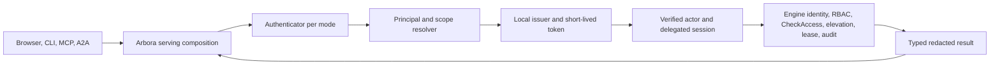

# Design — ARBORA-IDENTITY-ACCESS

Governing spec: [spec.md](spec.md). Rows: [requirements.md](requirements.md).

## Summary

Delivery phase: P1

Rows `ARBORA-IDENTITY-R030.1` to `.3` serve P1, because a coding client and the terminal UI need a native sign-in before any scenario can enter through the public boundary.

This plan serves the rows of `ARBORA-IDENTITY` in requirements.md. It keeps the earlier design record under Phase 1. The north star and the delivery phase of the spec close the plan.

## Technical Context

- **Language/Version**: Python 3.14 (floor 3.12)
- **Primary Dependencies**: Named per row in requirements.md.
- **Storage**: The medulla engine. Arbora holds no durable store of its own.
- **Testing**: pytest. Each row names the test and the proof level that it needs.
- **Target Platform**: Linux hosts and CI runners
- **Project Type**: Service and command-line tools
- **Performance Goals**: N/A. A row states its own budget when it has one.
- **Constraints**: Public files stay neutral and portable. A row states any further limit.
- **Scale/Scope**: The rows of requirements.md.

## Constitution Check

- **I. One owner per concept**: No departure is recorded in this plan; the rows carry the proof.
- **II. Extend before you create**: No departure is recorded in this plan; the rows carry the proof.
- **III. Specs describe the current state only**: No departure is recorded in this plan; the rows carry the proof.
- **IV. Requirements are neutral and controlled**: No departure is recorded in this plan; the rows carry the proof.
- **V. Hard cutover, no legacy path**: No departure is recorded in this plan; the rows carry the proof.
- **VI. Names carry no version suffix**: No departure is recorded in this plan; the rows carry the proof.
- **VII. One engine, no second database, no sync**: No departure is recorded in this plan; the rows carry the proof.
- **VIII. Ask the graph, not a bespoke operation**: No departure is recorded in this plan; the rows carry the proof.
- **IX. Connectors depend on the SDK and are called through arbora**: No departure is recorded in this plan; the rows carry the proof.
- **X. Every ontology class rolls up to the core**: No departure is recorded in this plan; the rows carry the proof.
- **XI. Code stays small, simple and unduplicated**: No departure is recorded in this plan; the rows carry the proof.
- **XII. No ratchets and no suppressions**: No departure is recorded in this plan; the rows carry the proof.
- **XIII. Zero flakes**: No departure is recorded in this plan; the rows carry the proof.
- **XIV. Compile first, then review**: No departure is recorded in this plan; the rows carry the proof.
- **XV. Python 3.14 standard, 3.12 floor**: No departure is recorded in this plan; the rows carry the proof.
- **XVI. Install and deploy only from published releases**: No departure is recorded in this plan; the rows carry the proof.
- **XVII. Publish the gate's tool before the gate**: No departure is recorded in this plan; the rows carry the proof.
- **XVIII. Landed means reachable**: No departure is recorded in this plan; the rows carry the proof.
- **XIX. A tag push publishes, with no manual approval**: No departure is recorded in this plan; the rows carry the proof.
- **XX. Secrets are never traced or logged**: No departure is recorded in this plan; the rows carry the proof.
- **XXI. Public files stay portable and neutral**: No departure is recorded in this plan; the rows carry the proof.

## Project Structure

```text
specs/identity-access/        existing: spec.md, plan.md, requirements.md, tasks.md, test-spec.md
```

Code paths are named per row in requirements.md. This plan adds no path of its own.

## Phase 0: Research

No unknowns; no research.md.

## Phase 1: Design

### Current seam and implementation boundary

This checkout's `arbora/mcp_server/server.py` and `runtime.py` compose the one FastMCP server and verified tool session; `bootstrap.py` keeps process authority alive. `arbora/gateway/graph_api.py` installs the existing actor identity middleware. `arbora/gateway/remote_oauth_api.py` already narrows delegated provider scopes. `arbora/deployment/cli.py`, `config_generator.py` and `doctor.py` own deployment commands and diagnostics. `arbora/webui_host/webui_co_service.py` hosts the browser co-service. `arbora/a2a/authority.py` is the A2A authority boundary. Reuse these. The proposed `arbora/identity/`, `arbora/access/`, and `arbora/api/ops/` packages are **not in this checkout**. Implementation must add them and wire them into the serving root before marking an operation available.

The engine is the durable identity and access authority. Arbora adapters call its typed public methods; they do not write a local identity SQL store. Use the existing gateway session resolution and MCP authority scope, then expose the same application service through REST/MCP/CLI. `stdio` is a transport, not an authorization exemption.



### Ports and composition

Define small protocols in `arbora.identity.ports`:

- `IdentityAuthority`: typed engine identity operations, mode CAS, RBAC decision.
- `SigningKeyStore`: load/rotate by key ID.
- `ExternalAuthenticator`: verify and resolve.
- `SessionStore`: engine-backed opaque session operations.
- `NotificationPort` and `Clock`.
 DTOs carry only redacted public fields and typed error/reason codes. `arbora.access.service` depends on an `AccessAuthority` protocol with request/approve/deny/revoke/check/explain/lease methods. The `mcp_server` serving composition creates the concrete adapters once and injects them into gateway, web host, CLI command factory, and MCP registry. Keep `webui_host` and MCP packages importing ports, not each other. Dependency inversion must clear the configured KISS indirect dependency threshold without increasing that threshold.

The adapter returns `UNAVAILABLE` when an engine method is absent. Where safe, it omits the operation from advertised capability discovery. It also emits a readiness reason. It never emulates RBAC, lease, or approval locally. The CLI can use the same factory with a local engine fixture. Mock ports support all ordinary PR tests.

The authentication cutover is ordered: construct a signed local-issuer token at the serving root. Carry it through every engine client path, including bootstrap, REST, MCP, A2A, CLI and background service calls. Prove authorized and denied behavior with the engine verifier. Then remove the engine's unauthenticated opt-out. Arbora must never retry an unsigned envelope after a token error or denial. During rolling deployment, an old client that cannot supply a token fails closed and reports a readiness error. It does not silently switch transport or bypass verification.

### Identity data and mode machine

The engine's reserved identity catalog contains `identity_config` (`mode`, `local_fallback`, policy, `epoch`, active `kid`), users keyed by opaque principal ID, credential/session/refresh/one-time-token hashes, MFA credentials, API keys, roles, groups, provider configs, mapping rules, external identity links, throttle counters and hash-chained audit. Arbora receives redacted DTOs only. Principal IDs never change when a user adds or removes an authenticator. Each mode uses the same issuer, scope projection and engine decision path.

Allowed transitions: `none→local` requires an administrator with local credential. `none/local→external` requires an enabled provider and linked administrator; `external→local` requires local credentials for every administrator; `any→none` requires loopback bind, explicit acknowledgment, `identity:admin`, and fresh MFA. The engine checks each precondition and epoch atomically. Transition rotates issuer/session keys, revokes browser and refresh sessions, and preserves users, links, grants and owned data. Leaving `none` removes the previous signing key immediately; other rotations may retain old public keys for at most one access-token lifetime. Configuration seeds initial mode only; durable mode wins thereafter and doctor reports drift.

In `none`, bootstrap principal is a normal engine principal with scoped admin grants but no approver/live-order membership. Every request still carries a valid signed token into engine RBAC. Network exposure requires an explicit acknowledgment, exact Host allowlist, and Origin check for cookie mutations. Show mode in session/status/MCP initialize and doctor. Local mode uses 256-bit opaque server-side session IDs stored only by hash. Use `__Host-arbora_session` with Secure/HttpOnly/SameSite=Lax/Path=/, CSRF token, fixation rotation, idle/absolute expiry and revocation. Access tokens live at most five minutes. Password candidates and recovery codes go only to engine verification methods; Arbora never logs them. Privileged console mutation requires `identity:admin`, operator-console origin, and MFA age at most 15 minutes. MFA enrollment itself is optional unless a group policy requires it.

### Public interface contract

All REST mutations use JSON, an idempotency key where replay could create an object, and the current mode epoch or resource version. Errors use `{code,message,request_id}` with stable codes `UNAUTHENTICATED`, `FORBIDDEN`, `MFA_REQUIRED`, `CSRF_INVALID`, `CONFLICT`, `RATE_LIMITED`, `UNAVAILABLE`, `INVALID_INPUT`; a public error never confirms whether an account exists. Inputs have strict size limits, UUID/ID grammar, and no arbitrary engine method name.

| Surface | Contract | Authorization |
|---|---|---|
| `GET /.well-known/openid-configuration`, `GET /.well-known/jwks.json` | Issuer, supported signing algorithm and active/overlap `kid`; no private key. | Public read with bounded rate. |
| `GET /auth/session`, `POST /auth/{login,logout,register,forgot,reset,change-password}`, `POST /auth/mfa/{totp,webauthn,recovery}` | Current principal/mode and ceremony state; one-use challenges; logout revokes server session. | Ceremony-specific CSRF, Origin, throttling. |
| `/api/identity/self`, `/api/identity/users`, `/api/identity/sessions`, `/api/identity/keys`, `/api/identity/service-accounts`, `/api/identity/roles`, `/api/identity/groups` | Redacted list/get/create/update/revoke operations; deterministic pagination. | Self routes limited to own record; admin mutation requires exact scope, console and fresh MFA. |
| `/api/identity/idps`, `/api/identity/mappings/dry-run`, `/api/identity/policy`, `/api/identity/mode`, `/api/identity/issuer`, `/api/identity/audit` | Provider configuration, deterministic role preview, policy CAS, mode transition, rotation and audit export. | Admin rules as above; secret refs only, never secret values. |
| `/scim/v2/{Users,Groups,ServiceProviderConfig,Schemas,ResourceTypes}` | SCIM 2.0 bearer bound to one provider; PATCH and `eq` filter; deprovision revokes access without deleting ownership. | Exact `identity:provision` service credential. |
| `/api/access/{requests,approvals,leases,check,explain}` and operation registry `access.*` | Typed engine-backed elevation and access decisions with reason codes and audit receipt. | Exact scope per operation; requester cannot approve own request; delegated sessions cannot approve. |
| `arbora identity {claim,link-claim,transition,reset-admin,rotate}` | Human-readable result and machine-readable error code; one-time material printed once, never logged. | Local socket/service credential plus required actor and step-up. |

The MCP `identity.*` twin is read and low-risk self service only. Identity admin, scope grants, provider edits, mode changes, and approvals are console-only. An MCP catalog entry must state required exact scope. `fleet:*`, `mcp:*`, `ops:*`, and other registry names are not inferred from `admin` or `kg:admin`. Unknown native tools are denied and omitted. Agent delegation preserves the principal/tenant/scope ceiling and never adds approval authority.

### External adapters

OIDC validates discovery metadata, issuer/audience/signature, `state`/`nonce`, PKCE S256 and callback binding. Ordered mappings union matching targets; no match grants only the base user role under JIT-create, or denies under JIT-deny. Source-tagged memberships are replaced on every login/sync while local grants remain. Link by verified email is off unless explicitly enabled per provider. Logout uses `id_token_hint` where supported. LDAP accepts LDAPS or StartTLS only, escapes RFC 4515 filters, bounds recursion and paging, and deprovisions disabled users. SCIM binds each token to one provider. SAML is brokered through an OIDC provider initially, so Arbora does not parse XML signatures. SMTP is optional; with no adapter, email-only routes and UI options are unavailable. All external adapters have deterministic local test doubles.

### Decisions, failure modes, and observability

One engine-backed authority eliminates local/engine disagreement. Unavailable engine or secrets store means login/identity mutation fail closed. Use distinct internal reason codes but safe public messages. Cover bad signing key, unknown `kid`, wrong tenant/audience, stale epoch, revoked credential, denied scope, and unavailable external IdP. Emit metrics for issuance, login failures, mode transitions, denied access and adapter availability. Those metrics carry no subject, token, password or raw IP labels. Audit all privileged identity/access changes and sampled denials through engine authority. No readiness gate needs an existing external provider; optional live-provider qualification is a separate deployment exercise.

### Implementation order

1. Freeze typed engine/Arbora DTOs and error codes; add local engine fixture and contract tests.
2. Add ports and one serving composition root, then issuer and `none` path.
3. Add local sessions, account recovery, MFA and API keys.
4. Add identity/access operations and exact scope registry wiring; only then advertise routes.
5. Add OIDC/LDAP/SCIM/brokered SAML/optional SMTP adapters and CLI/doctor.
6. Run the three-mode decision oracle, browser/MCP/CLI flows, scanner and release gates; record exact evidence.

### Bounded producer implementation

`identity.engine` parses and freezes the authoritative response shape;
`identity.issuer` prepares consistent local claims and narrowed context. It
signs through the existing read-only secret-backed key-ring port. Its injected
credential authority is checked before signing and again before returning the
token. It never generates, writes or rotates a deployment key or grants broker
authority. `identity.browser` validates exact cookie/Origin/CSRF transport and
captures private immutable request bindings. These source components are not
a mounted authentication implementation.

The serving composition must still inject qualified EG credential resolution,
current policy, source expiry, an existing broker and signing authority. Browser
session reference/expiry/MFA fields require a separately qualified EG response.
No adapter may invent those fields or use a bare user lookup. Until the public
generated binding and actual owners supply them, issuance and browser admission
remain unavailable. Use the existing WebUI evidence class and C adapter; E must
supply the exact caller-session instance bound by the producer. If scope-only
verification cannot enforce that pairing, revise the C-owned interface before
activation. No self-minted broker or parked implementation fallback is present.

The EG public source DTO is `IdentityReply<RequestContextClaims>` with
`PrincipalResolution<RequestContextClaims>` at `kind=resolution/value`.
Arbora rejects a missing or null `request_context`, including the internal
`PrincipalResolution<()>` shape. Optional context `node` and `priority` may be
omitted or null; neither becomes identity authority. The public resolution
context does not yet supply source credential expiry or browser-session proof;
these remain separate required authority inputs, never guessed from the policy
version or a successful context parse. Source-aligned synthetic wire fixtures
are not evidence that Rust serialization or generated bindings ran.

`identity.ports` defines injected composition facts with mandatory source expiry;
these are not new EG wire fields or a replacement WebUI evidence DTO.
`UnavailableIdentityAuthority` explicitly refuses until qualified EG adapters
supply those facts. `ArboraBrowserAuthority` implements the existing WebUI port
using a private per-request registry, exact caller-session instance, original
credential and forwarded-token pairing. It checks snapshots after awaited owner calls and rechecks authority before exporting evidence.
It removes bindings on rotation, refusal, cancellation or context-manager exit. Refresh must
invalidate the old binding before establishing a new one.

E owns the integration sequence: enter `BrowserAdmission.request` with the
original request; this producer rejects incoming cookie-plus-bearer ambiguity,
issues the token from that exact cookie and obtains C's current caller session
from that token before creating a private binding. Hand its returned normalized
scope to C, inject this owner's `session_for_request` into C and this owner as
the WebUI authority; call `before_invocation` with
the resulting exact caller session immediately before dispatch; exit the
context manager on every outcome. Request state cannot create authority. The
owner is intentionally task-bound: a task handoff must be qualified explicitly,
not repaired with a process session. This lifecycle does not
implement persistent session creation/rotation or mount any route.

Token verification may await remote key retrieval, so a session result read
before verification is not a current-state fence. Initial binding resolves
again after verification and refuses a changed session reference. Evidence
verification likewise ends its awaited owner calls with live session
resolution; request snapshot, token lifetime, current caller facts and rotation
are then checked synchronously before return. A refusal removes the private
binding immediately, before the request context exits. The qualified EG
adapter must uphold its live-resolution consistency contract.
This ordering is not a distributed transaction. Final engine authorization remains required.

### ARBORA-IDENTITY-R026 client attribution and segmentation

Data flow: verified token → client session record → run record and audit event → caller-scoped listing.
Attach the audit event at `arbora/api/invoke/audit.py`. The first child locates the session-open site.
Reused: the verified principal from `ARBORA-IDENTITY-R017.1`. Segmenting stored memories is an engine row.
Decision: attribute by verified principal only. Rejected alternative: a client-supplied client id, which a caller can forge.


### Scoped credentials, bearer ingress and protocol grants

R023.1 through R023.6 extend native credentials with scoped broker reuse and inline authorization.
R017.3 through R017.8 define stateless bearer verification and required tenant binding.
R019.1 through R019.6 extend access operations with exact protocol resource grants. Existing OIDC mapping under R009 remains authoritative.

Data flow: verified ingress -> current EG authority -> scoped credential broker -> approved vault/SDK transport -> exact resource enforcement.
EG decides authorization and owns durable grants. Arbora serves identity, broker ceremonies and protocol enforcement.
SDK owns connector transport and credential-reference resolution. AU runs admitted work and gains no credential authority.
No host-co-location privilege, shared plaintext token database or authentication-code file is permitted.

Credential reuse binds tenant, owner principal, requesting principal/client and connector. It also binds provider, audience, scope set, resource and operation.
All identifiers are bounded nonempty strings from verified authority or an approved catalog; clients cannot choose their authority binding.
An explicit EG grant must match every key and authorize use, not merely possession of a vault reference.
The approved vault stores token material, issuer/account binding, granted scopes, expiry and refresh version under that ownership tuple.
The broker returns an opaque reference and safe status. It injects credentials only into the approved transport for the granted operation.
Native Arbora access-token issuance remains restricted to the authenticated approved client and its audience. Other providers' reusable tokens remain private.
Refresh uses vault compare-and-swap on the credential version. Concurrent refresh cannot broaden scope or resurrect a revoked grant.
After restart, reconstruct use from vault persistence and current EG authority; cached process state is not a grant.
Unavailable grant or vault authority refuses use. Persist-before-ready requires a confirmed vault receipt; ambiguous writes require reconciliation before reuse.

For a running operation, `credential_missing` begins one challenge only when its declared interaction policy allows authorization.
Bind the pending operation digest, request identity, tenant, principal/client, connector, provider and EG decision to that challenge.
The caller receives `authorization_required` plus an opaque challenge reference and the provider's safe authorization URL.
Single-flight key is the exact ownership tuple and pending request; concurrent callers cannot attach another principal to the ceremony.
Before exchange, validate state, client binding, exact redirect and approved issuer/token endpoint configuration; exchange the code with PKCE S256.
After exchange, apply the declared provider token profile below before vault persistence.
JWT/OIDC verification and opaque-token binding use distinct validation methods; neither may fall back to the other.
The existing random 64-character verifier and 120-second ceremony deadline remain SDK defaults; a host may admit shorter bounds.
The deadline covers browser opening, callback binding, user input and token exchange, with no nested unbounded wait.
Browser opening failure returns `browser_launch_failed`; listener failure returns `callback_unavailable.`
Headless input uses a bounded authenticated challenge response. It carries the complete redirect response, including state. An unbound pasted code refuses.
An absent interactive input channel returns `interaction_required` immediately. Timeout returns `input_timeout` and invalidates the one-use challenge.
Do not print codes, verifier or tokens. Never write a code file or wait on blocking stdin inside a served request.
Cancellation closes the listener and invalidates state. Replayed, expired or cross-client challenges cannot exchange tokens or resume execution.
After a confirmed vault receipt, revalidate current grants and the original operation digest before one admitted continuation.
Reuse the existing operation idempotency/effect reservation; authorization completion never grants a second source effect.
Browser login proves identity and consent only; it does not replace EG permission for the pending operation.

Bearer API validation verifies the presented token on every request without requiring a browser session record or cookie lookup.
Pin issuer, allowed algorithm, exact audience and trusted key source; never select a key URL or algorithm from untrusted claims.
Require a signed nonempty tenant claim plus subject and expiry. Map the configured provider tenant claim to internal tenant only after verification.
Reject absent, blank or malformed tenant claims. Never infer tenant from hostname, headers, account defaults or process identity.
Issuer/audience/signature/expiry/not-before verification precedes current EG resolution and exact claim-to-principal binding.
Stateless refers to bearer cryptographic validation; current revocation, policy and delegation still require qualified authority.
Known revocation fails immediately; unavailable current authorization fails closed. Key caches have bounded validity and cannot outlive their trusted rotation window.
Local cookie sessions retain their existing CSRF, fixation and MFA semantics. Conflicting credentials do not trigger fallback between identity modes.

Resource identity resolves from a tenant-scoped catalog reference to a versioned endpoint, protocol and operation constraints.
User/role grants come from EG and verified identity mapping; request bodies cannot assert role membership or network privilege.
Web grants constrain the application and admitted methods/routes. SSH grants constrain account, channel operations and any forwarding destination.
RDP grants constrain the target desktop and redirected-device channels. Database grants constrain database identity and admitted operation class.
Adapters must enforce those declared constraints at the actual protocol boundary; encryption or generic TCP access cannot substitute for enforcement.
If the available adapter cannot enforce a constraint, return `unsupported_enforcement` and do not open an upstream channel.
Every connection and new operation requires the current matching EG grant; resource changes invalidate the version-bound decision.
Active grants carry a revalidation interval no longer than thirty seconds and never longer than remaining expiry.
Known revocation stops access immediately; failed revalidation stops it before further activity. Shorter operator limits take precedence.
Unmapped identity, absent grant and unavailable decision authority all deny access. A grant to one service never authorizes sibling services.
This future contract covers all four protocol boundaries. It does not establish existing adapters or network ingress.

Production reuse: `arbora/gateway/remote_oauth_api.py:245` authorize and :280 `oauth_callback` expose the existing broker begin/callback flow.
Their current broker import is `agent_utilities.mcp.remote_oauth_broker`; that import does not establish the new ownership-bound reuse contract.
`arbora/identity/composition.py:48` `build_identity_ports` remains the composition boundary; qualified owner facts are required before activation.
`arbora/api/http/auth.py:127` `verify_local_bearer_request` obtains verified token evidence but explicitly lacks current policy/delegation authority.
`arbora/api/mcp/caller.py:12` `caller_from_session` and :117 `caller_for_request` bind that authority for served requests.
`arbora/identity/oidc.py:102` `check_id_token_claims` is a decoded-claims helper; it cannot replace cryptographic bearer verification.
`arbora/access/service.py:90` `check_access` projects EG access; `arbora/api/ops/access.py:151` registers its served operations.
Missing wiring includes the scoped vault broker, SDK challenge-result adapter, qualified bearer-to-EG binding and all protocol enforcement adapters.
The protocol-grant binding requires a qualified EG contract; existing graph access checks alone do not prove that producer capability.
No second token store, local grant authority, OAuth manager or access-decision engine is introduced.
SCION-CONNECTOR-CONTROL-R035/R046 must preserve challenge bindings, typed bounded errors and broker-owned persistence before these host flows become available.
No runtime security or access configuration changes are authorized by this definition batch.
No external derivation is claimed; the inputs describe protocol and ownership requirements.


### Connector-bound grants and provider token profiles

This shared contract refines ARBORA-IDENTITY-R023 and SCION-CONNECTOR-CONTROL-R035/R046. Implementation still needs the required runtime wiring.
The exact credential-use tuple includes tenant, owner principal, requesting principal/client, connector, provider, audience, scopes, resource and operation.
The host derives connector from authenticated admission and the certified target connector registration, with its immutable registry revision.
A caller's connector ID is only a requested target; it cannot populate the trusted binding or current grant.
Compare the admitted connector with the grant, challenge, vault ownership tuple and SDK transport before any secret resolution or exchange.
Missing, forged or mismatched connector identity yields SDK `binding_mismatch` and host `reuse_denied`, with no credential or provider activity.
Changing connector requires a matching new grant, even when principal, client, tenant, provider and scopes remain identical.

ProviderTokenProfile is trusted configuration pinned by profile ID and revision in the grant and ceremony.
It declares issuer/provider authority, client, permitted resource audiences, consent scope ceiling and separate ID/access/refresh token representations.
Representations are jwt or opaque. OIDC ID tokens require jwt; access and refresh tokens may use either declared representation.
The profile also declares required validation fields, opaque binding mode, trusted introspection endpoint and validity/reuse bounds.
Never infer representation from token punctuation, client input or an unsuccessful signature verification. An unknown profile refuses without fallback.

For JWT tokens, validate the allowed algorithm, trusted signature key, issuer and token-role-specific audience and validity claims.
An OIDC ID token binds the client audience and ceremony nonce; access-token audiences bind approved resources.
Require the profile's claims, including expiry for JWT/OIDC; reject missing claims, wrong issuer/audience, bad signature, expiry or nonce mismatch.
Validate any provider tenant/account/consent claims against the established binding when the profile requires or returns them.
An ID token proves identity; it is not an access token and cannot be injected into a provider API request.

For opaque tokens, trust only an authenticated exchange with the configured provider endpoint under the bound client and PKCE ceremony.
Record the provider response's authenticated account, granted scope and validity metadata. Never decode opaque bytes or invent issuer/signature/expiry claims.
The profile selects `exchange_bound` or `introspection_required`. Its binding policy must establish the required account, audience/resource and consent evidence.
Exchange-bound evidence comes from the admitted authorization request and authenticated provider response under the declared provider contract.
If that contract cannot establish a required binding, refuse; successful transport alone is insufficient.
Required introspection uses the configured trusted endpoint and authenticated client, requires active=true and validates all declared binding fields.
Inactive, contradictory or missing required introspection evidence refuses. Unavailable required introspection never falls back to exchange-only acceptance.
Use provider expiry metadata when available. Otherwise apply a bounded host use lease; never describe that lease as provider token expiry.
No reuse outlives the current grant or profile validity policy. Refresh tokens go only to the bound provider token endpoint.
Refresh preserves connector, issuer/provider, client, tenant, account, audience and consent ceilings; any required missing evidence refuses.

Host tenant and requesting identity always come from authenticated admission and EG authority, including for opaque provider tokens.
This profile applies to outbound provider credentials only. ARBORA-IDENTITY-R017 API bearer admission still requires its signed tenant claim.
The broker stores profile revision, validation method, binding digest and provenance for validity metadata alongside the vault receipt.
Opaque exchange metadata and host lease bounds remain distinct from signed JWT claims in evidence and logs.
Map profile errors to `invalid_token_profile` or `token_validation_failed`; required introspection failures use `introspection_unavailable` or `token_inactive`.
These shared typed refusals stop persistence readiness and operation continuation; no token, code or raw introspection body enters public output.

### Additional owner requirements

- `ARBORA-IDENTITY-R026.8`: Plan the owner work and dependencies defined in requirements.md.

#### Atomic session record consumption

ARBORA-IDENTITY-R005.1 consumes MEDULLA-TYPED-PACKS-R085.1 through the existing
Session.Resolve operation. EG projects committed record identity, tenant and
expiry facts under the same storage transaction. Arbora retains authentication
and admission through its existing SessionAuthority and identity composition.
The consumer adds no credential issuer, grant, record store or operation.
Missing producer metadata stays unavailable. Controlled wire fixtures do not
qualify persisted native authority or live admitted host startup.

ARBORA-IDENTITY-R005.2 retains the full account lifecycle and served/native
acceptance. It remains pending independently of the bounded consumer tests.

#### Amendment 2026-10-20: process lease renewal containment

ARBORA-IDENTITY-R027 keeps the existing process identity producer and shared lease.
MCP and gateway renewal check current authority before acquisition and before commit.
The lease checks expiry and revocation under its update lock.
Confirmed identity, group or role loss closes that lease permanently.
Temporary provider failures retain the original expiry and may retry before it.
A new process must authenticate again and receive a new lease.

Focused tests cover expiry, acquisition races, concurrent refresh and revoked roles.
They also cover the gateway producer and existing hosted caller refusals.
These tests do not establish durable restart continuity or human session renewal.
SessionAuthority currently resolves human sessions but has no qualified renewal producer.
Human action approvals remain separate, single-use and nonrenewable.

### Delegated identity for connector calls (R028)

Some connector tools act for a user, not for the platform. The fleet acceptance run of 2026-10-18 showed `keycloak-mcp` and `vector-mcp` refuse such calls with `IdentityRequiredError`. Arbora called them with its process credential only.

R028 adds a delegated identity. The SDK marks each actor-required tool (SCION-CONNECTOR-CONTROL-R902). Arbora exchanges the verified caller token for an audience-bound token by RFC 8693 token exchange. The child binds that actor through the SDK transport. A call with no user caller refuses before any connector call.

### Amendment: 2026-10-23 WebUI deployment identity composition

Extend ARBORA-IDENTITY-R004 and R003 with explicit operator-selected WebUI
`none`, `eg` and `oidc` host composition. No-auth is a conscious loopback-only
mode, not a fallback for failed authentication. Preserve the host's existing
session authority and invoke policy; never manufacture credentials or grants.
Pass the selected mode and qualified session boundary through the WebUI public
factory. Installed-package startup and full authenticated browser acceptance
remain open until configured identity owners and compatible releases exist.

#### Remaining shared admission and invocation contract

The host must expose a public request-admission port and an invocation fence.
`request(scope)` owns one exact caller instance and its immutable mode/provenance
for the request lifetime. `before_invocation(scope, caller, operation_id,
effect, confirmation_reference)` consults the same owner immediately before
an effect. It must recheck current session/credential expiry, revocation,
rotation and scope narrowing after provider/JWT awaits. A cached claims mapping
or a newly minted frontend grant cannot substitute for the admitted caller.
Cancellation and errors remove the binding; no request inherits process grants.

In `none`, the explicit operator anonymous policy selects canonical operation
IDs and effect bounds. It grants no named identity, MFA or attended-human proof.
Containment and confirmation apply to configured effects just as they do to
signed-in callers. UI controls and WebMCP calls invoke the same operation and
policy check. Unconfigured operations and unknown effects refuse. Direct
frontend filesystem/configuration handlers must migrate through that dispatcher
or stay unavailable to anonymous callers. The current exact read-route policy
is a deliberately restricted interim slice, not full no-auth acceptance.

In `eg` and `oidc`, provider-specific login resolves into the same host-owned
caller. OIDC mode must not accept an Medulla-only boundary merely because a callback
exists. WebSocket admission needs a separate handshake/message contract with
bounded revalidation; relabeling a handshake as HTTP is forbidden. Existing
BrowserAdmission HTTP bindings and WebUI's local RequestGrant are not yet a
qualified shared caller, so the adapter must not be enabled as complete.

Security review qualifications: the admitted caller is an opaque, private,
request/task-bound handle from one owner, never a browser/request-state DTO.
Admission and invocation callbacks must come from that same owner instance.
Bind the decision and confirmation to canonical validated parameters, target
tenant/graph/resource and immutable action digest, not only operation name or
an unverified confirmation string. Recheck after authority-changing awaits and
at the true effect boundary. A pre-dispatch check cannot replace engine-native
CAS or consume-once fences. Reuse `AmbientHTTPAuthenticator`,
`BoundBrowserVerifier`, the existing single API invocation chokepoint and
`ArboraBrowserAuthority.before_invocation`; do not introduce a parallel policy
engine. Acceptance covers streaming lifetime, cancellation, duplicate calls,
task hops and revocation/scope narrowing during verifier awaits.

#### Separate delivery slices

1. Safety scaffold (R004.7/R004.4): explicit mode selection and refusal of unsupported composition. No deployed security changes.
2. Dispatch seam (R004.5): `BoundBrowserHTTPAuthenticator` supplies both resolver and revalidation from one authority owner, with private scope/task/caller lifetime and one-use fencing at existing HTTP invocation and registry visibility. Keep the WebUI adapter disabled pending successful installed composition and independent security review. Streaming remains unavailable until its own lifetime contract is qualified.
3. Effect migration (R004.6): move direct WebUI effects to governed operation dispatch with explicit anonymous operator policy and native effect fencing. This is a separate open implementation, not implied by either prior slice.

Keep these slices separately reviewable. Regenerate status from actual committed history as the final publication step. Source tests alone cannot mark deployment or complete-mode acceptance delivered.

The inactive `create_browser_api_application` composition primitive derives the resolver/fence owner and trusted origin from one `BrowserAdmission`. Mount routing must finish before admission snapshots the request: changing `root_path` afterward correctly invalidates the binding. Real ASGI source tests demonstrate mounted success with synthetic issuer facts and rejection when admission occurs outside the mount. This primitive does not install itself into WebUI, exempt any existing identity middleware, or make helper/executor task hops safe.

#### Guarded WebUI canonical-path candidate

A host may explicitly supply a typed canonical operation application to the WebUI session boundary. Both must share the exact same BrowserAdmission. This candidate routes only the canonical `/api/v1` namespace through mount-local admission and shared invocation; `/auth` stays host-owned. Unmigrated dynamic WebUI routes remain unavailable, including direct filesystem/configuration routes and non-API endpoints. Only the existing static-shell decision and fixed GET/HEAD liveness paths continue through the original gate. The default boundary without that application still refuses. No existing deployment is switched to this path.

Actual factory source tests cover a canonical synthetic read through the real invoke pipeline and parameter validation. They also cover host-auth routing, liveness, revocation and transport proof refusals. They do not qualify a real issuer, native effects, frontend route migration, streaming, or OIDC provider integration. Verify every applicable outer host/security/capacity control and obtain independent review before activation.

#### Canonical transport-control repairs

Canonical operation requests now validate framing and declared byte limits before issuance, and enforce a same-task streaming byte cap before buffering or invocation. They retain their own HTTP/validation privacy handlers because nested FastAPI handlers otherwise bypass WebUI masking. Unexpected post-invocation errors retain their outcome status rather than becoming authentication refusals; arbitrary exception details and headers are not reflected. Only the host-generated rate-limit exception may supply bounded retry metadata.

Rate policy reuses the gateway's configured rate/burst and hashed tenant/principal bucket implementation. It keys from the exact verified caller rather than ambient process identity. The canonical app separately bounds in-flight requests (explicit 1..1024, default16), rejects excess work without issuing credentials or queueing, and releases capacity on success, failure and cancellation. This is a separate asynchronous request bound, not a claim that legacy synchronous helper capacity was inherited. No legacy helper/executor is used by this path.

Body, privacy, rate and capacity equivalence remain activation gates until independent rereview accepts these repairs. Installed/native/live qualification and real anonymous effect policy remain open.

The WebUI boundary passes its already-resolved effective listener rate/burst into the canonical authenticator before serving. It must not reread Arbora's separate settings, which may still be zero when the WebUI selected non-loopback defaults. Reconfiguration after the first operation starts and nonfinite/negative policies refuse. The actual-factory remote-default case verifies this without starting a listener or changing deployed settings.

#### Source delivery boundaries

R004.7, R004.4 and R004.5 retain their full acceptance as rollups. Source delivery binds only R004.7.1, R004.4.1, R004.5.1 and R004.5.2. Their installed/provider/native siblings remain open. R004.6 remains wholly open; direct-handler refusal does not deliver anonymous effects. No source marker or delivery trailer claims an installed provider, native effect or activation.

#### 2026-10-22 amendment: true tokenless local mode (R004.1)

R004.1 supersedes the earlier planned bootstrap-JWT behavior specifically for
explicit local `none`: no login, signer, HMAC secret, or credential is generated.
The boundary records anonymous provenance and uses EG's explicit anonymous
transport. Scope projection is local mode policy, never evidence of verified
identity. Authentication remains the default. Human/MFA approval requirements
are not satisfied by anonymous access. This mode supplies no public-network
exposure override. EG owns the corresponding native transport/store isolation.

Anonymous runtime contract:
- `ARBORA_AUTH_MODE=none` is an explicit process-start selection; `external` remains the default. Pair it with transport `--auth-type none` and a literal loopback bind. Mode cannot change through settings reload.
- Local requests receive the fixed `anonymous` principal in tenant `local`, `authenticated=False`, no roles, no delegation, and no MFA. Local-instance operation scopes exclude approver scopes. Human-only and service-only operation rules continue to refuse this caller.
- Anonymous graph sessions expose descriptive request metadata separately; `engine_verified_context()` still rejects unauthenticated actors. A mode-captured pool uses EG's explicit `auth_mode='none'` connection and never invokes a verified-context carrier.
- HTTP peer and Host must be local. Origin, Cookie, Authorization, credential configuration, and reverse-proxy configuration are rejected rather than ignored. Startup logs an unsecured-mode warning and HTTP responses identify `X-Arbora-Auth-Mode: none`.
- Operation-policy admission accepts only the fully validated anonymous caller variant in explicit local mode. Exact scopes and principal-kind requirements still apply. An enabled embedded or remote policy decision can narrow or refuse anonymous operations and is never bypassed.
- The backing EG must use its own explicit anonymous mode and a fresh, mode-marked local store. This is not a mechanism to open an existing authenticated store. Plan, policy, effect journaling, schema admission, and approval workflows remain enforced.

#### 2026-10-22 amendment: anonymous discovery parity (R004.3)

HTTP registry, operation descriptors and OpenAPI must expose the same admitted
anonymous operations as MCP discovery and shared invocation. Registry filtering
reuses the invocation authority check for the concrete anonymous caller variant.
Objects claiming an anonymous kind, altered caller facts and disabled local mode
remain refused. Exact scopes, human/service restrictions and policy narrowing
continue to apply; clients never invoke an unadvertised operation as a fallback.


#### 2026-10-22 amendment: admission validation decomposition (R004.3)

Anonymous startup, Host parsing, actor authority and caller projection checks
remain fail closed when decomposed into focused validators. Regression coverage
includes exact Host cardinality, literal loopback peers and engine endpoints.
It also covers refusal of roles, credential leases or altered local identity. Principal
rules use their shared human/service predicates rather than duplicate anonymous
branches. This refactoring adds no admission exceptions or scanner exemptions.
#### 2026-10-22 amendment: admission predicate decomposition (R004.1)

Keep session construction, MCP caller projection, service-child ownership and
background authority mode checks behaviorally unchanged while separating their
tenant, step-up, owner and profile predicates. Preserve validation ordering,
credential refusal, anonymous-mode admission and authenticated defaults. Focused
regressions and per-function complexity measurements qualify this refactoring;
they do not establish additional native transport acceptance.


#### 2026-10-22 amendment: discovery admission decomposition (R004.3)

Discovery keeps exact anonymous caller validation ahead of principal, scope and
policy checks. A focused admission predicate preserves rejection of forged
anonymous kinds and disabled mode without adding scanner exemptions.


#### 2026-10-22 amendment: endpoint fixture isolation (R004.3)

Serving-root tests configure engine endpoints through the environment, not a
mutable override of the live settings proxy. Verify that scoped configuration
teardown leaves later endpoint reads live. Run serving-root composition before
anonymous endpoint admission tests to preserve remote-address and hostname
refusal independently of suite ordering. Production admission is unchanged.

The WebUI configuration requirement uses R004.7 so the existing tokenless local-serving R004.3 keeps its own meaning. Canonical browser invocation retains caller-session scope around the shared pipeline after same-owner use-time revalidation. Synthetic session fixtures run the existing GraphSession validation at that ambient boundary. This is source integration evidence; live Keycloak/Okta and installed EG acceptance remain open.

#### R004.6 local attended browser admission contract

This is a proposed contract, not runtime qualification.
The owner explicitly configures a local browser transport for anonymous mode.
It checks the exact configured origin, Host and loopback peer for each request.
It does not weaken `anonymous.validate_request` or synthesize an authenticated cookie.

Evidence distinguishes verified OIDC from local operator admission.
Only the configured admission owner can produce its private binding.
The local variant retains anonymous identity and contains no issuer, ACR or authentication timestamp.
It binds the document, route, registration generation, catalog and tool-schema scope.
It also binds the operator policy revision, canonical operation, target and action digest.
Expiry and revocation checks apply after authority-changing awaits and before dispatch.

Registration grants no operation authority, including read authority.
Every proposal requires configured local policy and a trusted attended gesture.
Mutations retain separate exact confirmation through the existing journal and invocation path.
Missing policy, changed bindings and unavailable authority refuse by default.
No new credential, durable store or identity upgrade follows from this proposal.

The current anonymous transport rejects browser Origin headers.
The current attended binding requires OIDC evidence.
These are deliberate refusal boundaries until the owner qualifies the separate browser contract.
Use the existing `AnonymousCaller`, `PolicyGate.check_op`, `bind_plan` and effect journal.
Policy receives the canonical operation; exact parameters and target need the existing binding and effect fences too.

### Explicit anonymous task reads

R004.8.1 adds a separate opt-in factory, not a fallback in the verified app. Its policy is empty by default. It uses the existing A2AService read path and a distinct caller. No GraphSession or authenticated claim is created. Source tests bind a synthetic native port and a concrete public-client adapter. It does not provision or start a service.

R004.8.2 owns the remaining native integration. The existing EG GetWorkItem view is tenant-bound and omits ownership evidence. It must not be converted to anonymous evidence by copying fields from the request. The engine already supplies an owner-bound GetRunWorkItem path. Its server-created anonymous authority uses the same immutable owner binding. R004.8.3 consumes that existing method without adding a protocol. Native installation, restart and cross-owner tests remain required.

Message send, cancellation, tools, global budgets, provider enforcement and browser mutation policy remain outside this read-only slice. They need their existing upstream implementations and acceptance tests. R004.8.1 and R004.8.3 have source test markers. Neither marker completes installed native acceptance.

The concrete source adapter uses the public generated GetRunWorkItem sender and decoder. It supplies the trusted graph before the read, even if the client default differs. The engine binds that method to its server-created anonymous principal and immutable run owner. Context subject, agent and scopes remain provenance, not client authority. Full ingress-to-client tests use synthetic native responses; they are not live engine tests.

### Local anonymous text send

The host composes explicit local admission with `MERISTEM-BOUNDARY-R043.13.1`, the received text-only execution constraint. EG owns run admission, idempotency, the exact lease and terminal state. The source slice stores a bounded terminal event with existing native node methods. It checks readback, then commits its opaque content reference. Replay reads that committed reference only after owner-bound run lookup. A usage receipt alone never becomes answer text. Installed proof and durable answer recovery remain separate open children. Native in-flight limits and finite per-run bounds do not claim a cumulative spending quota. No live security setting changes are part of this source work.

Cancellation currently covers the run deadline and explicit policy withdrawal, with native terminal cleanup after the provider drains. Browser disconnect alone does not promise immediate cancellation; the finite deadline still applies. Failed or uncertain submit, claim or cleanup requires native reconciliation, never automatic model re-execution. A native deadline is not a promise of automatic capacity reclamation.

The general none-mode middleware rejects Origin headers. These browser-specific
factories require an exact configured Origin. Host composition must reconcile
those policies before serving them together; standalone tests do not prove that
integration. Do not relax the general middleware or infer browser admission.

#### R004.6 local browser transport qualification

The first runtime component only validates the separate local browser transport.
Explicit origin configuration is required while canonical anonymous mode is active.
Each HTTP or WebSocket request must retain the exact origin, Host and loopback peer.
Credentials, proxy headers and duplicate authority headers refuse.
The component returns no binding, session grant or effect authority.
Native lease liveness and the composed attended flow remain separate acceptance gates.

#### R004.6 configured policy source evidence

Arbora's existing ActionPolicy owns configured-source qualification.
Its additive snapshot API normalizes the explicit file and effective graph overrides.
The revision also covers the irreversibility option used by that owner.
Missing, invalid, unavailable or incomplete sources refuse qualification.
Shipped defaults and fallback rules cannot produce configured-source evidence.
A revision alone grants no action; existing policy decisions remain unchanged.
The composed local path must evaluate and recheck the same qualified source before dispatch.

Qualified policy-source failures expose only a generic unavailable error.
Parser, file, and override exceptions must not survive in its exception chain.
This prevents malformed policy values from entering ordinary error tracebacks.
Failure remains refusal; legacy policy evaluation is unchanged.

#### R004.6 same-loop source prerequisite

An additive async source read uses the same validators, rule order and normalizer.
It captures the configured path, option, engine and caller before awaiting work.
Public native queries recheck that caller after connection and read awaits.
Cancellation retains the exact file worker until completion and prevents later native work.
The browser owner must retain its capacity slot until that task completes.
This avoids loop switching on this path, not the shared pool's inherited limitation.
Concurrent legacy synchronous consumers and stalled file latency remain unqualified.
This prerequisite adds no factory admission or operation authority.

#### R004.6 zero-effect socket owner prototype

An isolated owner prototype binds private membership to the exact live socket task.
It reuses canonical async source reads and public native control leases.
A copied socket, native lease document or caller JSON grants no membership.
Cancellation invalidates membership immediately while unfinished file work retains capacity.
Native retirement failures remain explicit unresolved outcomes, never restored authority.
The prototype grants no operations and is not wired into the application factory.
Actual WebUI handshake and effect admission remain separate acceptance gates.

#### R004.6 default-off local browser transport composition

The public WebUI factory may accept a distinct owner-issued local browser port.
Only its fixed WebSocket route can reach the zero-effect owner in explicit none mode.
Raw anonymous routes and authenticated session boundaries keep their existing gates.
The port carries no policy, session, credential or serialized admission proof.
Actual socket handshakes must preserve exact Origin, Host, peer and document scope.
Bounded readiness and ping frames grant no operation or effect authority.

#### R005.1 / R004.4.1 typed session refusal amendment (2026-10-26)

During generated `session.resolve`, the published client's typed
`IDENTITY_NOT_FOUND` refusal means the presented session is absent, expired or
revoked and must use the existing unauthenticated response path. Match only the
structured code, never diagnostic text. Broker authorization, tenant/policy,
transport and malformed-response failures remain unavailable. Preserve all
identity binding checks and refuse before effects. Consumer regressions and a
synthetic login/logout replay cover this classification; the installed browser
replay gate still requires HTTP 401 and remains unqualified until it passes.

## Phase 2: Task approach

tasks.md carries one numbered task line for each active row. Tasks run producer first. A task marked `[P]` may run in parallel with its neighbours.

## Complexity Tracking

none

## Build contract

Each row names its test. The repository pre-commit and pre-push hooks and the pull request gates apply. No row may use a suppression or a ratchet.

## Production caller chain

Each row names its entry point and caller chain in its own text. This plan adds no separate chain.

## Cross-repo seams

None owned here. The `Depends on` lines of requirements.md name each dependency by the row ID that owns it in the other repository.

## North star

Delivery runs in phases P1 to P5. Concept-proof scenarios define each phase (`ARBORA-ACCEPTANCE-R006`). The terminal UI replaces third-party coding front ends for daily development.

## Phase placement notes

Native client authentication: the operator enrols a named client once. The client then fetches tokens itself or through a header helper. The served endpoint publishes protected-resource metadata, so clients with native OAuth need no bridge. This retires the token-refresh service and the stdio bridge.
