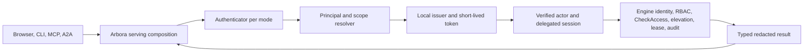

# Design — ARBORA-IDENTITY-ACCESS

## Current seam and implementation boundary

This checkout's `arbora/mcp_server/server.py` and `runtime.py` compose the one FastMCP server and verified tool session; `bootstrap.py` keeps process authority alive. `arbora/gateway/graph_api.py` installs the existing actor identity middleware. `arbora/gateway/remote_oauth_api.py` already narrows delegated provider scopes. `arbora/deployment/cli.py`, `config_generator.py` and `doctor.py` own deployment commands and diagnostics. `arbora/webui_host/webui_co_service.py` hosts the browser co-service. `arbora/a2a/authority.py` is the A2A authority boundary. Reuse these. The proposed `arbora/identity/`, `arbora/access/`, and `arbora/api/ops/` packages are **not in this checkout**; implementation must add them and wire them into the serving root before marking an operation available.

The engine is the durable identity and access authority. Arbora adapters call its typed public methods; they do not write a local identity SQL store. Use the existing gateway session resolution and MCP authority scope, then expose the same application service through REST/MCP/CLI. `stdio` is a transport, not an authorization exemption.

## Ports and composition

Define small protocols in `arbora.identity.ports`: `IdentityAuthority` (typed engine identity operations, mode CAS, RBAC decision), `SigningKeyStore` (load/rotate by key ID), `ExternalAuthenticator` (verify and resolve), `SessionStore` (engine-backed opaque session operations), `NotificationPort`, and `Clock`. DTOs carry only redacted public fields and typed error/reason codes. `arbora.access.service` depends on an `AccessAuthority` protocol with request/approve/deny/revoke/check/explain/lease methods. The `mcp_server` serving composition creates the concrete adapters once and injects them into gateway, web host, CLI command factory, and MCP registry. Keep `webui_host` and MCP packages importing ports, not each other. Dependency inversion must clear the configured KISS indirect dependency threshold without increasing that threshold.

When a required engine method is absent, the adapter returns `UNAVAILABLE`, omits the operation from advertised capability discovery where safe, and emits a readiness reason. It never emulates RBAC, lease, or approval locally. The CLI can use the same factory with a local engine fixture. Mock ports support all ordinary PR tests.

The authentication cutover is ordered: construct a signed local-issuer token at the serving root. Carry it through every engine client path, including bootstrap, REST, MCP, A2A, CLI and background service calls. Prove authorized and denied behavior with the engine verifier. Then remove the engine's unauthenticated opt-out. Arbora must never retry an unsigned envelope after a token error or denial. During rolling deployment, an old client that cannot supply a token fails closed and reports a readiness error. It does not silently switch transport or bypass verification.

## Identity data and mode machine

The engine's reserved identity catalog contains `identity_config` (`mode`, `local_fallback`, policy, `epoch`, active `kid`), users keyed by opaque principal ID, credential/session/refresh/one-time-token hashes, MFA credentials, API keys, roles, groups, provider configs, mapping rules, external identity links, throttle counters and hash-chained audit. Arbora receives redacted DTOs only. Principal IDs never change when a user adds or removes an authenticator. Each mode uses the same issuer, scope projection and engine decision path.

Allowed transitions: `none→local` requires an administrator with local credential. `none/local→external` requires an enabled provider and linked administrator; `external→local` requires local credentials for every administrator; `any→none` requires loopback bind, explicit acknowledgment, `identity:admin`, and fresh MFA. The engine checks each precondition and epoch atomically. Transition rotates issuer/session keys, revokes browser and refresh sessions, and preserves users, links, grants and owned data. Leaving `none` removes the previous signing key immediately; other rotations may retain old public keys for at most one access-token lifetime. Configuration seeds initial mode only; durable mode wins thereafter and doctor reports drift.

In `none`, bootstrap principal is a normal engine principal with scoped admin grants but no approver/live-order membership. Every request still carries a valid signed token into engine RBAC. Network exposure requires an explicit acknowledgment, exact Host allowlist, and Origin check for cookie mutations. Show mode in session/status/MCP initialize and doctor. Local mode uses 256-bit opaque server-side session IDs stored only by hash, `__Host-arbora_session` with Secure/HttpOnly/SameSite=Lax/Path=/, CSRF token, fixation rotation, idle/absolute expiry and revocation. Access tokens live at most five minutes. Password candidates and recovery codes go only to engine verification methods; Arbora never logs them. Privileged console mutation requires `identity:admin`, operator-console origin, and MFA age at most 15 minutes. MFA enrollment itself is optional unless a group policy requires it.

## Public interface contract

All REST mutations use JSON, an idempotency key where replay could create an object, and the current mode epoch or resource version. Errors use `{code,message,request_id}` with stable codes `UNAUTHENTICATED`, `FORBIDDEN`, `MFA_REQUIRED`, `CSRF_INVALID`, `CONFLICT`, `RATE_LIMITED`, `UNAVAILABLE`, `INVALID_INPUT`; a public error never confirms whether an account exists. Inputs have strict size limits, UUID/ID grammar, and no arbitrary engine method name.

| Surface | Contract | Authorization |
|---|---|---|
| `GET /.well-known/openid-configuration`, `GET /.well-known/jwks.json` | Issuer, supported signing algorithm and active/overlap `kid`; no private key. | Public read with bounded rate. |
| `GET /auth/session`, `POST /auth/{login,logout,register,forgot,reset,change-password}`, `POST /auth/mfa/{totp,webauthn,recovery}` | Current principal/mode and ceremony state; one-use challenges; logout revokes server session. | Ceremony-specific CSRF, Origin, throttling. |
| `/api/identity/self`, `/api/identity/users`, `/api/identity/sessions`, `/api/identity/keys`, `/api/identity/service-accounts`, `/api/identity/roles`, `/api/identity/groups` | Redacted list/get/create/update/revoke operations; deterministic pagination. | Self routes limited to own record; admin mutation requires exact scope, console and fresh MFA. |
| `/api/identity/idps`, `/api/identity/mappings/dry-run`, `/api/identity/policy`, `/api/identity/mode`, `/api/identity/issuer`, `/api/identity/audit` | Provider configuration, deterministic role preview, policy CAS, mode transition, rotation and audit export. | Admin rules as above; secret refs only, never secret values. |
| `/scim/v2/{Users,Groups,ServiceProviderConfig,Schemas,ResourceTypes}` | SCIM 2.0 bearer bound to one provider; PATCH and `eq` filter; deprovision revokes access without deleting ownership. | Exact `identity:provision` service credential. |
| `/api/access/{requests,approvals,leases,check,explain}` and operation registry `access.*` | Typed engine-backed elevation and access decisions with reason codes and audit receipt. | Exact scope per operation; requester cannot approve own request; delegated sessions cannot approve. |
| `arbora identity {claim,link-claim,transition,reset-admin,rotate}` | Human-readable result and machine-readable error code; one-time material printed once, never logged. | Local socket/service credential plus required actor and step-up. |

The MCP `identity.*` twin is read and low-risk self service only. Identity admin, scope grants, provider edits, mode changes, and approvals are console-only. An MCP catalog entry must state required exact scope. `fleet:*`, `mcp:*`, `ops:*`, and other registry names are not inferred from `admin` or `kg:admin`. Unknown native tools are denied and omitted. Agent delegation preserves the principal/tenant/scope ceiling and never adds approval authority.

## External adapters

OIDC validates discovery metadata, issuer/audience/signature, `state`/`nonce`, PKCE S256 and callback binding. Ordered mappings union matching targets; no match grants only the base user role under JIT-create, or denies under JIT-deny. Source-tagged memberships are replaced on every login/sync while local grants remain. Link by verified email is off unless explicitly enabled per provider. Logout uses `id_token_hint` where supported. LDAP accepts LDAPS or StartTLS only, escapes RFC 4515 filters, bounds recursion and paging, and deprovisions disabled users. SCIM binds each token to one provider. SAML is brokered through an OIDC provider initially, so Arbora does not parse XML signatures. SMTP is optional; with no adapter, email-only routes and UI options are unavailable. All external adapters have deterministic local test doubles.

## Decisions, failure modes, and observability

One engine-backed authority eliminates local/engine disagreement. Unavailable engine or secrets store means login/identity mutation fail closed. Bad signing key, unknown `kid`, wrong tenant/audience, stale epoch, revoked credential, denied scope, and unavailable external IdP produce distinct internal reason codes but safe public messages. Emit metrics for issuance, login failures, mode transitions, denied access and adapter availability. Those metrics carry no subject, token, password or raw IP labels. Audit all privileged identity/access changes and sampled denials through engine authority. No readiness gate needs an existing external provider; optional live-provider qualification is a separate deployment exercise.

## Implementation order

1. Freeze typed engine/Arbora DTOs and error codes; add local engine fixture and contract tests.
2. Add ports and one serving composition root, then issuer and `none` path.
3. Add local sessions, account recovery, MFA and API keys.
4. Add identity/access operations and exact scope registry wiring; only then advertise routes.
5. Add OIDC/LDAP/SCIM/brokered SAML/optional SMTP adapters and CLI/doctor.
6. Run the three-mode decision oracle, browser/MCP/CLI flows, scanner and release gates; record exact evidence.

## Bounded producer implementation

`identity.engine` parses and freezes the authoritative response shape;
`identity.issuer` prepares consistent local claims and narrowed context and
signs through the existing read-only secret-backed key-ring port. Its injected
credential authority is checked before signing and again before returning the
token. It never generates, writes or rotates a deployment key or grants broker
authority. `identity.browser` validates exact cookie/Origin/CSRF transport and
captures private immutable request bindings. These source components are not
a mounted authentication implementation.

The serving composition must still inject qualified EG credential resolution,
current policy, source expiry, an existing broker and signing authority. Browser
session reference/expiry/MFA fields require a separately qualified EG response.
No adapter may invent those fields or use a bare user lookup. Until the public
generated binding and actual owners supply them, issuance and browser admission
remain unavailable. Use the existing WebUI evidence class and C adapter; E must
supply the exact caller-session instance bound by the producer. If scope-only
verification cannot enforce that pairing, revise the C-owned interface before
activation. No self-minted broker or parked implementation fallback is present.

The EG public source DTO is `IdentityReply<RequestContextClaims>` with
`PrincipalResolution<RequestContextClaims>` at `kind=resolution/value`.
Arbora rejects a missing or null `request_context`, including the internal
`PrincipalResolution<()>` shape. Optional context `node` and `priority` may be
omitted or null; neither becomes identity authority. The public resolution
context does not yet supply source credential expiry or browser-session proof;
these remain separate required authority inputs, never guessed from the policy
version or a successful context parse. Source-aligned synthetic wire fixtures
are not evidence that Rust serialization or generated bindings ran.

`identity.ports` defines injected composition facts with mandatory source expiry;
these are not new EG wire fields or a replacement WebUI evidence DTO.
`UnavailableIdentityAuthority` explicitly refuses until qualified EG adapters
supply those facts. `ArboraBrowserAuthority` implements the existing WebUI port
using a private per-request registry, exact caller-session instance, original
credential and forwarded-token pairing. It checks snapshots after awaited
owner calls, rechecks current authority before exporting evidence, and removes
bindings on rotation/refusal/cancellation or context-manager exit. Refresh must
invalidate the old binding before establishing a new one.

E owns the integration sequence: enter `BrowserAdmission.request` with the
original request; this producer rejects incoming cookie-plus-bearer ambiguity,
issues the token from that exact cookie and obtains C's current caller session
from that token before creating a private binding. Hand its returned normalized
scope to C, inject this owner's `session_for_request` into C and this owner as
the WebUI authority; call `before_invocation` with
the resulting exact caller session immediately before dispatch; exit the
context manager on every outcome. Request state cannot create authority. The
owner is intentionally task-bound: a task handoff must be qualified explicitly,
not repaired with a process session. This lifecycle does not
implement persistent session creation/rotation or mount any route.

Token verification may await remote key retrieval, so a session result read
before verification is not a current-state fence. Initial binding resolves
again after verification and refuses a changed session reference. Evidence
verification likewise ends its awaited owner calls with live session
resolution; request snapshot, token lifetime, current caller facts and rotation
are then checked synchronously before return. A refusal removes the private
binding immediately, before the request context exits. The qualified EG
adapter must uphold its live-resolution consistency contract; this ordering is
not a distributed transaction or a substitute for final engine authorization.

## ARBORA-IDENTITY-R026 client attribution and segmentation

Data flow: verified token → client session record → run record and audit event → caller-scoped listing.
Attach the audit event at `arbora/api/invoke/audit.py`. The first child locates the session-open site.
Reused: the verified principal from `ARBORA-IDENTITY-R017.1`. Segmenting stored memories is an engine row.
Decision: attribute by verified principal only. Rejected alternative: a client-supplied client id, which a caller can forge.

## Scoped credentials, bearer ingress and protocol grants

R023.1 through R023.6 extend native credentials with scoped broker reuse and inline authorization.
R017.3 through R017.8 define stateless bearer verification and required tenant binding.
R019.1 through R019.6 extend access operations with exact protocol resource grants. Existing OIDC mapping under R009 remains authoritative.

Data flow: verified ingress -> current EG authority -> scoped credential broker -> approved vault/SDK transport -> exact resource enforcement.
EG decides authorization and owns durable grants. Arbora serves identity, broker ceremonies and protocol enforcement.
SDK owns connector transport and credential-reference resolution. AU runs admitted work and gains no credential authority.
No host-co-location privilege, shared plaintext token database or authentication-code file is permitted.

Credential reuse binds tenant, owner principal, requesting principal/client and connector. It also binds provider, audience, scope set, resource and operation.
All identifiers are bounded nonempty strings from verified authority or an approved catalog; clients cannot choose their authority binding.
An explicit EG grant must match every key and authorize use, not merely possession of a vault reference.
The approved vault stores token material, issuer/account binding, granted scopes, expiry and refresh version under that ownership tuple.
The broker returns an opaque reference and safe status. It injects credentials only into the approved transport for the granted operation.
Native Arbora access-token issuance remains restricted to the authenticated approved client and its audience. Other providers' reusable tokens remain private.
Refresh uses vault compare-and-swap on the credential version. Concurrent refresh cannot broaden scope or resurrect a revoked grant.
After restart, reconstruct use from vault persistence and current EG authority; cached process state is not a grant.
Unavailable grant or vault authority refuses use. Persist-before-ready requires a confirmed vault receipt; ambiguous writes require reconciliation before reuse.

For a running operation, `credential_missing` begins one challenge only when its declared interaction policy allows authorization.
Bind the pending operation digest, request identity, tenant, principal/client, connector, provider and EG decision to that challenge.
The caller receives `authorization_required` plus an opaque challenge reference and the provider's safe authorization URL.
Single-flight key is the exact ownership tuple and pending request; concurrent callers cannot attach another principal to the ceremony.
Before exchange, validate state, client binding, exact redirect and approved issuer/token endpoint configuration; exchange the code with PKCE S256.
After exchange, apply the declared provider token profile below before vault persistence.
JWT/OIDC verification and opaque-token binding use distinct validation methods; neither may fall back to the other.
The existing random 64-character verifier and 120-second ceremony deadline remain SDK defaults; a host may admit shorter bounds.
The deadline covers browser opening, callback binding, user input and token exchange, with no nested unbounded wait.
Browser opening failure returns `browser_launch_failed`; listener failure returns `callback_unavailable.`
Headless input uses a bounded authenticated challenge response. It carries the complete redirect response, including state. An unbound pasted code refuses.
An absent interactive input channel returns `interaction_required` immediately. Timeout returns `input_timeout` and invalidates the one-use challenge.
Do not print codes, verifier or tokens. Never write a code file or wait on blocking stdin inside a served request.
Cancellation closes the listener and invalidates state. Replayed, expired or cross-client challenges cannot exchange tokens or resume execution.
After a confirmed vault receipt, revalidate current grants and the original operation digest before one admitted continuation.
Reuse the existing operation idempotency/effect reservation; authorization completion never grants a second source effect.
Browser login proves identity and consent only; it does not replace EG permission for the pending operation.

Bearer API validation verifies the presented token on every request without requiring a browser session record or cookie lookup.
Pin issuer, allowed algorithm, exact audience and trusted key source; never select a key URL or algorithm from untrusted claims.
Require a signed nonempty tenant claim plus subject and expiry. Map the configured provider tenant claim to internal tenant only after verification.
Reject absent, blank or malformed tenant claims. Never infer tenant from hostname, headers, account defaults or process identity.
Issuer/audience/signature/expiry/not-before verification precedes current EG resolution and exact claim-to-principal binding.
Stateless refers to bearer cryptographic validation; current revocation, policy and delegation still require qualified authority.
Known revocation fails immediately; unavailable current authorization fails closed. Key caches have bounded validity and cannot outlive their trusted rotation window.
Local cookie sessions retain their existing CSRF, fixation and MFA semantics. Conflicting credentials do not trigger fallback between identity modes.

Resource identity resolves from a tenant-scoped catalog reference to a versioned endpoint, protocol and operation constraints.
User/role grants come from EG and verified identity mapping; request bodies cannot assert role membership or network privilege.
Web grants constrain the application and admitted methods/routes. SSH grants constrain account, channel operations and any forwarding destination.
RDP grants constrain the target desktop and redirected-device channels. Database grants constrain database identity and admitted operation class.
Adapters must enforce those declared constraints at the actual protocol boundary; encryption or generic TCP access cannot substitute for enforcement.
If the available adapter cannot enforce a constraint, return `unsupported_enforcement` and do not open an upstream channel.
Every connection and new operation requires the current matching EG grant; resource changes invalidate the version-bound decision.
Active grants carry a revalidation interval no longer than thirty seconds and never longer than remaining expiry.
Known revocation stops access immediately; failed revalidation stops it before further activity. Shorter operator limits take precedence.
Unmapped identity, absent grant and unavailable decision authority all deny access. A grant to one service never authorizes sibling services.
This future contract covers all four protocol boundaries. It does not establish existing adapters or network ingress.

Production reuse: `arbora/gateway/remote_oauth_api.py:245` authorize and :280 `oauth_callback` expose the existing broker begin/callback flow.
Their current broker import is `agent_utilities.mcp.remote_oauth_broker`; that import does not establish the new ownership-bound reuse contract.
`arbora/identity/composition.py:48` `build_identity_ports` remains the composition boundary; qualified owner facts are required before activation.
`arbora/api/http/auth.py:127` `verify_local_bearer_request` obtains verified token evidence but explicitly lacks current policy/delegation authority.
`arbora/api/mcp/caller.py:12` `caller_from_session` and :117 `caller_for_request` bind that authority for served requests.
`arbora/identity/oidc.py:102` `check_id_token_claims` is a decoded-claims helper; it cannot replace cryptographic bearer verification.
`arbora/access/service.py:90` `check_access` projects EG access; `arbora/api/ops/access.py:151` registers its served operations.
Missing wiring includes the scoped vault broker, SDK challenge-result adapter, qualified bearer-to-EG binding and all protocol enforcement adapters.
The protocol-grant binding requires a qualified EG contract; existing graph access checks alone do not prove that producer capability.
No second token store, local grant authority, OAuth manager or access-decision engine is introduced.
SDK-CONNECTOR-CONTROL-R035/R046 must preserve challenge bindings, typed bounded errors and broker-owned persistence before these host flows become available.
No runtime security or access configuration changes are authorized by this definition batch.
No arXiv derivation is claimed; the inputs describe protocol and ownership requirements.

## Connector-bound grants and provider token profiles

This shared contract refines ARBORA-IDENTITY-R023 and SDK-CONNECTOR-CONTROL-R035/R046. Implementation still needs the required runtime wiring.
The exact credential-use tuple includes tenant, owner principal, requesting principal/client, connector, provider, audience, scopes, resource and operation.
The host derives connector from authenticated admission and the certified target connector registration, with its immutable registry revision.
A caller's connector ID is only a requested target; it cannot populate the trusted binding or current grant.
Compare the admitted connector with the grant, challenge, vault ownership tuple and SDK transport before any secret resolution or exchange.
Missing, forged or mismatched connector identity yields SDK `binding_mismatch` and host `reuse_denied`, with no credential or provider activity.
Changing connector requires a matching new grant, even when principal, client, tenant, provider and scopes remain identical.

ProviderTokenProfile is trusted configuration pinned by profile ID and revision in the grant and ceremony.
It declares issuer/provider authority, client, permitted resource audiences, consent scope ceiling and separate ID/access/refresh token representations.
Representations are jwt or opaque. OIDC ID tokens require jwt; access and refresh tokens may use either declared representation.
The profile also declares required validation fields, opaque binding mode, trusted introspection endpoint and validity/reuse bounds.
Never infer representation from token punctuation, client input or an unsuccessful signature verification. An unknown profile refuses without fallback.

For JWT tokens, validate the allowed algorithm, trusted signature key, issuer and token-role-specific audience and validity claims.
An OIDC ID token binds the client audience and ceremony nonce; access-token audiences bind approved resources.
Require the profile's claims, including expiry for JWT/OIDC; reject missing claims, wrong issuer/audience, bad signature, expiry or nonce mismatch.
Validate any provider tenant/account/consent claims against the established binding when the profile requires or returns them.
An ID token proves identity; it is not an access token and cannot be injected into a provider API request.

For opaque tokens, trust only an authenticated exchange with the configured provider endpoint under the bound client and PKCE ceremony.
Record the provider response's authenticated account, granted scope and validity metadata. Never decode opaque bytes or invent issuer/signature/expiry claims.
The profile selects `exchange_bound` or `introspection_required`. Its binding policy must establish the required account, audience/resource and consent evidence.
Exchange-bound evidence comes from the admitted authorization request and authenticated provider response under the declared provider contract.
If that contract cannot establish a required binding, refuse; successful transport alone is insufficient.
Required introspection uses the configured trusted endpoint and authenticated client, requires active=true and validates all declared binding fields.
Inactive, contradictory or missing required introspection evidence refuses. Unavailable required introspection never falls back to exchange-only acceptance.
Use provider expiry metadata when available. Otherwise apply a bounded host use lease; never describe that lease as provider token expiry.
No reuse outlives the current grant or profile validity policy. Refresh tokens go only to the bound provider token endpoint.
Refresh preserves connector, issuer/provider, client, tenant, account, audience and consent ceilings; any required missing evidence refuses.

Host tenant and requesting identity always come from authenticated admission and EG authority, including for opaque provider tokens.
This profile applies to outbound provider credentials only. ARBORA-IDENTITY-R017 API bearer admission still requires its signed tenant claim.
The broker stores profile revision, validation method, binding digest and provenance for validity metadata alongside the vault receipt.
Opaque exchange metadata and host lease bounds remain distinct from signed JWT claims in evidence and logs.
Map profile errors to `invalid_token_profile` or `token_validation_failed`; required introspection failures use `introspection_unavailable` or `token_inactive`.
These shared typed refusals stop persistence readiness and operation continuation; no token, code or raw introspection body enters public output.

## Additional owner requirements

- `ARBORA-IDENTITY-R026.8`: Plan the owner work and dependencies defined in requirements.md.

### Atomic session record consumption

ARBORA-IDENTITY-R005.1 consumes EG-TYPED-PACKS-R085.1 through the existing
Session.Resolve operation. EG projects committed record identity, tenant and
expiry facts under the same storage transaction. Arbora retains authentication
and admission through its existing SessionAuthority and identity composition.
The consumer adds no credential issuer, grant, record store or operation.
Missing producer metadata stays unavailable. Controlled wire fixtures do not
qualify persisted native authority or live admitted host startup.

ARBORA-IDENTITY-R005.2 retains the full account lifecycle and served/native
acceptance. It remains pending independently of the bounded consumer tests.
