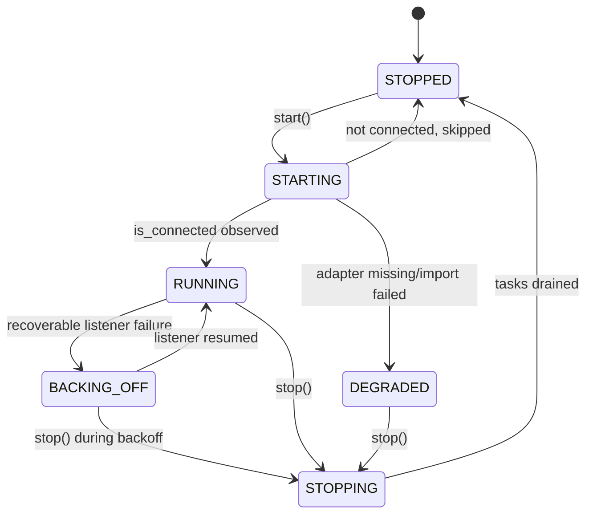

# Messaging channel supervision lifecycle — architecture

This plan describes the messaging supervision architecture and its health-reporting attachment points.

## Existing system and reuse

The typed supervision model and registry failure records remain the single state authority. The health projection below adds configuration and operator-enable context without a second supervision loop.

## Architecture

GRAPHOS-MESSAGING-R001.1 defines the pure typed model and illegal-transition refusal. GRAPHOS-MESSAGING-R001 and R002/R004 own router wiring and lifecycle behavior; GRAPHOS-MESSAGING-R005.1 adds the configuration-aware health projection to the existing registry and host-health read paths.

## Configuration-aware health projection

CompositionPlan.messaging_intake_enabled is true only when the operator explicitly enables intake and KG_DAEMON_ROLE is host. Backend credentials describe configuration, not operator intent; credential presence alone never starts intake or makes a disabled component alert-eligible.

GraphOS assembles components.messaging_intake from the composition plan and MessagingRegistry.configured_backend_ids().
It also reads typed degraded records and active backend connection state.
requirements.md defines the stable JSON fields and state rules.
GraphOS sorts backend entries by stable backend ID.
The projection returns booleans, states, safe reason codes, and backend IDs.
It omits credential values and raw exception text.

Authenticated GET /api/dashboard/health and graph_configure(action="health") expose the same projection alongside the existing shared runtime report. Unauthenticated /health liveness and /health/ready readiness remain detail-free. Any component-health alert evaluator consumes alert_eligible; health reads do not emit notifications.

## Quality and environment

At implementation, run the focused messaging tests and served health acceptance cases in test-spec.md, then the repository's standard spec and lifecycle gates. This spec publication adds no runtime code and claims no execution of the newly defined served health cases.
