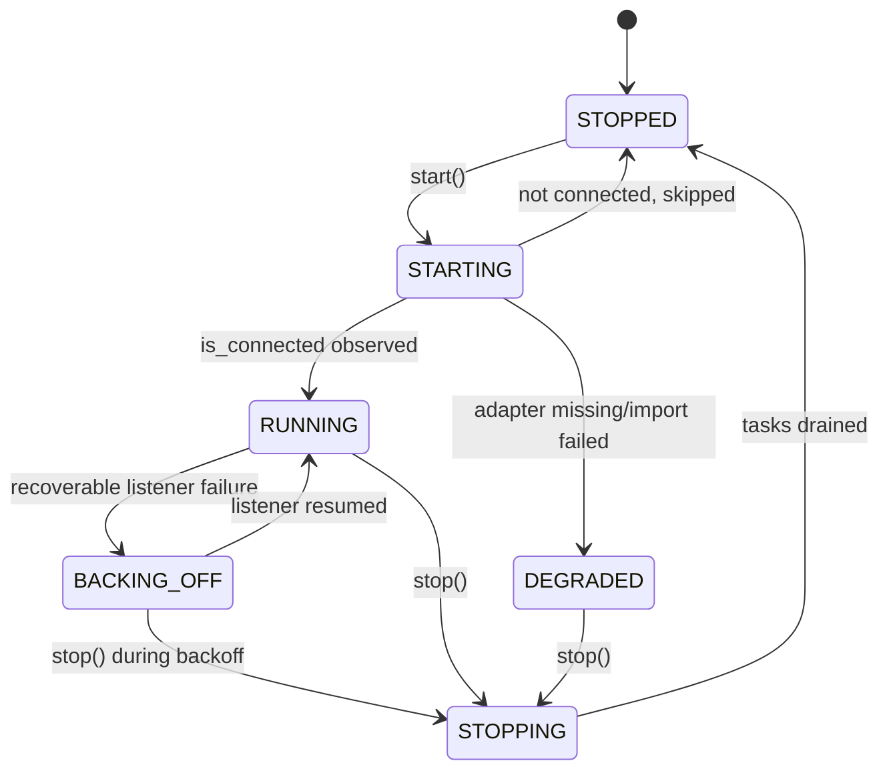

# Messaging channel supervision lifecycle — architecture

## Summary

Delivery phase: P5

No scenario of P1 to P4 exercises these rows, so they serve P5. They wait for the P4 gate (`ARBORA-ACCEPTANCE-R006.4`).

This plan serves the rows of `ARBORA-MESSAGING` in requirements.md. It covers messaging channel supervision lifecycle. The design record follows in the sections below.

## Technical Context

- **Language/Version**: Python 3.14, with a 3.12 floor
- **Primary Dependencies**: the arbora served registry and the Medulla client adapter from the SDK
- **Storage**: N/A, because the engine owns every fact
- **Testing**: pytest with one bound test per row, at the proof level the row names
- **Target Platform**: Linux service
- **Project Type**: service
- **Performance Goals**: N/A, because rows state their own limits
- **Constraints**: one door, and the engine owns every decision
- **Scale/Scope**: the rows of this spec only

## Constitution Check

- R-I One door, no policy table: pass. Every decision is read from the engine.
- R-II Every module is reachable from a production caller: pass. Each row names its caller chain.
- R-III Public specs and core skills are complete and self-contained: pass.

## Project Structure

- `specs/messaging-channel-supervision/` (existing): spec, requirements, plan, tasks, test-spec and checklist.
- Code paths: each row names its files in its `Shape:` sentence. This plan adds no other path.

## Phase 0: Research

No unknowns remain. The sections below record the earlier research and decisions.

## Phase 1: Design

The sections below hold the architecture, ownership, data flow and failure modes of this spec.

## Phase 2: Task approach

tasks.md lists one task per row, producer first. Tasks of independent rows run in parallel.

## Complexity Tracking

None. The constitution check passed.

## Production caller chain

Each row names its entry point and caller chain in its own text. This plan adds no separate chain.

## Cross-repo seams

None owned here. The `Depends on` lines of requirements.md name each dependency by the row ID that owns it in the other repository.

This plan describes the messaging supervision architecture and its health-reporting attachment points.

## Existing system and reuse

The typed supervision model and registry failure records remain the single state authority. The health projection below adds configuration and operator-enable context without a second supervision loop.

## Architecture

ARBORA-MESSAGING-R001.1 defines the pure typed model and illegal-transition refusal. ARBORA-MESSAGING-R001 and R002/R004 own router wiring and lifecycle behavior; ARBORA-MESSAGING-R005.1 adds the configuration-aware health projection to the existing registry and host-health read paths.

## Configuration-aware health projection

CompositionPlan.messaging_intake_enabled is true only when the operator explicitly enables intake and KG_DAEMON_ROLE is host. Backend credentials describe configuration, not operator intent; credential presence alone never starts intake or makes a disabled component alert-eligible.

Arbora assembles components.messaging_intake from the composition plan and MessagingRegistry.configured_backend_ids().
It also reads typed degraded records and active backend connection state.
requirements.md defines the stable JSON fields and state rules.
Arbora sorts backend entries by stable backend ID.
The projection returns booleans, states, safe reason codes, and backend IDs.
It omits credential values and raw exception text.

Authenticated GET /api/dashboard/health and graph_configure(action="health") expose the same projection alongside the existing shared runtime report. Unauthenticated /health liveness and /health/ready readiness remain detail-free. Any component-health alert evaluator consumes alert_eligible; health reads do not emit notifications.

## Quality and environment

At implementation, run the focused messaging tests and served health acceptance cases in test-spec.md, then the repository's standard spec and lifecycle gates. This spec publication adds no runtime code and claims no execution of the newly defined served health cases.

## Build contract

This section applies to `ARBORA-MESSAGING-R700.1` to `ARBORA-MESSAGING-R700.4`. Each row must pass the pre-commit gates on the first commit.

### Gates and values

The values come from `.pre-commit-config.yaml` and `pyproject.toml`. They match the list in the `hosted-api-operations` plan.

- Ruff selects `E`, `F`, `I`, `UP` and `B` with line length 88. Mypy checks each new module. Vulture runs at confidence 95.
- The wiring gate fails a module with no production fan-in. `memory_subscriptions.py` is reached from `arbora/api/ops/messaging.py`. `webhook_delivery.py` and `memory_webhooks.py` are reached from the supervised job registered in `arbora/messaging/supervision.py`.
- New functions stay at cyclomatic 10, cognitive 15 and 35 statements. The clone gate allows 0 new clone pairs.

### Shapes

- Delivery is one function that takes a `DeliveryRequest`. The function reuses `send_webhook` of `arbora/messaging/action_dispatch.py` and adds no second transport.
- Matching an event to subscriptions is a table lookup from topic to subscription list.
- A function takes at most one boolean parameter.
- Each concern has its own file: `memory_subscriptions.py`, `webhook_delivery.py` and `memory_webhooks.py`.
- Engine calls go through `send_engine` of `arbora/api/ops/_engine.py` (`ARBORA-OPS-R897.1`).
